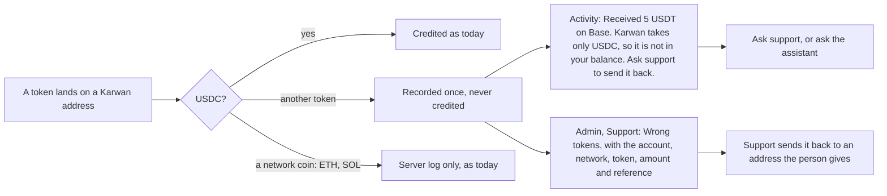

# 59 · The wrong token is never silent

Track T5 (money), audit item M-04 (plan item 5, with M-03 in view 58). Proposed and approved 6 Nov 2026, with network coins left in the log; built the same day, not deployed.

## What is wrong today

Someone sends USDT, or any token that is not USDC, to a Karwan deposit address or to a payment link's own address. The watcher sees it, finds it is not USDC, writes one warning to the server log and stops. The tokens sit in a wallet Karwan holds. The person sees nothing in Activity, the requester sees nothing on the link, and nobody at Karwan is told unless they read the logs.

## The idea in one line

The money is never credited as USDC, and never moved by itself, but it is always recorded: one line in the person's Activity that says what came in and what to do, and one row on the admin support page so a person at Karwan can send it back.

## The flow

- **The Activity line** has no amount in USDC and no sign, because nothing reached the balance. It names the token by its symbol and the network by name. Its reference is the one support asks for.
- **Payment link addresses** work the same way, and the line goes to the person who made the request.
- **The assistant** lists these with the stuck money moves, so "where is the USDT I sent?" gets a straight answer and the way to support.
- **Recorded once:** a redelivered notification writes nothing new, so a restart cannot make one transfer read as two.

## Why not sweep or swap it automatically

A swap would decide the price for the person, and a sweep back to the sender is unsafe: the sender is often an exchange, whose hot wallet does not credit returns. So a person at Karwan returns the tokens to an address the owner gives, from the Circle console, and that is the whole procedure for now. A send-back button with two people signing comes with the admin roles work (plan item 10).

## Why network coins stay in the log

Karwan sends gas coins to these same wallets itself: test ETH and SOL from the faucet on testnet, and SOL so a link's Solana wallet can pay its own fee. Recording those would put a line in people's Activity for money they never sent. A coin someone sends by mistake stays visible to support in the log. Telling the two apart is the follow-up, and it needs the senders Karwan itself uses.

## Where it lives

| Part | File |
|---|---|
| Recording | `backend/src/circle/depositWatcher.ts` (deposit and payment link paths) |
| Admin list | `GET /api/admin/support/wrong-tokens`, shown on `/admin/support` |
| Assistant | `list_stuck_money_moves` in `backend/src/assistant/moneyTools.ts` |
| The line | `myMoney.text.wrongToken` in five languages |
