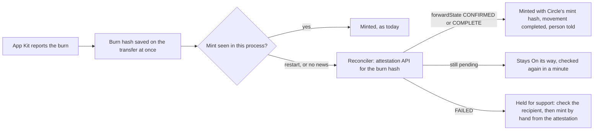

# 60 · A transfer between networks that survives a restart

Track T5 (money), audit items M-05 and RT-13 (plan item 6). Proposed and approved 6 Nov 2026; built the same day, not deployed. A FAILED forward goes to support rather than `kit.retry`: App Kit's own code shows retry would wait on the same failed forward (see below).

## What is wrong today

Most transfers between Arc and another network now run through App Kit with Circle's Forwarding Service: money coming in from Base, Ethereum, Arbitrum and the rest, Solana deposits, and every withdrawal from Arc, Solana included. Karwan burns the USDC on one network and Circle mints it on the other.

Karwan learns that the mint happened only from App Kit, inside the one running process that started the transfer. When the backend restarts between the burn and the mint (a deploy, a crash), nothing is left listening:

- The money arrives, because Circle mints it anyway, but the transfer stays at "On its way" for good, and so does the money movement behind it.
- On boot, Karwan skips these rows on purpose ("no persisted resumable state").
- Check again answers that App Kit manages the transfer, and for Solana it points the person at Solscan.

## The idea in one line

The burn hash is all Karwan needs. Circle's attestation API, given that hash, says whether Circle minted and in which transaction, so any process can finish the record at any time.

## The flow

- **The reconciler** runs on boot, on Check again and Resume, and every minute while any App Kit transfer with a burn hash is not finished. It reads only Circle's public attestation API, so running it twice is harmless.
- **Finishing goes through the existing code:** the same "minted" update, movement leg, event and receipt as a live mint, so the person sees one ending, whichever process saw it.
- **A forward that FAILED** means Circle did not mint. App Kit's forwarder wait throws on FAILED and its message says to check the recipient's balance and, if the mint did not happen, submit it by hand from the attestation. `kit.retry` with the forwarder on would only wait on the same failed forward again, so Karwan holds the transfer instead: it appears under Transfers to check on the admin support page, the movement reads Needs attention, and nothing is sent again by itself.
- **A transfer that errored after its burn** is no longer marked failed. The burn happened, so the money is on its way or held; the reconciler decides which.
- **What the person sees while it is held:** the transfer stays on its last step with the existing line, "Confirmation is taking longer. Check transfer status before starting another transfer", and Activity shows the movement as Needs attention. The assistant says a person from the team is checking it. A line of its own for a held transfer comes later.
- **Check again** and **Resume** work for App Kit transfers, Solana included, instead of answering `APPKIT_MANAGED`.

## A restart before the burn is known

If the backend stops after asking Circle to burn but before App Kit reports the burn hash, Karwan cannot tell yet whether the money left. It never sends again by itself: a transfer with no burn hash after 30 minutes is held, goes to the admin support page with its source wallet, and support confirms on the network whether the burn happened. App Kit's burn hash is now kept as soon as App Kit reports it, before the burn is final, so this case is narrow.

## Where it lives

| Part | File |
|---|---|
| Burn hash kept on the row as soon as App Kit reports it | `backend/src/circle/bridge-kit.ts`, `backend/src/db/bridges.ts` |
| The reconciler | `backend/src/money/appKitReconcile.ts` (the decision), `backend/src/circle/appKitFinish.ts` (attestation read, finish, hold, the one-minute pass) |
| Boot, Check again, Resume | `backend/src/index.ts`, `backend/src/routes/bridge.ts` |
| Admin | `GET /api/admin/support/held-transfers`, Transfers to check on `/admin/support` |
| Assistant | `list_stuck_money_moves` says a held transfer is being checked by a person |

## Not in this batch

- Gateway transfers (the Transfer balance spends, view 22) are a different rail with their own transfer id. They are not CCTP burns and are not read here.
