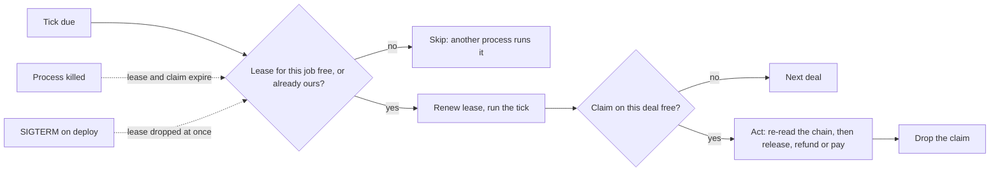

# 61 · One runner for each background job

Track: foundation, serving T2 (protected deals) and T5 (money). Covers audit items M-06 and RT-11 (plan item 7). Proposed and approved 6 Nov 2026, built the same day, not deployed. The owner kept the 15-second balances cache (RT-11, option 1).

## What is wrong today

Deal timers and payouts run inside the API process. Examples are auto-release when a review ends, refunds at expiry, financing repayments, and the payout runners for jobs, work and contests. Each one is a `setInterval` loop, and each remembers in memory what it is working on.

- **A second copy would run every job twice.** Nothing stops it. Today there is one API container, but a blue-green deploy, a scale-out or a stray `docker run` would make two.
- **A kill mid-action leaves no trace.** If the process dies while it is releasing a deal, its "working on this deal" set dies with it. The next process starts the same action again with no record that the first one began.
- **A deploy only pauses the timers.** Auto-release, expiry and repayment deadlines are stored on the deal, so the new container acts on them at its first tick. The gap is the restart time plus one tick (60 seconds for deals).
- **RT-11:** the balances shown on the top-up and withdraw card are cached for 15 seconds in that process's memory. A second instance could show a different number for up to 15 seconds.

## The idea in one line

Before a job runs a tick, it takes a short lease in Postgres. Before it acts on one deal, it takes a claim on that deal. A process that dies loses both when they expire, and the next process carries on.

## The flow

- **Leases:** a `watcher_leases_v1` row per job holds the job name, the holder, a token and an expiry. A tick may run only while its process holds the lease. The lease lasts two ticks and is renewed each tick, with a two-minute floor. On SIGTERM the holder drops it, so the new container's first tick runs it.
- **Claims:** a `watcher_claims_v1` row (key, holder, expiry) replaces the in-memory "processing" sets in the deal, factoring and purchase-order watchers. A claim lasts 10 minutes and is dropped when the action ends. A deal left behind by a killed process is tried again once its claim expires. Release and claim re-read the deal on chain before they send. The factoring repayment carries a fixed Circle idempotency key, and the purchase-order repayment is claimed through the financing contract. So a retry does not pay twice. The claim keeps two processes from submitting the same transaction at the same moment.
- **Without Postgres** (local flat-file mode) there is one process by definition: the lease and claim always succeed and nothing changes.

## Which jobs take a lease

Leases go on jobs that move money, write to the chain or message a person. These are the deal, job-expiry, factoring, purchase-order, family-financing, contest, agent-job, work, recovery and suite-earnings watchers, plus the App Kit reconciler, the delivery-check publisher and reconciler, the facts publisher, the reputation reconciler and attestation sweep, the rating asker, the delivery and question sweeps, the record-read sweep, account deletion, chat retention, the support sweeper, the test financier, the example keeper, and the market, trend, person-agent and reporter agents.

Some jobs stay per process because they only refresh a cache in that process: current contracts, vault scan, RPC health, heartbeats, the error tracker and the yield index. The outbox dispatcher and the durable task runner already lease their own rows. The Telegram bot is left as it is: Telegram itself refuses a second poller. The seller agents' reconciler also stays per process, because the seller agents answer events inside the process that saw them. Work that answers an event (a payout landing, a deal settling) runs in the process that raised the event, as before.

## The balances card (RT-11)

The 15-second in-memory cache stays (owner, 6 Nov 2026). Two instances can disagree for at most 15 seconds, and both read the same source, so this is a display delay, not a wrong balance. Dropping the cache would read Circle and the chain on every poll. Moving it to Postgres would add a write on most polls to save a read.

## Test

- **Two processes against one database:** two schedulers in one test with separate holders on one Postgres. For a job, only one runs each tick. When the holder is stopped without dropping its lease, the other takes the job within one lease period.
- **Killed mid-action:** a claim left by a killed holder blocks the deal until it expires, and then the deal is acted on once.

## Exit

On testnet, a backend deploy during an open review window still auto-releases the deal, within one tick of the new container starting.

## Where it lives

| Part | File |
|---|---|
| Lease and claim rules, the memory and Postgres stores | `backend/src/ops/watcherLease.ts` |
| The wrapper each job's loop goes through, the shutdown drop | `backend/src/ops/leasedLoop.ts`, `backend/src/index.ts` |
| Tables `watcher_leases_v1`, `watcher_claims_v1` (migration 59) | `backend/src/db/migrations.ts` |
| Claims beside the in-memory sets | `agents/dealWatcher.ts` (one claim per deal per tick), `agents/factoringWatcher.ts`, `agents/poWatcher.ts` |
| Admin | Job leases on `/admin/diagnostics`: holder, how long held, when it expires |
| Tests | `backend/src/ops/watcherLease.test.ts`, `backend/src/ops/watcherLease.postgres.test.ts` |

## Not in this batch

- The exit check is a testnet deploy during an open review window. The owner runs that deploy, so it stays open until then.
- The assistant guide and the canon do not change: nothing a person sees or can ask for is different.
