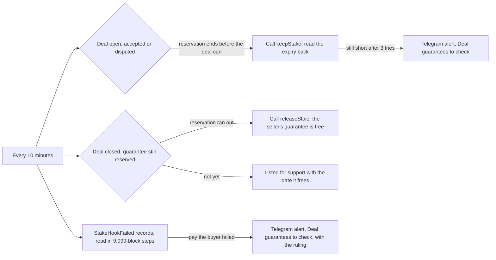

# 62 · A deal guarantee is never left behind

Track: T2 (protected deals). Covers audit item CR-02 (plan item 8). Proposed and approved 6 Nov 2026, built the same day, not deployed. A failed payment to the buyer is held for a person (owner, 6 Nov 2026).

## What is wrong today

A seller can lock a deal guarantee on a deal. The escrow asks the stake vault, a separate contract, to keep it reserved, pay part of it to the buyer after a ruling, or free it at the end. A vault that refuses never blocks the deal: the escrow records `StakeHookFailed` and moves on. Nothing in Karwan reads that record.

- **Keep (hook 2).** When a deal's timeline moves later, the guarantee must stay reserved past it. If the vault refused, the reservation can run out while the deal is still open. A ruling after that pays the buyer nothing from the guarantee. The escrow has a retry, `keepStake(dealId)`, which anyone may call, and nobody calls it.
- **Free (hook 0).** If freeing failed at the end of a deal, the seller's guarantee stays locked until the reservation runs out, up to about seven months later. After that, anyone may free it with `releaseStale`. Nobody does.
- **Pay the buyer (hook 1).** If a ruling's payment to the buyer failed, there is no retry on chain. The buyer's share stays reserved and goes back to the seller when the reservation runs out.

## The idea in one line

Every 10 minutes, Karwan compares each open guarantee with what its deal needs and fixes what the chain allows. What it cannot fix goes to a person, with the amount.

## The flow

- **From chain state first.** The reservation's end (`expiryOf`) is compared with what the deal needs: the deal's horizon plus 180 days plus 30 days, the same rule the escrow uses. This catches a failed keep whether or not its record was ever read.
- **The records second.** `StakeHookFailed` is read on the Agreement escrow from the last block read, at most 9,999 blocks per call (Arc's limit is 10,000). It is the only signal for a failed payment to the buyer.
- **Who pays gas:** the operator key that already settles financing lines. Every call is one anyone may make, so a wrong call can only be refused.
- **Nothing is paid by Karwan.** A failed payment to the buyer is listed with the deal, the ruling and the stake. A person decides what to do. The contract cannot be changed, so the fix is noted for the next escrow (plan item 27).

## Where it lives

| Part | File |
|---|---|
| The rules (pure): what each guarantee needs and the next step | `backend/src/deals/guaranteeKeeper.ts` |
| Chain reads and calls, the record scan with its saved block, the pass under a lease | `backend/src/deals/guaranteeKeeperLive.ts`, started in `backend/src/index.ts` |
| Holds and the scan's saved block | records `guarantee-hold` and `guarantee-scan` (`backend/src/db/evidence.ts`) |
| Admin | `GET /api/admin/support/guarantee-holds`, Deal guarantees to check on `/admin/support`, the Deal guarantees card on `/admin/diagnostics` |
| Assistant | `list_stuck_money_moves` names a guarantee on the person's own deal as kind `deal_guarantee`; the guide's reputation entry says how guarantees are kept |
| Tests | `backend/src/deals/guaranteeKeeper.test.ts`, `contracts/test/suite/agreement/AgreementStake.t.sol` (`test_a_refused_keep_is_made_good_by_anyone_calling_keepStake`) |

## Test

- **Forge:** the vault refuses `extend`, the escrow records the failure, the vault accepts again, and `keepStake` then reserves the guarantee past the deal.
- **Backend:** a reservation that ends too soon gets a keep. One still short after three passes is held and alerted once. A closed deal whose reservation ran out gets `releaseStale`. A failed payment record becomes a hold with its deal.

## Exit

The live vault refuses only when a reservation has already run out, so a refusal cannot be forced on testnet without harming a real deal. On the Arc fork, a refusal is forced and handled, with a log line and the count on the admin health page. On testnet, the pass runs with the count read back as zero.
