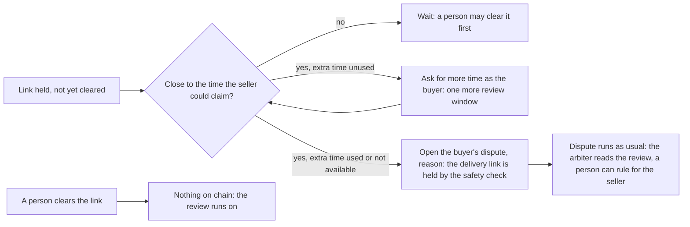

# 63 · A held delivery link is held on chain too

Track T2 (protected deals). Covers audit item RT-09 (plan item 9). Proposed and approved 6 Nov 2026 (extra time first, then the dispute), built the same day, not deployed.

## What is wrong today

When a delivery link is rated suspicious or malicious, Karwan holds the deal (view 21). The buyer cannot open the link, release is refused, the review end does not pay, and a person can check the link.

On the escrow family, that hold lives only in Karwan's backend. The contract does not know about it. Once the buyer's review time runs out, anyone may call `claim(dealId)`, including the seller, and the seller is paid for a link nobody has cleared. The older escrows held on chain through the guardian wallet. The family moved that power to the guardian Safe, which the backend does not drive.

## What the escrow allows

Read from the contract on 6 Nov 2026:

- `claim` is refused while the deal is disputed, after a failed check, or when the last payment needs the buyer and the silence wait has not passed.
- The buyer may ask once for more time (`requestMoreTime`). That adds one more review window, with no dispute and nothing on either record.
- The buyer may open a dispute (`dispute`). The deal then ends only by a ruling or an agreed split, and the outcome is recorded on both people's records.
- On the family, the buyer on chain is the buyer's agent wallet, which Karwan holds. So Karwan can make both moves for the buyer on every family deal.

## The idea in one line

While a held link is still unchecked, Karwan uses the buyer's extra review time first, and opens the buyer's dispute only if the link is still held as that time runs out.

## The flow

- **Close to the claim.** Karwan acts when a quarter of the review window is left, between 5 minutes and 24 hours before the seller could claim. The claim time is read from the escrow. It is the review end, or the silence wait when the review never started.
- **Extra time first.** This keeps a false alarm off both records. The cost is that the buyer has then used their one request for more time on this delivery.
- **The dispute is the last resort.** Its reason goes on chain as a hash of a fixed sentence, and it is written on the deal. Both people get a line in the deal chat that says what happened and why. A person from the team is alerted.
- **A clean link changes nothing.** A link cleared by a person before either step needs nothing on chain.
- **After a dispute is open,** the existing dispute path runs (view 21 and the dispute table). The automatic table never rules on a held link, not even when the delivery check passed: it sends the dispute to the review Safe, so a person decides. If the person clears the link, the review Safe can rule for the seller. Karwan never accepts a split for the buyer by itself.
- **The dispute must land before the review ends.** The escrow refuses a buyer's dispute once the seller can claim (`AgreementDispute.t.sol`), which is why Karwan acts ahead of the claim time and not at it. If the watcher was down past the claim time, the dispute is tried and refused, and the hold stays off chain only.

## Test

- **Backend (pure):** each case picks the right step. A held link early does nothing. Near the claim with extra time unused, it asks for more time. With it used, it disputes. A clean or cleared link, a deal already disputed and a closed deal do nothing.
- **Forge:** `test_more_time_then_a_dispute_keeps_a_held_link_from_being_claimed` in `AgreementDispute.t.sol`: more time, then a dispute a minute before the new end, and `claim` reverts a day later.
- **Arbiter:** a held link is referred to a person even with a passed check (`arbiterV3.test.ts`).

## Exit

On testnet, a seeded bad link on a family deal gets more time, then a dispute. Then `claim` is refused.

## Where it lives

| Part | File |
|---|---|
| The rule (pure) | `backend/src/deals/heldLinkOnChain.ts` |
| The step in the deal watcher's family branch | `backend/src/agents/dealWatcher.ts` (`runHeldLinkOnChainSafely`) |
| A held link is never ruled by the table | `backend/src/deals/arbiterV3.ts`, both dispute watchers |
| The deal record of what was done | `DirectDeal.heldLinkOnChain` in `backend/src/db/deals.ts` |
| Chat lines, assistant guide, docs | deal chat system lines, `platformGuide.ts`, view 21 |
