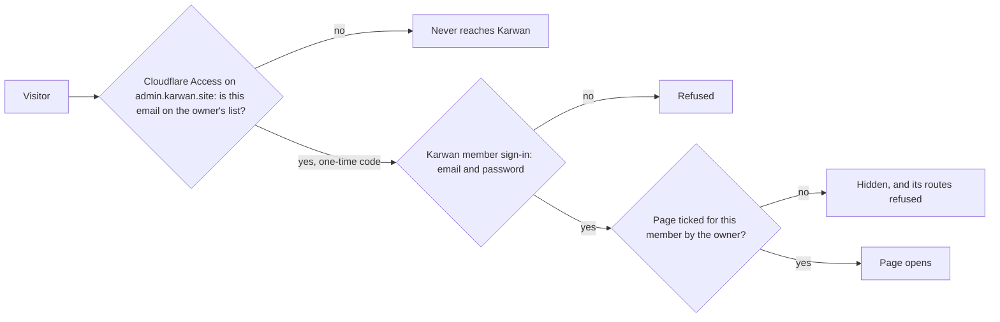
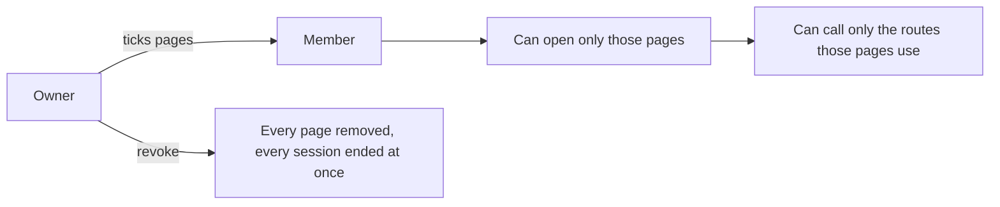
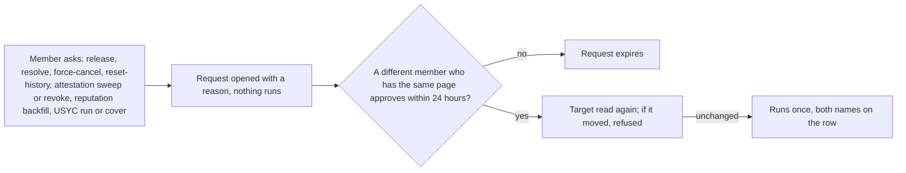

# 64 · A closed admin desk, pages by member, and two people for any money move

Track: foundation (platform security). Covers audit items S-01, P-02, RT-26, RT-27 and RT-30 (plan item 10). Proposed 6 Nov 2026. The owner chose a closed host with sign-in inside it, pages ticked per member by the owner alone, personal keys for scripts, the first owner made by a server script, and no way around the second person.

## What is wrong today

- **The desk is on the open internet.** `karwan.site/admin` loads for anyone and asks for a token. `api.karwan.site/api/admin` answers anyone who has it.
- **One shared key.** Every admin route opens with one token, `ADMIN_API_TOKEN`. Whoever holds it can do anything, and nothing records who did it. A second token, `SUPPORT_API_TOKEN`, opens the support inbox.
- **One person can move money.** `release` pays the next milestone from the buyer's agent wallet. `resolve` rules a v2 dispute. `usyc /run` and `/cover` move treasury money. `reputation/backfill` and `attestations/*` write to chain. Any of them runs on one click by one person.
- **Force-cancel ignores the escrow.** It marks a deal cancelled without reading the chain. If the escrow still holds money, that money has no recorded way out.
- **Reset-history has no confirm.** It deletes a person's briefs, listings, deals and proposals from one request.

## The idea in one line

The desk lives on its own closed address that only people the owner lets in can reach. Inside it each member signs in as themselves and sees only the pages the owner ticked for them. Every change leaves a row, and any money or chain move waits for a second member.

## Three locks

1. **The closed address.** The desk moves to `admin.karwan.site`, behind Cloudflare Access. Only email addresses the owner lists get past Cloudflare, each with a one-time code, and the owner removes a person there in one click. The public site no longer has `/admin`: it answers not found.
2. **Karwan checks Cloudflare too.** Every admin request reaches the backend through the closed address. The backend checks Cloudflare's signed pass on each one (signature against Cloudflare's published keys, this app's audience, this team as issuer). A request without a valid pass is answered not found, so `api.karwan.site/api/admin` is shut to the internet even for someone who learns the path.
3. **Member sign-in.** Inside, a member signs in with their team email and password. The session lives in the page only, never in storage, lasts 12 hours, and ends at once when the owner revokes the member or the password is reset.

## Pages by member

- **One owner.** The owner account is set once by a script the owner runs on the server. Only the owner can give, change or take away a member's pages. No member, whatever pages they have, can change access, their own included.
- **Ticks, not roles.** Each admin page (deals, disputes, support, treasury, USYC, diagnostics and the rest) is one tick. A page brings the routes it needs and nothing else. A route no ticked page uses is refused for that member.
- **Revoke is instant.** Revoking takes every tick away and ends every session and key of that member. Removing them from the Cloudflare list closes the address to them as well.

## Every change leaves a row

Every admin change writes one row: the member, the page, the route, the target (deal, person or record), the request, the result, and for money moves and status changes what it was before and after. A refused attempt writes a row too. The owner and members with the log page read them; nobody can edit or delete a row from the desk.

## Two people for money

- The approver sees in plain words what will happen. One member can never approve their own request. If only one member is around, the request waits. There is no way to run one alone.
- **Force-cancel reads the escrow first.** It is refused while the escrow is funded, accepted or disputed, and when the escrow cannot be read. It only closes a deal whose escrow holds nothing.
- **Reset-history asks for the address typed again**, and is refused on mainnet.

## Scripts

A member can make a personal key for a script. The key carries that member's name and pages, is shown once, and ends when the member makes it end or the owner revokes them. A script reaches the closed address with a Cloudflare service token, and its key decides what it may do. A money route asked for by a script still needs a second member.

## The shared tokens go

Once the owner account is in, `ADMIN_API_TOKEN` and `SUPPORT_API_TOKEN` are removed from the env and the manifest, and no route accepts them.

## What it does not change

The dispute desk for the review Safe already needs several signers on chain. It stays as it is, and its steps get rows like any other change. Watchers that release or refund on their own clocks are not members and do not go through this. The team portal (`/team`), which serves the canon to the team, is not the admin desk and keeps its own sign-in.

## Built in three steps

Each step has its own tests, docs and commit.

1. **The closed address.** `admin.karwan.site`, the Cloudflare pass checked by the site and the backend, `/admin` gone from the public site.
2. **Members and pages.** The owner account, member sign-in, ticks per member, revoke, the row for every change, personal keys.
3. **Two people for money.** Requests and approvals, force-cancel reading the escrow, reset-history's confirm, the shared tokens removed.

## What the owner sets up

In Cloudflare: Access (Zero Trust) for `admin.karwan.site` with an allow list of team emails and one-time codes, a service token for scripts, and `admin.karwan.site` pointed at the site through Cloudflare. On Vercel: the `admin.karwan.site` domain. In the env: the Cloudflare team domain and the app's audience tag on the site and the backend.

## Test

- **Closed address:** a request without a pass, with a forged or expired pass, or with a pass for another app is answered not found; a valid pass gets through; `/admin` on the public site is not found.
- **Pages:** each route answers only members whose ticked pages use it; only the owner can change ticks; a revoked member's session and keys stop at once.
- **The row:** a change writes one row with the member, target and result; a refused attempt writes one too.
- **Two people:** a money route opens a request and moves nothing; the same member cannot approve it; a second member with the page runs it once; a request older than 24 hours cannot be approved; a target that moved is refused.
- **Force-cancel:** refused on a funded, accepted or disputed escrow and when the read fails; allowed on an empty one.
- **Reset-history:** refused without the matching address and on mainnet.

## Exit

On testnet: the desk reachable only at `admin.karwan.site` through Cloudflare; a release asked for by one member and approved by another, with both names on the row; `ADMIN_API_TOKEN` gone from the env.

## Where it lives

| Part | File |
|---|---|
| Cloudflare pass check | new `backend/src/middleware/accessPass.ts`, `frontend/middleware.ts` |
| Member session, pages and owner | `backend/src/middleware/adminAuth.ts`, `backend/src/db/teamMembers.ts`, new `backend/src/ops/adminPages.ts` |
| Rows, requests, keys | new `backend/src/db/adminActions.ts`, a database migration |
| Money routes behind a request | `backend/src/routes/admin.ts`, `adminUsyc.ts` |
| Sign-in, access, the log and approvals | `frontend/app/admin/` |
