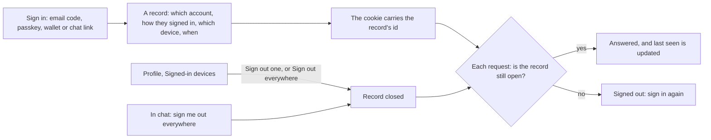

# 65 · Signed-in devices, and signing one out

Track: foundation (account security). Covers audit items S-02 and RT-25 (plan item 11). Proposed 6 Nov 2026, waiting for approval.

## What is wrong today

Every way of signing in (email code, passkey, wallet signature, a chat's one-time link) hands the browser a signed cookie that lasts 30 days. Karwan keeps no record of it. So nothing can end one early: not the person on a phone they lost, and not support. Signing out only clears the cookie in the browser that asks; a copy of it elsewhere keeps working until it runs out.

## The idea in one line

Every sign-in gets a record, every request checks that record, and a person can see where they are signed in and sign any of those out, from Profile or from their chat.

## The flow

- **The record.** It holds the account, how they signed in, a plain device name read from the browser (such as "Chrome on Windows"), when it started, when it was last used, and when it ends. No IP address is kept.
- **Checking it.** The cookie carries the record's id, and every request checks it. Each server keeps the list of closed records in memory and refreshes it every minute, so a sign-out reaches every server within a minute and the one that did it at once.
- **Signed-in devices.** A new row on Profile opens the list: each device with how it signed in and when it was last used, the current one marked "This device", a Sign out button on each, and Sign out everywhere at the bottom. Signing out on this device is the same as Sign out.
- **From chat.** The assistant can list where the person is signed in and sign them out everywhere, with a confirm, so a lost phone can be closed from Telegram. The chat itself stays connected.
- **Signing out** closes the record, not only the cookie.
- **Cookies from before this.** The first request with one quietly gets a record and a new cookie, so nobody is signed out by the change and every device then shows on the list.
- **What does not change.** The 30-day length, the half-hour length of a chat's one-time link, and how each sign-in works. The team desk keeps its own sessions (view 64).

## Test

- A closed record stops its cookie on the next request, on the server that closed it and on another one after its refresh.
- Sign out everywhere closes every record of that account and no one else's.
- A cookie from before the change gets a record and keeps working; a forged or altered id is refused.
- Signing out closes the record.
- The assistant tool lists only the caller's own devices and signs out only their own.
- e2e: the list shows the current device as This device.

## Exit

On testnet, signing out a second browser from Profile signs it out within a minute, and the list shows both devices before and one after.

## Where it lives

| Part | File |
|---|---|
| Records, the closed list, the check | `backend/src/auth/session.ts`, new `backend/src/auth/sessionRecords.ts`, a database migration |
| List and sign-out routes | `backend/src/routes/auth.ts` |
| Assistant tools | `backend/src/assistant/` |
| Signed-in devices page | `frontend/app/profile/devices/`, a row on Profile |
