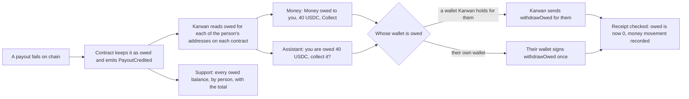

# 66 · Money owed to you, collected in one tap

Track: T5 money. Covers audit items M-01 and CR-03 (plan item 3). Approved 7 Nov 2026.

## What is wrong today

When a contract pays someone and the transfer fails, it does not stop the deal. It keeps the money for that person as an owed balance and emits `PayoutCredited`. Only the owed person can collect it, by calling `withdrawOwed` from that same address. Three live contracts work this way on testnet: every deal escrow in the suite (agreement, jobs, time), the deal guarantee vault, and the CRE fees contract. The older v3 escrow does too, but it is not configured.

Nothing in Karwan shows an owed balance or calls `withdrawOwed`. Someone owed money has no screen, no assistant answer and no button. The money is safe, but they cannot reach it.

## The idea in one line

Wherever a person is owed money, Money shows it with a Collect button, the assistant can tell them and collect it, and support sees every owed balance with the total.

## The flow

- **Finding it.** For a signed-in person, Karwan reads `owed` live from each contract for each address that is theirs: their account wallet, their agents' wallets and a connected wallet. A live read is always exact, so this needs no indexer. Support's list needs to know who is owed, so a scan reads `PayoutCredited` events every 10 minutes, under one runner as in view 61, and keeps each credited address. The amounts it shows are read live, and an address drops off once its `owed` reads 0.
- **Showing it.** Money gets one row, shown only when something is owed: "Money owed to you: 40 USDC", with a Collect button. It names no contract and no network. The details sheet says why in one line: "A payment to you could not be delivered at the time. It is kept for you until you collect it."
- **Collecting it.** Collect opens the usual confirm sheet: the amount, the wallet it goes to, and that it cannot be undone. For a wallet Karwan holds (an agent's or the account's Circle wallet), Karwan sends the call. For the person's own wallet, their wallet signs once, the same way as a deal guarantee step (view 37). Either way the server checks the receipt and that `owed` is now 0, then records a money movement of kind `owed_withdrawal` with a receipt.
- **The money stays theirs.** `withdrawOwed` can only pay the address that is owed, to itself. Nothing in this flow can send it anywhere else.
- **Several at once.** One Collect gathers every owed balance the person has, one call per contract and wallet. If one fails, the others are still kept, and the row shows what is left.
- **The assistant.** `get_money_owed` answers "am I owed anything". `propose_collect_owed` opens the same confirm, so Telegram and the website can both do it.
- **Support.** Admin Support, under "Money owed to people", lists every open owed balance by person, contract and amount, with the total per contract from `owedTotal`. Support can see it but cannot collect it for someone.

## No step-up on Collect

The money can only go back to the same address that is owed, so it never leaves the person. Own-wallet moves on Arc are exempt from the step-up (PIN or passkey), and Collect is treated the same way: the confirm sheet only (owner, 7 Nov 2026).

## Test

- forge: a payout the token refuses (a blocked address on the test token) is kept as owed on each of the three contracts, and `withdrawOwed` from that address pays it and sets `owed` to 0.
- backend: the read finds a person's owed balance on every contract and wallet; Collect from a Karwan-held wallet sends the call, checks the receipt and records the movement; a second Collect while one is running is refused; nothing is shown for someone owed nothing.
- backend: the scan picks up each `PayoutCredited` address once, in steps under Arc's 10,000-block log limit, and runs under one runner; the support list drops an address once its `owed` reads 0.
- assistant: both tools answer only for the caller.
- e2e: the row appears when something is owed and Collect opens the confirm sheet.

## Exit

A wallet cannot refuse a USDC transfer. On Arc a payout is kept as owed only when USDC blocks the address or the escrow cannot pull its parked money back yet, and neither can be set up with real testnet USDC. The forge tests prove the owed and collect paths with a blockable test token. On testnet: with nothing owed, Money shows no row, the support list is empty with every contract read, and the assistant says nothing is owed.

## Where it lives

| Part | File |
|---|---|
| Reading owed per person, collecting | new `backend/src/money/owed.ts`, wrappers in `backend/src/chain/` |
| The scan for support | new `backend/src/money/owedScan.ts`, one runner |
| Routes | `GET /api/money/owed`, `POST /api/money/owed/collect`, the own-wallet intent and complete pair |
| Assistant tools | `backend/src/assistant/` |
| Money row and confirm | `frontend/features/money/` |
| Support list | admin Support, "Money owed to people" |
| Arc check | `docs/arc-circle-checks.md` entry before any code |
