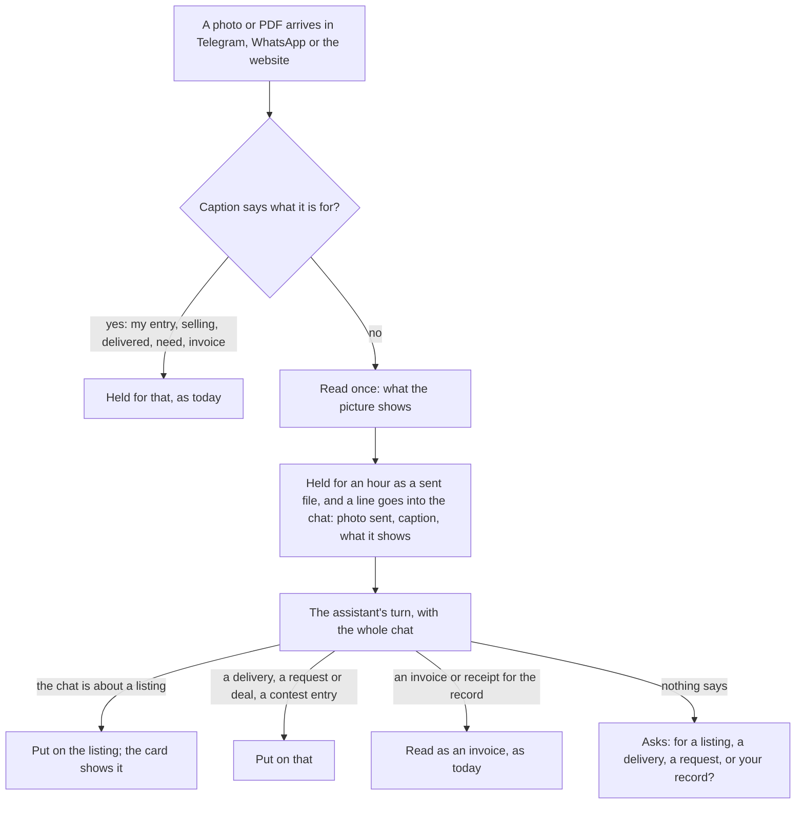
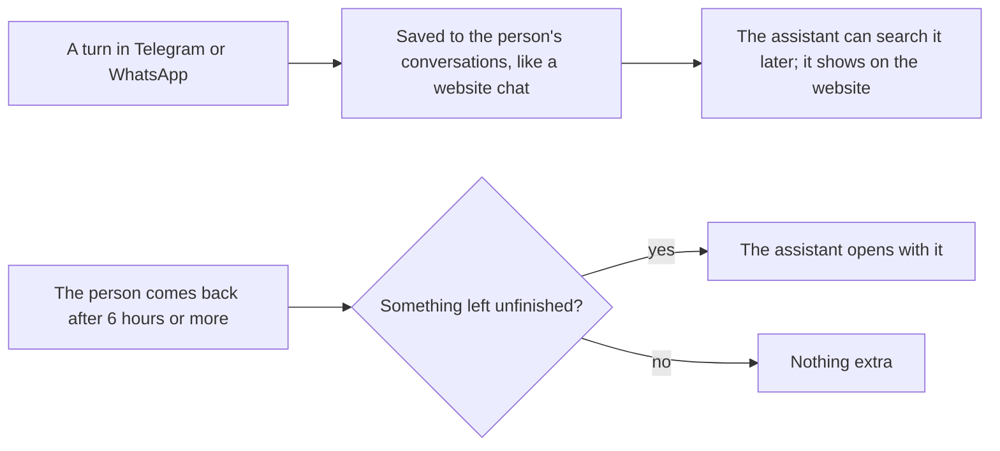

# 66 · Photos the assistant understands, and picking up where you stopped

Track T6 (channels), roadmap item T6.6. Proposed 7 Nov 2026 from the owner's Telegram test: a seller listing a laptop sent its photo with the caption "Laptop photo", and Karwan answered "I couldn't read who it was for, the amount or the date. Please send a clearer photo of the whole invoice." The three decisions below were chosen the same day. Waiting for approval of this view.

## What is wrong today

- **A photo goes around the assistant.** In a chat app a photo never reaches the assistant. `channels/media.ts` sorts it by keywords in the caption: "selling", "listing" or "offer" holds it for an offer, "delivered" or "packed" for a delivery, "need" or "deal" for a request, "my entry" for a contest. Anything else is read as an invoice for the person's record. "Laptop photo" matched no keyword, so the laptop was read as an invoice.
- **The assistant suggested the caption that failed.** It had just said to send the photo "with a caption like 'laptop photo'". It can't know the keyword list, and it should not have to.
- **The assistant never learns a photo arrived.** The photo and Karwan's answer to it are not written into the chat history, so the next turn has no idea there is a photo, or what it shows.
- **Telegram chats are not kept as conversations.** The website keeps every assistant conversation, and the assistant can search them (`recall_conversations`). A Telegram chat is only a rolling window of the last 20 messages on the Telegram account. Nothing in it can be searched later, nothing shows on the website, and a person who comes back the next day gets no reminder of the listing they left half done.

## The idea in one line

A photo is a message like any other: the assistant sees it, works out from the chat what it is for, and puts it there; every chat is kept, and when a person comes back to something unfinished, the assistant picks it up.

## A photo arrives

- **Read once, by the same model that reads invoices today.** It returns one or two plain sentences ("A silver HP Envy laptop, open, screen on, on a wooden table.") and what kind of picture it is: an item, a parcel, a document or invoice, a screenshot, or other. Nothing else is kept from the read. The file itself is held the same way offer photos are held today: on the server for an hour, under the person's account, at most four.
- **The line in the chat** reads like: `[You sent a photo, caption "Laptop photo". It shows a silver HP Envy laptop, open, screen on.]` It is written into the chat history before the assistant's turn, so the assistant answers with the photo in mind ("Got the photo of your HP Envy. Here is the listing to check.") and the line stays in the conversation for later.
- **One new assistant tool, `use_sent_photo`,** takes the sent file and a purpose: listing, delivery, request or deal, contest entry, or record (invoice). It moves the file into the same hold each of those uses today, or runs today's invoice reading. The assistant calls it from the chat; the person never needs a keyword.
- **A clear caption still works on its own.** "Selling this", "delivered", "my entry", "invoice" go straight where they go today, and the assistant is told in the same way.
- **Nothing is read as an invoice by default any more.** With no caption and nothing in the chat to say what it is for, the photo is held and the assistant asks. Saying "for my record" reads it as an invoice.
- **A picture that does not match** what is being listed (the chat is about a laptop, the photo shows a phone) is pointed out by the assistant, and the photo is not put on the listing until the person says so.
- **The website's attach button** sends its file down the same path, so the website, Telegram and WhatsApp behave the same. Its "For an offer / Read as an invoice" choice stays as a caption.

## Every chat is kept, and picked up

- **One kept conversation per chat-app thread.** Each Telegram or WhatsApp turn is also written to the person's conversations (`assistant_conversations`), marked with where it came from. A new conversation starts after 24 hours with no messages, so they stay readable; the rolling 20-message window the assistant reads from is unchanged. Deleting the account deletes them, as for website chats. The website's conversation list shows them with a small "Telegram" mark.
- **What counts as unfinished,** read from what Karwan already holds, not from a guess:
  - a confirm card sent and not yet answered (a listing, a request, a payment link);
  - sent files held for a listing, a delivery or a request that has not been posted;
  - a question the assistant asked that was not answered (the last message in the chat is the assistant's, and it asked something).
- **Picking up.** When the person writes after 6 hours or more of quiet and one of those is true, the assistant's reply starts with one line on it ("Last time you were listing your HP Envy for 270 USDC. The photo is still with me. Shall I show you the listing again?") and then answers what they wrote. It says it once; it does not repeat on every message. A card past its expiry is re-offered fresh, not reused.
- **The same thing on the website.** Opening the assistant page after a break shows the same line above the input when something is unfinished, wherever it was started.
- **Memory stays as it is.** Saved notes (view 20) are still the person's to turn off; turning memory off also stops the picking-up line, since that line reads the person's past chats.

## What it costs

- One image read per photo without a clear caption. A captioned photo is not read.
- Limits: the existing per-account chat limit counts a photo as a message; at most 4 sent files held at once, an hour each.

## Decisions (owner, 7 Nov 2026)

1. **The assistant looks at the photo** and decides from the chat where it goes. Chosen.
2. **Resume and save chats:** chat-app conversations are kept and searchable like website chats, and the assistant picks up unfinished work when the person comes back. Chosen.
3. **A photo with no caption and no context is held and the assistant asks** what it is for; it is never read as an invoice by default. Chosen.

## Status

| Part | State |
|---|---|
| Photo read on arrival, the chat line, `use_sent_photo` (`channels/media.ts`, `assistant/agent.ts`) | Proposed |
| No invoice reading by default | Proposed |
| Chat-app turns kept as conversations (`channels/dispatch.ts`, `db/assistantConversations.ts`) | Proposed |
| Picking up unfinished work, in chat apps and on the website | Proposed |
