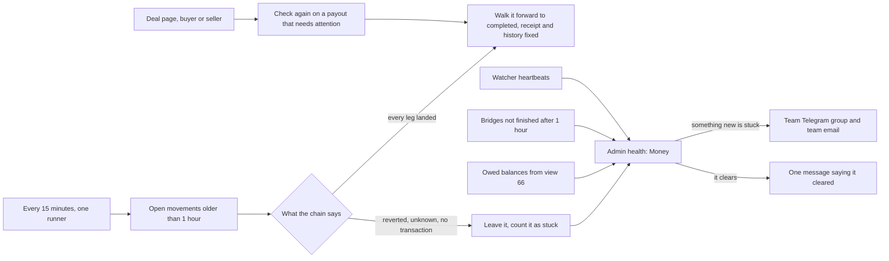

# 67 · Money that stops is found, fixed or flagged

Track: T5 money. Covers audit items M-02, R-03, RT-04 and RT-29 (plan item 4). Approved 7 Nov 2026: proved-only automatic repair, and both people on a deal can ask for a payout check.

## What is wrong today

A money movement finishes when every leg of it is proved on chain. When the call that records a leg is lost, for example when a page closes or a confirmation wait times out, the movement stays in `submitted`, `verifying` or `needs_attention`. The money moved, but the receipt does not say so.

`backend/src/scripts/reconcile-stuck-movements.ts` fixes this. It reads each stuck leg's transaction on every chain and walks the record forward only when a receipt proves the transfer succeeded. But it runs only when an operator runs it by hand. Nothing tells anyone that a movement is stuck, an owed balance is open, a bridge has stopped or a watcher has gone quiet. On a deal page, only the buyer can press "Check again" on a payout that needs attention. The seller sees the same button, but the route refuses them.

## The idea in one line

Every 15 minutes Karwan re-checks stuck money on its own, and finishes whatever the chain proves. Admin health shows what is still stuck, the team is told when something stops, and both people on a deal can ask for a payout to be checked.

## The flow

- **The scheduled check.** The decision logic in the script moves into `backend/src/money/reconcileSweep.ts`. The script and the new scheduled job both call it. The scheduled job runs every 15 minutes under one lease (`moneyReconcile`, view 61), so two backends never both run it. It looks only at movements untouched for an hour, because a transfer in the air is not stuck.
- **What it may do on its own.** Only what a receipt proves. When every leg's transaction landed, it records the legs through the normal recording path and completes the movement. It also sets a bridge row to finished when its movement is already completed. It never cancels anything, never marks anything failed, never adopts a transaction for a leg that has none and never attaches a hash. Those stay manual flags on the script, for an operator to judge.
- **Money health.** Admin `/health` gets a Money section, read from the same sweep and stores:
  - movements in `needs_attention`, with the oldest one's age;
  - other open movements stuck for more than an hour;
  - owed balances and their total (from view 66);
  - transfers between networks not finished (not minted and not failed) after an hour;
  - watchers that are stalled or missing (the heartbeats already on that page);
  - when the scheduled check last ran, and what it fixed and left.

  Each line links to the reference, so support can open the movement.
- **Alerts.** When a line goes from clear to not clear, one message goes to the team Telegram group (`SUPPORT_TELEGRAM_CHAT_ID`) and to the team email (`SUPPORT_TEAM_EMAIL`, falling back to `SUPPORT_EMAIL`). It names the line, the count and the oldest reference. While the line stays open, there is one reminder a day. When it clears, there is one message saying so. Which lines are open is stored, so a restart does not send the alert again. No new settings are needed.
- **Both people on a deal.** The deal page already lists the caller's own movements on a deal (`GET /api/deals/direct/:jobId/movements`, party-scoped). That is the party payout list, so no second route is added. Two changes are made:
  - "Check again" works for the buyer and the seller. It only reads the chain and records what is proved; it moves no money.
  - The card shows whenever one of the caller's payouts needs attention, not only while a release is due.

  The assistant's `recheck_payout` follows the same rule.

## What a person sees

Nothing new when things work. When a payout of theirs needs attention, the deal page says so and offers "Check again", whichever side of the deal they are on. Most stuck records now fix themselves within 15 minutes, so the receipt and history read right without anyone pressing anything.

## Test

- **backend:** a movement whose every leg landed is completed by the sweep. One with a reverted, unknown or missing transaction is left and counted. One younger than an hour is not touched. The sweep never cancels.
- **backend:** the scheduled job runs only while it holds the `moneyReconcile` lease, and a second runner does nothing.
- **backend:** the health Money section counts an injected `needs_attention` movement, an old bridge and an open owed balance.
- **backend:** an alert is sent once when a line opens, not again on the next run or after a restart, and once when it clears. The Telegram and email transports are mocked.
- **backend:** the seller's "Check again" on their payout is accepted. A stranger's is refused.
- **e2e:** the seller sees the payout card and "Check again" on a payout that needs attention.

## Exit

On testnet, a movement left stuck on purpose (its leg's hash recorded, its completion call never made) shows on admin health, the team gets one alert within 15 minutes, the scheduled check completes it, and a message saying it cleared follows.

## Where it lives

| Part | File |
|---|---|
| Sweep logic (moved out of the script) | new `backend/src/money/reconcileSweep.ts`, decisions stay in `money/reconcile.ts` |
| Scheduled job | `backend/src/index.ts`, `leased('moneyReconcile', 15 min)` |
| Money health and alert state | new `backend/src/ops/moneyHealth.ts`, alert state in `db/evidence` |
| Admin health | `backend/src/routes/admin.ts` `/health`, admin diagnostics page |
| Seller can check a payout | `backend/src/routes/deals.ts` reconcile route, `frontend/features/deals/workspace/DealHero.tsx` |
| Script | `backend/src/scripts/reconcile-stuck-movements.ts` calls the sweep, manual flags unchanged |
