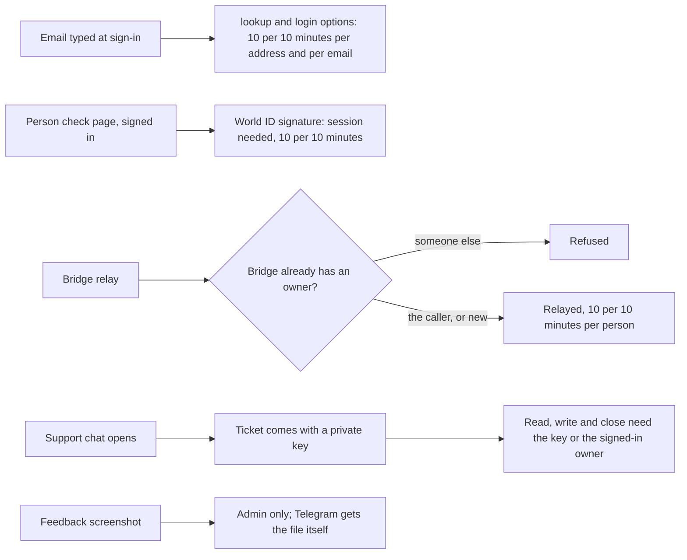

# 68 · Open doors get limits and an owner

Track: foundation (security). Covers audit items S-03, S-04, RT-16, RT-22, RT-31 and RT-32 (plan item 12). Approved 7 Nov 2026: lookup keeps saying whether an account exists, behind the limit; the inbound path form stays until the webhook is repointed.

## What is wrong today

Six routes can be called by anyone, or by any signed-in person, more often or more widely than they should be.

| Route | Today |
|---|---|
| `POST /api/auth/lookup` | No limit. Says whether an email has an account. |
| `POST /api/auth/login/options` | No limit. Answers 404 for an email with no account. |
| `POST /api/world-id/rp-signature` | No session and no limit. Signs a World ID request for anyone. |
| `POST /api/bridge/relay` | Any signed-in person, for any bridge id, with no limit. It cannot pay anyone but the transfer's own recipient, but it writes a bridge record and spends the relay wallet's gas. |
| `GET /api/support/:id/messages`, `POST /api/support/:id/message`, `POST /api/support/:id/close` | Need only the ticket id (`KSUP-` plus 10 hex characters). The id is shown to the person and goes in email subjects. |
| `POST /api/support/inbound/:secret` | The mail secret is accepted in the URL as well as the header. URLs end up in access logs. |
| `GET /api/feedback/:id/asset/:n` | Screenshots are public by id and number, cached for a day. Testers send screens that show balances and addresses. |

## The idea in one line

Every open door gets a limit. Every door that belongs to someone checks that the caller is that someone.

## The changes

- **Sign-in lookups.** `lookup` and `login/options` get the same kind of limit as the email code route: 10 calls per 10 minutes from one address, and 10 per 10 minutes for one email, whoever asks. For an email with no account, `login/options` answers the same way as for one with an account, with no 404 and no passkey list. Whether `lookup` still says that an account exists is your call (below).
- **World ID signature.** It needs a session, because the person check page is only reached signed in. Limit: 10 per 10 minutes per person.
- **Bridge relay.** A bridge that already has an owner can only be relayed by that owner. A new bridge id becomes the caller's. Limit: 10 per 10 minutes per person.
- **Support tickets.** Opening a chat returns the ticket id and a private ticket key (128 random bits). The widget keeps both. Reading, writing and closing need that key, or a session for the person who opened the ticket. A wrong key answers the same as an unknown ticket. A chat saved in a browser before this change has no key, so the widget clears it and offers to start again.
- **Inbound mail.** A new `POST /api/support/inbound` takes the secret only in the `x-inbound-secret` header. The path form stays until you repoint the mail webhook, then it is removed in its own change (below).
- **Feedback screenshots.** Served only to the admin desk, with `Cache-Control: private, no-store`. The desk loads them through its own proxy. Telegram gets each screenshot as an uploaded file, not a link it fetches.

Limits on a person count per signed-in address. Limits on a caller who is not signed in count per network address, as every limit does today. A refused call answers 429 with `Retry-After`. Today both sign-in screens would show their general "could not look that up" error for it, so they get one new line in all five languages: "Too many tries. Try again in a few minutes."

## Your call: does lookup say that an account exists?

The sign-in screen uses `lookup` to choose its next step. An unknown email gets "No account with that email" and an offer to sign up. A known one goes to a passkey or an email code.

- **Keep it, behind the limit (recommended).** The screens stay as they are. At 10 tries per 10 minutes, checking a list of emails is slow and leaves a trace in the log. Banking apps commonly work this way.
- **Hide it.** `lookup` only says whether to offer a passkey. Every other email, known or not, gets an email code, and the email itself says sign in or sign up. Nobody can tell from the screen whether an account exists. The "not found" step goes away and sign-in and sign-up become one path. That is a change to both sign-in screens.

## Test

- **backend:** the 11th lookup, login options call or World ID call within 10 minutes is refused with 429, both per address and per email. Login options for an unknown email answers 200 in the same shape. World ID without a session is refused.
- **backend:** relaying someone else's bridge is refused, relaying your own or a new one is accepted, and the 11th relay in 10 minutes is refused.
- **backend:** a ticket's messages, a new message and close are refused without the key, accepted with the key or the owner's session, and a wrong key answers like an unknown ticket. Inbound mail is accepted with the header secret on the new route.
- **backend:** a screenshot is refused without the admin desk and served with it, with no public cache.
- **e2e:** the support widget opens a chat, sends, reads a reply and ends it with the key. The admin feedback page shows a screenshot.

## Exit

`npm run check:admin-routes` and the page route map are current, and the four "Open: plan item 12" entries in `frontend/scripts/pageRouteAllow.ts` are gone.

## Where it lives

| Part | File |
|---|---|
| Limiter keyed by person or email | `backend/src/middleware/rateLimit.ts` |
| Sign-in lookups | `backend/src/routes/auth.ts` |
| World ID signature | `backend/src/routes/worldId.ts` |
| Bridge owner and limit | `backend/src/routes/bridge.ts` |
| Ticket key and inbound header route | `backend/src/support/store.ts`, `backend/src/routes/support.ts`, `frontend/shared/components/AssistantWidget.tsx`, `frontend/core/api.ts` |
| Screenshots | `backend/src/routes/feedback.ts`, `backend/src/telegram/bot.ts`, `frontend/app/admin/feedback/page.tsx` |
| Route map | `frontend/scripts/pageRouteAllow.ts`, admin route snapshot |
