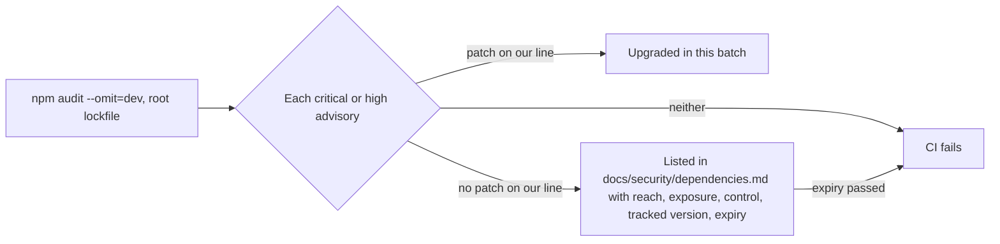

# 69 · Dependencies with a date on them

Track: foundation (security). Covers audit item S-05 (plan item 13) and the exit evidence of P0.7. Approved 8 Nov 2026 as drafted.

## What is wrong today

`npm audit --omit=dev` on 8 November 2026:

| Lockfile | Critical | High | Moderate | Low |
|---|---|---|---|---|
| Root (frontend and backend workspaces) | 1 | 56 | 21 | 13 |
| `backend/package-lock.json` | 0 | 23 | 9 | 11 |

The backend lockfile turned out to be unused: it last changed on 9 June, and the Dockerfile and CI install the backend from the root lockfile with `--workspace=backend`. The gate reads the root lockfile only.

- The one critical is `next` 15.5.24. Next.js 10.0.0 to 15.5.27 can serve one visitor's cached SSG or ISR page to another (GHSA-4jqv-mc3x-m676, GHSA-mcj8-r9mp-w47p). The advisory names self-hosted apps. Ours run on Vercel, but the fix is a patch release on the line we already use, so we take it.
- Most of the highs come in through four families we cannot patch from our side: the Circle kits (`@circle-fin/*`, through `toml`, `zod` 3, `@coral-xyz/anchor`, `web3`), Reown and WalletConnect (through `ws`, `query-string`, `decode-uri-component`, `abitype`), `@worldcoin/agentkit`, and `@coinbase/cdp-sdk`. npm can only offer majors or downgrades for these, for example `@circle-fin/app-kit` 1.0.0, which is older than our 1.15.2, or `wagmi` 3.
- A few highs have a patch release on the line we already use: `follow-redirects` 1.16.2, `undici` 6 past 6.29.0, and `ws` 8 past 8.20.1.
- The last written disposition is from 26 August, in an internal note, and it lists four families. Nothing in CI stops a new critical or high from landing.

## The idea in one line

Take every fix that stays on our current versions. Write down, with a date, why each remaining high is acceptable for now and what we are waiting for. Make CI fail on anything new.

## The changes

1. **Next.js** 15.5.24 to 15.5.29, the newest release on the 15.5 line. React stays 19. The `postcss` override inside Next stays until Next ships a fixed `postcss` itself.
2. **Patch-level transitive fixes**, through the root `overrides`: `follow-redirects` 1.16.2, `undici` 6.29.1 and `ws` 8.22.1. No Circle, Reown, wagmi or viem version changes in this batch.
3. **`docs/security/dependencies.md`** (new, public). One row per advisory family still open: the package, how it gets in, whether our code reaches the vulnerable path, whether that path faces the internet, what stops it, the upstream version we are watching, and an expiry date one month out. Every row is dated and has an owner.
4. **`docs/security/audit-accepted.json`** (new). The machine copy of that table: advisory id, package, expiry. The doc and the file are checked against each other.
5. **CI gate**, `frontend/scripts/audit-gate.ts` (`npm run check:audit`) plus a pure checker with tests. It runs `npm audit --omit=dev --json` on the root lockfile and fails when a critical or high advisory is missing from the accepted file, or listed with an expiry in the past. One step in `ci.yml`, after the route checks.
6. **A size limit on every API request**, using Hono's `bodyLimit` in `backend/src/index.ts`: one ceiling of 20 MB for every route. The largest legitimate body today is feedback, 12 MB of screenshots sent as base64, about 16.5 MB on the wire; attachments, sent files and entry files are smaller. Each route keeps its own tighter per-file checks. A larger request gets 413 before any parsing.

## What is not in this batch

- **Next.js 16.** A major with its own regression stage. Tracked in the doc.
- **The Circle kits.** No fixed release exists on 1.x today. Moving money code to a new kit major needs the Arc and Circle check first (`docs/arc-circle-checks.md`) and its own plan item.
- **wagmi 3 and Reown.** A wallet connection major. Its own stage, after mainnet signs.
- **zod 4 in the backend.** Every route schema would move. The advisory needs an oversized collection in the request. Today the API has no overall limit on request size, so this batch adds one (change 6) and the zod row rests on it.

## How we know it worked

- `npm audit --omit=dev` shows 0 critical on the root lockfile.
- Every remaining high is in the accepted file with a date this month, and the gate passes.
- The gate fails in a test run with one accepted entry removed, and again with one expiry set in the past.
- Typecheck, unit tests, the frontend checks and a production build pass on node-services with the new Next. The sign-in, deal and send browser tests pass.
