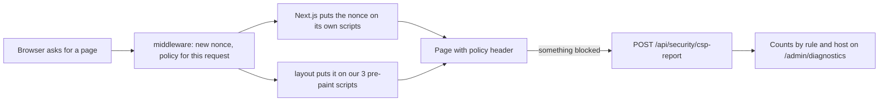

# 70 · Pages run only our scripts

Track: foundation (security). Covers audit item S-06 (plan item 14). Approved 8 Nov 2026: nonce on every page.

## What is wrong today

The site sends a partial Content Security Policy from `frontend/next.config.mjs`:

| Rule | Today |
|---|---|
| Framing, plugins, `<base>`, form targets | Enforced: no framing, no plugins, `<base>` and forms stay on our own site. |
| Scripts | Report-only, `'self' 'unsafe-inline'`. Any inline script would run. Nothing collects the reports. |
| Where a page can connect, load images, fonts, frames and workers | No rule at all. |

So if someone got a script into a page, through a crafted link, a profile field or a wallet SDK gone wrong, it could run, load more code from anywhere and send what it reads anywhere. On a page that shows balances and signs money moves, that is the gap.

## The idea in one line

Every page gets a fresh random code (a nonce) for each load. Only scripts carrying it run, and the page can talk only to the hosts we name.

## How it works

1. **One policy, built in one place.** A pure function, `buildCsp({ nonce, apiOrigin, extraConnect, reportUrl })` in `frontend/shared/security/csp.ts`, with tests. Rules:
   - `script-src 'nonce-…' 'strict-dynamic' 'wasm-unsafe-eval'`: our scripts and the scripts they load, nothing injected. WebAssembly is allowed for the hashing library; `eval` is not.
   - `connect-src 'self'`, the API, the Arc RPCs, the other chains' RPCs the bridge reads, Circle, WalletConnect and Reown, MetaMask, Coinbase and World ID. Anything else a page really needs shows up in the report week.
   - `frame-src` for the wallet windows that need one, `img-src 'self' data: blob: https:` (profile photos come from many hosts), `font-src 'self'`, `worker-src 'self' blob:`.
   - `style-src 'self' 'unsafe-inline'`. The interface sets inline styles for motion and layout; styles cannot run code.
   - The four enforced rules from today stay.
2. **One host list.** `shared/security/cspHosts.ts`. A test reads the RPC addresses written in the wallet and bridge code, and viem's default RPC for each mainnet chain, and fails if any is missing, so adding a chain cannot silently break it. RPCs named in settings (`NEXT_PUBLIC_*_RPC`, the Circle client) are added at request time.
3. **Middleware for every page.** It makes the nonce and sets the policy header on the request (Next.js reads it from there and stamps its own scripts) and on the response. Its matcher grows from a list of app routes to every page, skipping `_next/static`, images and files.
4. **Report-only first.** `CSP_MODE=report` (the default) sends `Content-Security-Policy-Report-Only`; `CSP_MODE=enforce` sends the real header. You flip it in Vercel, testnet first.
5. **Somewhere for reports to land.** `POST /api/security/csp-report` on the backend: open, 64 KB cap, rate limited per address. It keeps counts by rule and blocked origin, never full URLs or query strings, for 30 days. `/admin/diagnostics` gets a "Blocked by the page policy" card.

## The cost

A nonce has to be new on every load, so no page can be served from a prebuilt copy any more. The landing page, docs and developer pages render on each request instead of from Vercel's cache. That means more function time on Vercel and a slower first byte on those pages; how much is measured before and after, not guessed. Pages behind sign-in already render per request and do not change.

The other way, a policy without nonces, keeps static pages but has to allow every inline script, because Next.js writes its page data as inline scripts. That leaves the gap above open. This view takes the nonce.

## What does not change

Nothing a person can do. The assistant guide, canon, FAQ and terms stay as they are. The API (`api.karwan.site`) keeps its own headers from the Caddyfile; it returns JSON, not pages.

## How we know it worked

- Unit tests on `buildCsp` and the host list, and a browser test that loads a page, reads the header and confirms every script on it carries the nonce and an injected one does not run.
- Sign-in with email, passkey and an outside wallet, a bridge, a send and a deal page pass in the browser with the policy enforced in a test build.
- One week on testnet in report mode with the card on `/admin/diagnostics` showing no blocked origin we have not either added or explained. Then enforce on testnet, then mainnet.
- Time to first byte on `/` measured before and after, written into this view.
