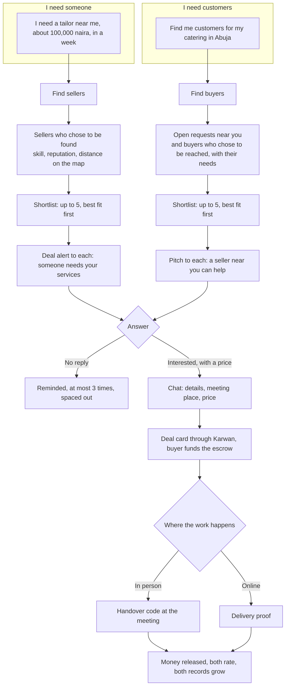

# 72 · Your agent finds the people

Track T1 (find and agree), proposed as roadmap item T1.9, with T3 (the record that is checked), T5 (paid from the agent's weekly budget) and T6 (the same thing on Telegram). It builds on [view 13](13-portable-reputation.md) (paid record reads), [view 15](15-outside-agents.md) (find_counterparty), [view 16](16-feedback-and-location.md) (private location, messages by tag), [view 30](30-negotiation-in-the-assistant.md) (Agree for me), [view 41](41-agents-that-always-answer.md), [view 48](48-one-agent-per-person.md) (the agent's weekly budget) and [view 52](52-an-agent-that-works-for-you.md). Raised by the owner on 8 Nov 2026; decisions given the same day.

## The story

Someone lands in a new city and needs a good tailor, a mechanic, a caterer or a supplier. Today they ask around, walk the streets and hope. With Karwan they tell their agent what they need. For a small fee per search, taken from their agent's weekly budget, the agent finds people whose record checks out, near them or online, contacts them, and the deal is agreed in chat and settled through Karwan escrow, whether the work happens face to face or online.

It runs both ways. A tailor, a shop, a freelancer or a small business joins Karwan to **be found**, and their agent goes out to **find customers**: the people and businesses near them who need what they sell. Nobody needs a website, an office or an advert. Their agents do the walking.

## What is there today

Read from the code on 8 Nov 2026.

| Piece | Where | State |
|---|---|---|
| Post a request, sellers' agents offer, a shortlist of up to five with reasons | buyer desk, view 30 | Built, testnet |
| Agree for me: the agent agrees within budget, one tap to lock the money | view 30 | Built, testnet |
| Find sellers who fit, ranked on their full record, sealed rows only | `find_counterparty` in `mcp/match.ts` | Outside agents only (MCP), not the website or Telegram assistant |
| Find clients for me (setup answer) | `findClients` in agent prefs, view 19 | The seller's agent answers requests already posted. It never goes looking |
| Private location: country, city, area | view 16 | Saved. Shortlists and market search rank by place name: same area, same city, same country (`locationFit` in `location/rules.ts`). There is no distance, and the sellers an agent considers are picked by country only (`hintScore` in `matching/sellerIndex.ts`) |
| Where the request happens: near, country, anywhere | `propose_post_request` `where` | Asked, used as country only |
| Message a person by tag | `message_person` | Built |
| In-person deals with a handover code; shipped goods with tracking | view 33 | Built |
| The agent's weekly budget, up to 5 USDC, for paid reads and research | `weeklyBudgetUsdc`, view 48 | Built |
| Verification shown and ranked first | view 13 rule 5 | Built; not required anywhere |

What is missing is the joining:

1. **The website and Telegram assistant cannot search people.** A craftsman with a good record but no offer up is invisible unless their agent happens to answer a request.
2. **Near is a name, not a distance.** Two people in Wuse match; a seller in Maitama, ten minutes away, counts only as the same city, and someone who types "Abuja" and someone who types "FCT" don't match at all.
3. **Nobody contacts anyone on a person's behalf.** After a shortlist, the seller learns of the buyer only if they offered first; a seller's agent never tells a buyer it can help.
4. **A profile can't say how you meet people.** At my shop, I come to you, or online is not saved.
5. **A buyer can't say what they regularly need**, so a seller's agent has nothing to find except posted requests.

## The idea

One flow, run from either side. Every step is an assistant tool on the shared core, so the website, Telegram and outside agents do the same thing.

## Find sellers

1. **Say it once.** "I need a tailor near me to make a dress, ₦100,000, in a week." The agent asks only what is missing: in person or online, near you or anywhere.
2. **Paid from the agent's weekly budget.** Each search costs a small fee that covers the record checks, taken from the weekly budget the person already gave their agent (view 48). There is no ask per search while the budget lasts; when it runs short the agent says so and asks to raise it. A search that finds nobody costs nothing.
3. **Two lanes run at once.** The directory lane ranks everyone who chose to be found. The market lane sends the request to sellers' agents, **private**: only the people contacted see it.
4. **Who comes up.** Skill fit first, then reputation (verified, tier, rating), then distance on the map for in-person work. A seller with no price set still comes up on skill and reputation; their deal alert asks how much they would take.
5. **The shortlist.** Up to five, the best fit recommended, each with name and tag, tier, rating, how far ("about 2 km", "same area", never the address), how they work (at their shop, comes to you, online), a price or "Asks for a quote", and three reasons. Never scores or counts.

### Contact

- **Deal alert.** Each seller chosen gets one message on Telegram and in Karwan: someone near you needs your services, with what is needed, the budget in their currency, by when and where. They answer with one tap: interested with their price and time, or no thanks. Their agent answers for them within the ways they set; anything outside them it asks them first (view 41).
- **Reminders.** A seller who does not reply is reminded at most three times, spaced out: after 2 hours, the next morning, and the evening of the next day, never at night in their time. After the third they are skipped, with no mark on their record.
- **Let me choose.** The person picks one to three to alert, sees each answer, and chooses who to deal with.
- **Agree for me.** The agent alerts the top three itself, collects the answers and agrees with the best one inside the person's rules (budget, distance). The person wakes up to a matched deal and taps once to lock the money. If all three pass or stay silent, it alerts the next three.

## Find buyers (the reverse)

A seller tells their agent "find me customers": "Find me customers for my catering in Abuja" or simply, in setup, Find clients for me.

1. **What the agent looks at.**
   - **Open requests** near the seller or online that fit what they sell, public or private requests that reached them.
   - **Buyers who chose to be reached.** A person or a business turns on **Let sellers reach me** and says what they regularly need: "fresh tomatoes every week for my restaurant", "office cleaning twice a month", "school uniforms each September". This is a buyer's standing need, not a request; nothing is funded and no money moves.
2. **Paid the same way**, from the seller's agent's weekly budget, nothing if nobody fits.
3. **The pitch.** For each fitting buyer the seller's agent sends one pitch: a seller near you can help, with what they offer, their price in the buyer's currency, how they work, their tier and rating. The buyer answers with one tap: interested, not now, or not interested.
4. **Gentler on buyers.** A pitch is never reminded more than once. A buyer gets at most three pitches a day for each need and can pause pitches at any time. A buyer who says "not interested" to a seller is never pitched by that seller again for that need.
5. **Then the same path.** Interested opens a chat; the deal is made through Karwan, the buyer funds the escrow, and it settles the same way.
6. **Agree for me for sellers.** A seller can let their agent pitch on their behalf within their ways while they are away. They wake up to buyers who said interested, waiting in chat. The seller's agent never agrees a deal for the buyer: the buyer always taps.

### Be found and be reached

Both are switched on in Your agent (view 45) and asked in setup (view 19).

| Who | Question | Saved as | Shown to others |
|---|---|---|---|
| Seller | What do you do? | skills, a line, photos (view 28) | Yes |
| Seller | How do you meet people? | at my place, I come to you (how far), online | Yes |
| Both | Where are you? | a point on the map, private (view 16) | Only the distance, for in-person work |
| Both | Who can contact you? | verified only, or anyone on Karwan | No |
| Buyer | What do you regularly need? | standing needs, each with how often and a rough budget | Only to the agents of sellers who fit |

## Location

Location matching uses a map service. A person types their area or shares where they are once; the service turns it into a point on the map, which is stored privately and never shown. Matching uses distance and travel areas (for example within the city, or within 10 km for "I come to you"). Others see only rounded distance. The map service is chosen in the spec, with the address never sent anywhere except to that service.

## Rules this view adds

1. **Found and reached only by choice.** Nobody is in either directory unless they turned on Let agents find me or Let sellers reach me. Turning it off takes them out at once.
2. **Location is for matching, never for showing.** Distance is rounded; the address is shared by the two people in chat after they agree to meet (view 16).
3. **Contact is limited.** A seller gets one deal alert per search and at most three reminders, spaced out and never at night. A buyer gets one pitch per seller per need, at most one reminder, at most three pitches a day for each need. Either side can block the other.
4. **Every deal settles through Karwan.** Alerts, pitches, chat and Agree for me never move money. The deal card, the escrow and one tap from the buyer do.
5. **Paid from the agent's weekly budget.** The fee is taken only when someone is found, and the person sees what their agent spent (view 48).
6. **Verification waits for mainnet.** On testnet anyone can be found, reached and contact others, with verification shown and ranked first. Before mainnet, verification is done automatically through industry identity and business verification partners, and becomes required on both sides. The partners are chosen in the mainnet plan.
7. **Matching stays inside Karwan.** Outside agents get the same sealed rows through `find_counterparty` (view 15); nobody gets scores, counts or locations.

## Owner's decisions (8 Nov 2026)

| # | Question | Decided |
|---|---|---|
| 1 | Who pays to find? | From the agent's weekly budget, within it |
| 2 | Does a search post a public request? | No, private: only the people contacted see it |
| 3 | Contact and follow-up | Tell them someone needs their services; remind at most 3 times if they don't reply, spaced well |
| 4 | Distance | A map service for location matching |
| 5 | Verification | Pending until mainnet; then automatic, through industry partners |
| 6 | A seller with no price | Comes up on skill and reputation; the deal alert asks how much they would take |
| 7 | Sellers finding buyers | Built the same way, the reverse direction |
| 8 | Limits on pitches to buyers | Accepted as proposed: one reminder per pitch, at most three pitches a day for each need, "not interested" stops that seller for that need |

## Phases

| Phase | What a person can do | Network |
|---|---|---|
| 1 | Be found and be reached: the questions in Your agent and setup, location on the map, standing needs | Testnet |
| 2 | Find sellers from the website and Telegram assistant: shortlist with distance, paid from the weekly budget | Testnet |
| 3 | Deal alerts with reminders, one-tap answers, Let me choose, chat to deal card | Testnet |
| 4 | Find buyers: open requests and standing needs, pitches, chat to deal card | Testnet |
| 5 | Agree for me on both sides | Testnet |
| 6 | Automatic verification through partners, required on both sides | Mainnet, after the mainnet escrow |

## Status

Approved by the owner 8 Nov 2026, decisions 1 to 8. Spec written the same day (internal); plan next, no code before.
