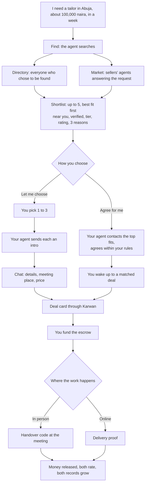

# 72 · Your agent finds the people

Track T1 (find and agree), proposed as roadmap item T1.9, with T3 (the record that is checked), T5 (the small fee per find) and T6 (the same thing on Telegram). It builds on [view 13](13-portable-reputation.md) (paid record reads), [view 15](15-outside-agents.md) (find_counterparty), [view 16](16-feedback-and-location.md) (private location, messages by tag), [view 30](30-negotiation-in-the-assistant.md) (Agree for me), [view 41](41-agents-that-always-answer.md) and [view 52](52-an-agent-that-works-for-you.md). Raised by the owner on 8 Nov 2026. Proposed, not approved.

## The story

Someone lands in a new city and needs a good tailor, a mechanic, a caterer or a supplier. Today they ask around, walk the streets and hope. With Karwan they tell their agent what they need. For a small fee per search, the agent finds people whose record checks out, near them or online, contacts the ones they pick, and the deal is agreed in chat and settled through Karwan escrow, whether the work happens face to face or online.

The other side is just as important: a tailor, a local shop, a freelancer or a small business joins Karwan to **be found**. They don't need a website, an office or an advert. Their agent answers for them.

## What is there today

Read from the code on 8 Nov 2026.

| Piece | Where | State |
|---|---|---|
| Post a request, sellers' agents offer, a shortlist of up to five with reasons | buyer desk, view 30 | Built, testnet |
| Agree for me: the agent agrees within budget, one tap to lock the money | view 30 | Built, testnet |
| Find sellers who fit, ranked on their full record, sealed rows only | `find_counterparty` in `mcp/match.ts` | Outside agents only (MCP), not the website or Telegram assistant |
| Private location: country, city, area | view 16 | Saved, but matching uses only the country (`hintScore` in `matching/sellerIndex.ts`, +1). The city never helps |
| Where the request happens: near, country, anywhere | `propose_post_request` `where` | Asked, used as country only |
| Message a person by tag | `message_person` | Built |
| In-person deals with a handover code; shipped goods with tracking | view 33 | Built |
| Paid record reads and a data budget | views 13, 48 | Built |
| Verification shown and ranked first | view 13 rule 5 | Built; not required anywhere |

So most of the parts exist. What is missing is the joining:

1. **The website and Telegram assistant cannot search people.** They can post a request and wait, or search listings. A craftsman with a good record but no offer up is invisible unless their agent happens to answer the request.
2. **Near means nothing yet.** A buyer in Wuse, Abuja is shown a seller in Lagos as readily as one two streets away.
3. **There is no "contact them for me".** After a shortlist, nobody reaches out on the buyer's behalf. The seller learns of the buyer only if they offered first.
4. **A profile can't say how you meet people.** At my shop, I come to you, or online is not saved, so in-person work can't be matched well.
5. **Finding costs Karwan and is free to the buyer.** Paid reads come out of the agent's data budget without the buyer seeing a price for the search itself.

## The idea

One flow with two ends: **Find** for the person who needs someone, **Be found** for the person who does the work. Every step is an assistant tool on the shared core, so the website, Telegram and outside agents do the same thing.

### Find

1. **Say it once.** "I need a tailor near me to make a dress, ₦100,000, in a week." The agent asks only what is missing: in person or online, near you or anywhere.
2. **The fee comes first.** "Finding costs 0.10 USDC (about ₦150). Go ahead?" It covers the record checks. If nobody fits, it is refunded.
3. **Two lanes run at once.** The directory lane ranks everyone who chose to be found: skill fit first, then distance for in-person work, then verified, tier and rating. The market lane is today's request to sellers' agents, private by default, so only the people contacted see it.
4. **The shortlist.** Up to five, the best fit recommended, each with name and tag, verified in words, tier, rating, how far (for example "about 2 km", never the address), how they work (at their shop, comes to you, online), a price guide and three reasons. Never scores or counts.

### Contact

- **Let me choose.** The person picks one to three. Their agent sends each an intro: what is needed, the budget in their currency, by when and where, and the buyer's tier. The seller answers with one tap (interested, with a price and a time, or no thanks), or their agent answers within the ways they set.
- **Agree for me.** The agent contacts the top fits itself, at most three, takes their answers and agrees with the best one inside the rules the person set (budget, distance, verified only). The person wakes up to a matched deal and taps once to lock the money. Nothing is paid without that tap.

### Agree and settle

Chat holds the details (measurements, the meeting place, photos). The deal is then made through Karwan, as every Karwan deal is: escrow, an in-person handover code or online delivery proof, review, release, ratings. A deal agreed in chat but paid outside Karwan gets no record and no protection; the agent says so once.

### Be found

A person or a business turns on **Let agents find me** in Your agent (view 45). It asks four things:

| Question | Saved as | Shown to others |
|---|---|---|
| What do you do? | skills and a line, photos (view 28) | Yes |
| Where do you work? | city and area, private (view 16) | Only the distance, for in-person work |
| How do you meet people? | at my place, I come to you (how far), online | Yes |
| Who can contact you? | verified people only, or anyone on Karwan | No |

Their agent answers intros within their ways and asks them about the rest (view 41). A business answers as the business (view 34).

## Rules this view adds

1. **Found only by choice.** Nobody is in the directory unless they turned on Let agents find me. Turning it off takes them out at once.
2. **Location is for matching, never for showing.** Distance is shown rounded ("about 2 km", "same area", "same city"); the address is shared by the two people in chat after they agree to meet (view 16).
3. **Intros are limited.** One intro per seller per find, at most three per find, at most ten new people a day per buyer. A seller can block a buyer, and a buyer who is blocked or ignored by many is slowed down.
4. **Every deal settles through Karwan.** Intros, chat and Agree for me never move money. The deal card, the escrow and one tap from the buyer do.
5. **The fee is shown before, refunded if nobody fits.** It is paid from the person's balance in their currency (view 55), never from the escrow.
6. **On mainnet, verified on both sides.** Only a verified person or business can be found, and only a verified person can send intros. On testnet anyone can, and verification is shown and ranked first, so the whole flow can be tested.
7. **Matching stays inside Karwan.** Outside agents get the same sealed rows through `find_counterparty` (view 15); nobody gets scores, counts or locations.

## Decisions for the owner

| # | Question | Proposed |
|---|---|---|
| 1 | Who pays to find? | The buyer, a flat fee per search (testnet: 0.10 test USDC), refunded when nobody fits. Being found is free |
| 2 | Does the market lane still post a public request? | Private by default for a find: only the people contacted see it. The person can make it public to draw more offers |
| 3 | How many intros in Agree for me? | Three at a time, the next three only if all three pass |
| 4 | How is distance worked out? | From city and area names to a rough point, no GPS and no map; in-person work matches within the city first, then the country |
| 5 | Mainnet verification | Required on both sides to be found or to send intros (rule 6) |
| 6 | Seller who is found but has no price | Shown with "Asks for a quote"; their agent asks them on Telegram within the minute (view 41) |

## Phases

| Phase | What a person can do | Network |
|---|---|---|
| 1 | Be found: the four questions in Your agent and in setup; the directory | Testnet |
| 2 | Find from the website and Telegram assistant: the shortlist with distance and how they work, the fee shown and refunded | Testnet |
| 3 | Let me choose: intros, one-tap answers, chat to deal card | Testnet |
| 4 | Agree for me on a find: three at a time, a matched deal to wake up to | Testnet |
| 5 | Verified on both sides, fee in real USDC | Mainnet, after the mainnet escrow |

## Status

Proposed 8 Nov 2026. Waiting for the owner's decisions above; then spec and plan, no code before.
