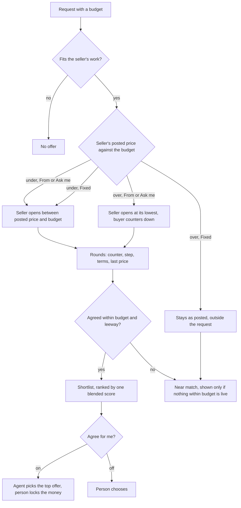
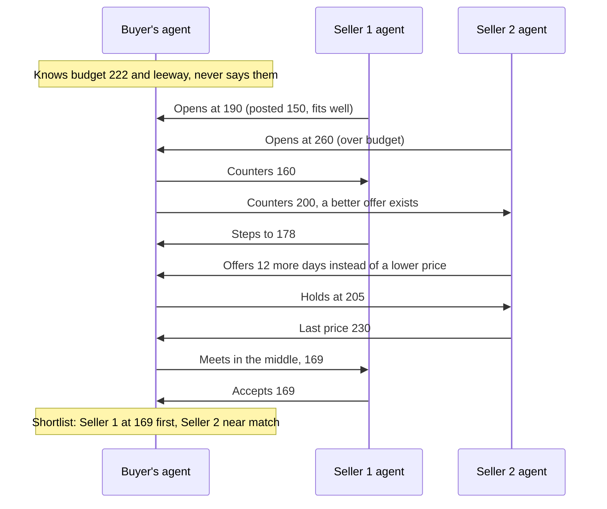
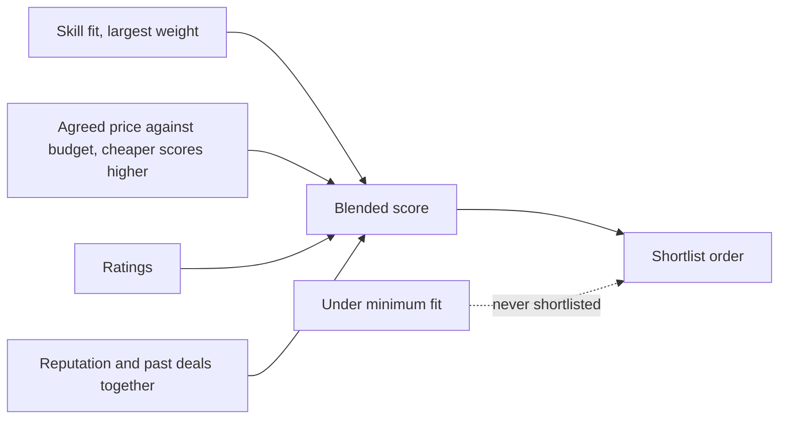

# 73 · Agents that bargain

T1 (find and agree). It replaces how both agents price and agree on a request, changing [view 41](41-agents-that-always-answer.md) decision 11, [view 47](47-prices-that-vary.md) decision 3 and the ranking rule that a better skill fit always ranks first. Raised by the owner on 9 Nov 2026 from a testnet request: "4 different clothes sewn, up to ₦300,002". Three sellers came in above the budget (₦344,016, ₦359,836, ₦364,664) and were ranked first. The fourth offered ₦40,460, a seventh of the budget, and was ranked last. The owner: "pricing should be like people negotiating", and "the whole architecture and flow is planned first, how agents negotiate like real humans do". All twelve decisions were taken by the owner the same day.

## What is true today

Read from the code on 9 Nov 2026.

- **Sellers open at their posted price**, whatever the budget (since 7 Nov). Under the budget it is never raised; over the budget it goes in at the seller's lowest, marked outside the request.
- **Sellers already concede like people** (`agents/concession.ts`, view 41): firm while there is time, steadier near the deadline or with competition, one step only after the buyer moved, at most five exchanges with the fourth a last price, and a longer delivery offered once before going lower.
- **Buyers barely bargain.** The buyer's agent counters one seller at a time, the top of its list, for at most two rounds (`MAX_COUNTER_ROUNDS`). It never tells a seller that a better offer is on the table.
- **Cheaper is not better.** The score gives every price at or under the budget full marks (`scoreBidDeterministic`), so 30 and 220 against a 222 budget score the same.
- **Fit decides first.** Offers are sorted into four fit bands before anything else (`buyerTaskPlanning.ts`), so a cheaper seller who fits a little less never comes first.
- **The budget is public.** A request shows "Up to ₦300,002", so every seller knows the most the buyer will pay before the first word.

So a request becomes a list of posted prices sorted by fit. Nobody bargains: an offer far under the budget leaves the seller's money on the table, an offer over it is shown at full price, and the buyer's agent never uses the offers it holds.

## How people bargain, and what the agents copy

| What people do | What the agents do |
|---|---|
| Keep their real limit to themselves | Each agent knows only its own person's limit. The buyer's leeway and the seller's lowest are never shown to the other side or said in a counter. |
| Open with room to move, but not an insult | Openings sit inside a fair band (decision 5): never a lowball a seller would walk away from, never a price above what the market bears. |
| Move only when the other side moves | One step per answer, smaller each time (the view 41 schedule, used by both sides). |
| Use the other offers they have | The buyer's agent may say a better offer exists, never who or how much (decision 7). |
| Trade something other than price | Days, payment in parts, or a smaller first part before price moves (decision 8). |
| Feel the clock | Both sides speed up as the request's time runs out. |
| Say "this is my last price" and mean it | A last price is final. Under it, the agent walks away or asks its person. |
| Split the difference to close | When the gap is small, either side may meet in the middle (decision 9). |
| Remember who they dealt with | A seller or buyer with clean past deals between them gets a small goodwill step, never past a limit. |

## Decisions

1. **A posted price under the budget is bargained toward the budget.** The seller's agent opens between its posted price and the budget, higher when the work fits well, the seller's record is strong and demand is high. It never asks above the budget and never takes less than its posted price.
2. **A Fixed price bargains up only.** Against a bigger budget it opens toward the budget as in decision 1. Against a smaller budget it stays exactly as posted: it never comes down, and it shows as outside the request.
3. **An offer over the budget is countered down.** The buyer's agent counters toward the budget in rounds. The offer reaches the shortlist only once its price is within the leeway the buyer allowed; otherwise it ends as a near match, shown only when nothing within the budget is live (as today). A Fixed price over the budget is not countered, since it cannot move.
4. **One blended score ranks the shortlist.** Skill fit, the agreed price against the budget, ratings and reputation are weighed together. A strong fit at a fair price beats a perfect fit that costs far more. Skill fit keeps the largest single weight, and an offer under a minimum fit is never shortlisted. Within the budget, cheaper scores higher.

5. **A fair band for every opening.** The band runs from the market price, when Karwan has one, to the budget. A seller opens in the top part of it, a buyer's counter in the lower part. An opening never goes under half the market price, so a counter is never an insult.
6. **The same pace on both sides.** The buyer's agent uses the seller's schedule from view 41, mirrored: up to five exchanges each, the fourth a last price, steps that shrink and come only after the other side moved.
7. **The buyer's agent bargains with everyone at once.** It counters every seller who fits, not only the top one, and may tell a seller "I have a better offer", without naming who or the price (decision 12). A seller's agent answers by stepping, holding or walking away; it never sees the other offers.
8. **Terms before price.** Before a last price, either side may offer once to change a term instead: more days, payment in parts, or a smaller first part. The person's own limits on days and parts still hold.
9. **Meet in the middle to close.** When the gap is under 5% of the budget after three exchanges, the side that moved last may offer the midpoint, once.
10. **The person stays in charge.** With Agree for me on, the agent closes any price inside its person's limits. With it off, the agent bargains on its own but asks before agreeing; the question shows the price, the gap and what the other side said.

11. **The budget shows as a range.** Sellers and their agents see a band, such as "₦200k to ₦300k", never the buyer's exact top. The band is enough to tell whether the work is worth it; the agents bargain inside it, and a seller's opening (decision 5) sits in the band, not at its top. The buyer always sees their own exact budget.
12. **The buyer's agent may say a better offer exists.** One line in a counter, "I have a better offer", only when it is true, never who or how much.

## What each side knows

| | Buyer's agent | Seller's agent |
|---|---|---|
| Its own person's limit | Budget and leeway | Lowest price, posted price, Fixed or not |
| The other side's limit | Never | Only the budget range the request shows (decision 11) |
| Other offers on the request | All of them | None; at most "a better offer exists" |
| Market price | Yes, when Karwan has one | Yes, the same reading |
| Records | The seller's ratings and reputation | The buyer's reputation |

## Where it lives

| Layer | Change |
|---|---|
| `backend/src/agents/sellerPricing.ts`, `seller.ts` | openings by price type and budget (decisions 1, 2, 5); the posted price becomes the seller's lowest on that request |
| `backend/src/agents/concession.ts` | one schedule for both sides (6), terms before price (8), meet in the middle (9) |
| `backend/src/agents/buyer.ts`, `strategy.ts` | counters every fitting seller (7), counters over-budget offers before shortlisting (3), mirrored schedule (6) |
| `backend/src/agents/buyerTaskPlanning.ts`, `strategy.ts` | fit bands replaced by the blended score with a minimum fit (4); cheaper scores higher under the budget |
| request routes, market, request page, seller tools | sellers and their agents get the budget range, never the exact budget (11); the buyer's own views keep it |
| `backend/src/agents/nearMiss.ts` | unchanged rule, fed by offers that did not come down and Fixed prices over the budget |
| request page and assistant | each offer says in one line why it ranks where it does and how the price moved ("Opened at ₦258,000, agreed ₦227,000") |
| guide and canon | how agents bargain, what each side knows, how the shortlist is ordered |
| tests | the clothes request above, replayed: the ₦40,460 seller opens higher, the over-budget sellers are countered, a Fixed price under the budget stays put, the order follows the blended score |
