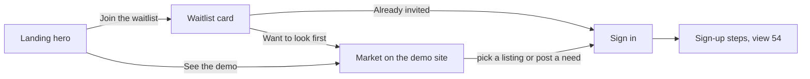
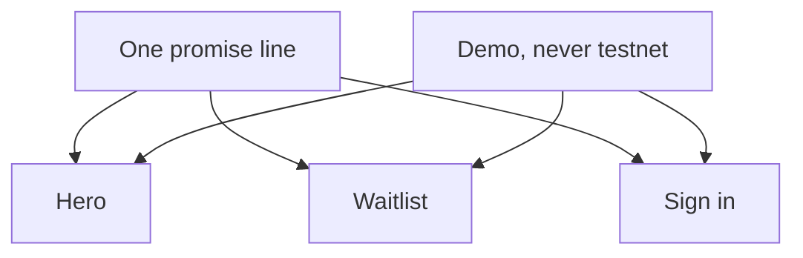

# 74 · The first screen says what Karwan is

Track T1 (find and agree), roadmap item T1.1 (one market, one entry). Proposed 10 Nov 2026 from the owner's request that "the first user experience on Karwan should tell the user what the product is all about", in words a person who has never used crypto can read. Drawn in Figma on the page "First experience · 10 Nov" and approved by the owner the same day. It builds on [view 49](49-the-landing-tells-the-whole-story.md) and [view 54](54-a-guide-as-you-sign-up.md) and changes no money rule.

## The idea in one line

Every door into Karwan says the same thing first: Karwan holds the payment until the work or the goods arrive.

## What each door says

| Door | It says | It no longer says |
|---|---|---|
| Landing hero | The headline, then one line: what Karwan does | "Try it on testnet" |
| Waitlist card | What Karwan does, and that people are let in a few at a time | The network name, "account and wallet access" |
| Sign in | What Karwan is for | "Trading here uses test USDC" |
| Demo site | One note: this is the demo, the money is not real | "testnet" |
| Market before sign-in | The promise in one row, with its (i) | "Back" on a top page |

## Words

- The promise is one sentence, the same in all five languages, and it names no chain, token or wallet.
- The practice site is "the demo". Its money is "not real". The word "testnet" stays in the docs.
- Signing in with a wallet stays one tap away and is named for the people it is for: "Use a crypto wallet".

## The market before sign-in

- A listing with no photo of its own shows a real photograph that fits its category. Each category has several, and the listing picks one, so a row seldom repeats a picture. A title that names a kind of work (carpentry, translation, sales and the rest) picks the photograph for that work first.
- A real seller's listing with no photo of its own keeps a stock photograph for its category. Since 13 Nov 2026 it carries no "Sample photo" label: the owner chose to show it the way other markets show category pictures, unlabelled.
- The price reads in the visitor's currency first, with the dollar figure small beside it.

## What stays the same

The landing scenes, the headline, the sign-up steps of view 54, the money rules, and what the assistant can do.
