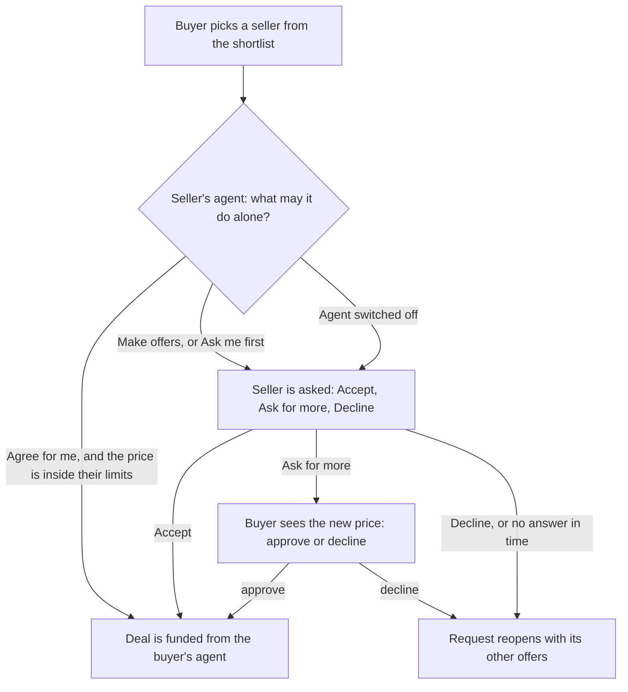
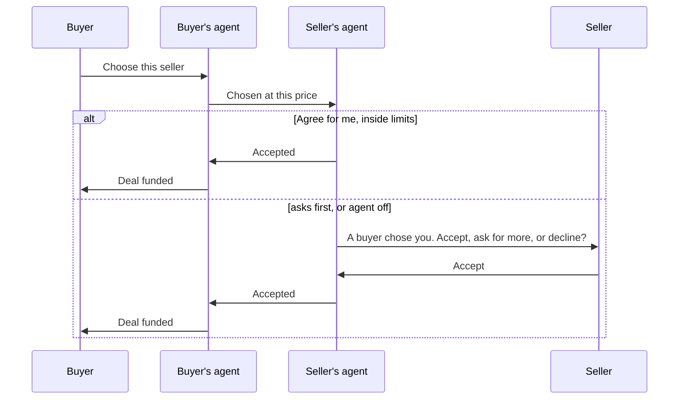
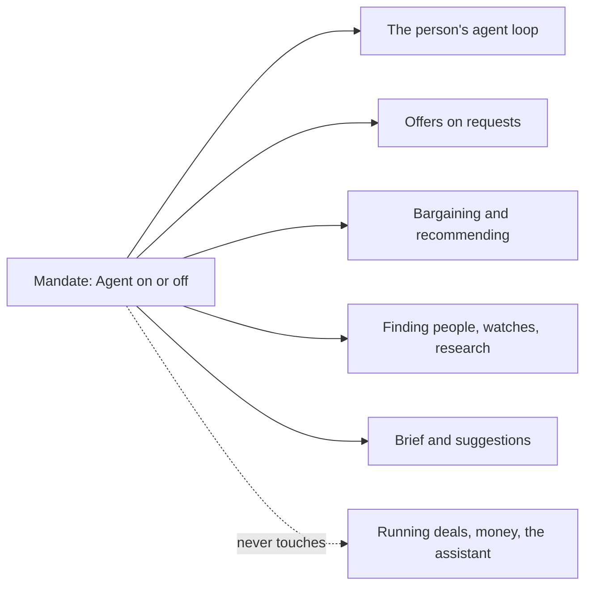

# 75 · Your agent asks before a deal, and can be switched off

Track T1 (find and agree), continuing roadmap item T1.8 (agents that always answer), with T6 (channels) for the questions and the switch. Proposed 10 Nov 2026 from the owner's test of an agent-matched deal: "the seller chosen does not get the chance to accept, decline or ask for more. It accepts automatically, which should be a setting", and "there should also be an option to turn off the agent, so all agent services around your account get switched off. It means you are now running things manually." It builds on [view 30](30-negotiation-in-the-assistant.md) (Agree for me), [view 41](41-agents-that-always-answer.md), [view 48](48-one-agent-per-person.md) and [view 52](52-an-agent-that-works-for-you.md) (the mandate). It changes no contract and no money rule.

## What is wrong today

Setup asks every person "How much should your agent do on its own?" and gives three answers:

| Answer | What Karwan says it means |
|---|---|
| Make offers within my price | "It offers for you, then asks before any deal" |
| Ask me first | "It suggests, you decide every time" |
| Agree for me | "It may take a price inside your limits for you. Money still waits for your tap" |

For a buyer this holds. For a seller it does not. When the buyer picks a seller from the shortlist, the deal is funded at once. The seller is told afterwards. The screen with Accept, Ask for more and Decline exists, but only on the older path where the buyer's agent picked the seller. So a seller who chose "asks before any deal" is put into a deal without being asked.

There is also no way to stop the agent. A person can set limits, quiet hours and the mode, but cannot say "do nothing for me until I say so".

## The idea in one line

Nothing becomes a deal for you unless you said yes or told your agent it may say yes, and one switch stops your agent altogether.

## Being chosen

The buyer's side does not change until the moment they choose. After it:

1. **The buyer chooses.** Nothing is funded yet. The request reads "Waiting for the seller to accept" and names how long they have.
2. **The seller's agent reads its mandate.** With Agree for me, and the price at or above the seller's lowest, it accepts for them and the deal is funded, as today. In every other case it asks the seller.
3. **The seller is asked once, everywhere they are reachable:** the app, Telegram, email. The question shows the request, the price and the three answers. The assistant can answer it from any channel.
4. **The seller answers.** Accept funds the deal. Ask for more sends a higher price to the buyer, who approves or declines, exactly as the existing raise works. Decline, or silence past the time limit, reopens the request with its other offers and tells the buyer.
5. **The buyer can change their mind while waiting.** They cancel the choice and pick another seller. Nothing was funded, so nothing is returned.

Both screens exist already: the seller's Accept, Ask for more, Decline card and the buyer's waiting state with Cancel. This view puts the shortlist choice through them.

## The switch

One setting in the mandate: **Agent on** or **Agent off**. It sits first on the agent page and the assistant can set it from any channel ("turn my agent off", "turn it back on").

| With the agent off | What happens |
|---|---|
| Requests that fit what you sell | Your agent makes no offers. You can still offer by hand. |
| Your own requests | Offers still arrive. Your agent does not bargain, recommend or agree. You choose by hand. |
| Offers your agent already made | They stand until their date. If a buyer chooses one, you are asked, whatever your mode was. |
| Finding people, market watches, paid research | Stopped. Nothing is spent on data. |
| Morning brief and agent suggestions | Stopped. |
| Deals already running | Unchanged. Deadlines, delivery, review and release go on, and Karwan still tells you about them. |
| Money, direct deals, payment links, your posted offers for sale | Unchanged. |
| The assistant | Still answers and still does what you tell it. It is how you run things by hand from Telegram. |

Turning it back on starts from now. The agent does not act on what it missed.

## Decisions for the owner

1. **How long the seller has to answer.** Recommended: 24 hours, or until the request's own date if that is sooner. The buyer sees the time and can cancel at any point.
2. **Buying an offer as listed.** Today an order on a posted offer is accepted at once, because the seller posted it at that price. Recommended: keep that for sellers on Make offers or Agree for me, and ask first only for sellers on Ask me first or with the agent off.
3. **What the default mode means for a seller.** The words already say "asks before any deal". Recommended: keep the words and make them true, so a seller is asked unless they picked Agree for me. The other choice is to make accepting automatic by default and change the words, which is faster for buyers and takes the decision from sellers.
4. **Agent off and the assistant.** Recommended above: the agent stops, the assistant stays as your hands. The other choice is that the assistant also stops acting and only answers questions.
5. **Agent off while you have open requests.** Recommended above: they stay open and you choose by hand. The other choice is to pause them until the agent is back on.

## What this view does not do

It does not change how agents bargain ([view 73](73-agents-that-bargain.md)), what a seller sees of a budget, or who may see a request. It does not change the escrow: the deal is funded by the same call, only later. It does not cover agents learning from past deals, repeating monthly work, or the deal review; each gets its own view.
