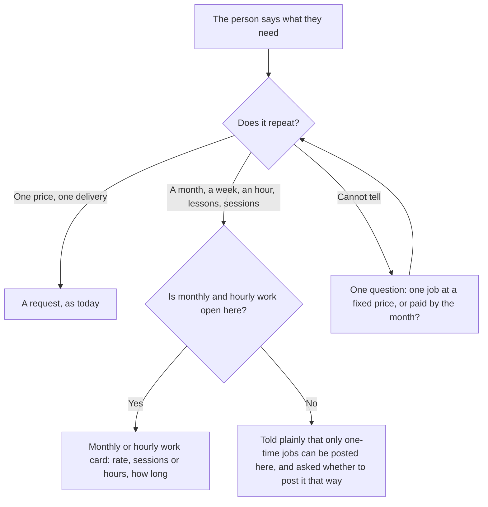
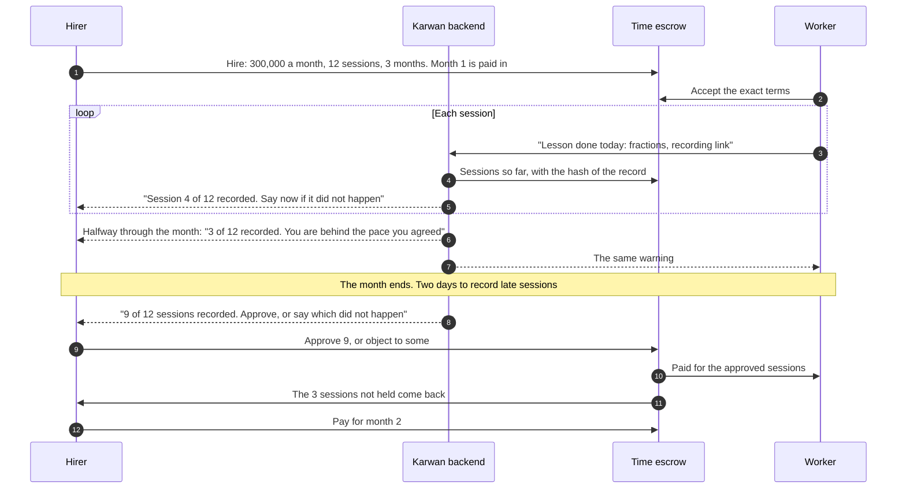

# 76 · Monthly work, session by session

Track T1 (find and agree), roadmap item T1.2 (choose the kind of deal), with track T2 (protected deals), roadmap item T2.1 (the escrow family deployed and used). Proposed 11 Nov 2026 from the owner's test: "300,000 monthly, lessons" was posted as a one-time request, and a month of lessons has no record of each lesson for the hirer to check. The owner decided 1, 2, 3 and 5 on 11 Nov 2026, each as recommended; decision 4 is still open. It builds on [view 32](32-kind-of-deal-and-hourly-work.md) (pay by the hour, monthly retainers on the Time escrow) and [view 55](55-money-in-your-own-currency.md). It changes no contract.

## What is wrong today

- **Repeating work is posted as a one-time job.** The assistant has tools for hourly and monthly work, but nothing tells it when to use them. "I need a tutor, 300,000 a month" becomes a fixed-price request with a deadline, and sellers' agents bid one price for one delivery.
- **A month is all or nothing.** On a monthly retainer the worker claims the month once and the hirer approves or objects to the whole month. Twelve lessons were agreed, nine happened: there is no way to say so, and nothing to look at when deciding.
- **Nobody is watching the month.** Karwan reminds about paying and reviewing, but not about work that is falling behind.

## The idea in one line

Work that repeats is recognised and posted as monthly work; the two people agree how many sessions a month holds, the worker records each one as it happens, the month's money waits on the escrow, and at the end the hirer pays for the sessions that happened.

## Participants

| Who | Does what |
|---|---|
| Hirer | Says what they need and how often; reviews the month; pays for the next one |
| Worker | Accepts the terms; records each session with a note and, if they have one, a link |
| Assistant, on every channel | Tells repeating work from a one-time job, asks one question when unsure, shows one card per step |
| Karwan backend | Keeps the session record, tells the other side after each session, warns when the month is behind, settles on time |
| Time escrow | Holds one month at a time and pays per session. The contract already bills in units: a session is one unit |

## Telling repeating work from a one-time job

Notes: the check runs on the server when the assistant prepares a request card, so every channel behaves the same and the model cannot skip it. The request form on the website asks the same "How you pay" question the deal form already asks.

## A month of sessions

Notes:

- **The session record.** Each entry has the date, a note of up to 300 characters and an optional link. The hirer sees the list on the work page and in chat. The record's hash goes on chain with each entry, as hours already do.
- **Flagging early.** During the month the hirer can mark a session "did not happen". That is a note for the review; no money moves and nothing is disputed until the month's review.
- **The review.** As view 32 decided: two days after the month to record, three days to review. Silence pays the recorded sessions. Sessions objected to go to the two people for 72 hours, then to Karwan's review team.
- **Money.** The month's money is on the escrow before the month starts. A session is worth the month's price divided by the sessions agreed. Sessions not recorded come back to the hirer at settlement.
- **A plain retainer stays.** Work with no sessions to count (a bookkeeper on call) is still one claim a month.

## What fails where

| Where | What fails | What happens |
|---|---|---|
| Posting | The person wants monthly work where it is not open | Told plainly; offered a one-time request instead, never posted that way silently |
| Recording | More sessions than agreed | Refused, with how many are left this month |
| Recording | After the two days past the month | Refused; the worker was reminded a day before |
| Recording | The month is not paid in | Refused; both sides were told when the month started unpaid |
| The month | Fewer sessions than the pace agreed at the halfway point | Both sides are told once. Nothing else changes |
| Review | The hirer objects to sessions | Those go to dispute; the rest are paid at once |
| Review | The hirer says nothing | Reminded a day before; recorded sessions are paid when review ends |

## What it does not do

- Book or schedule sessions on a calendar, or hold the lesson itself.
- Check a recording. The link is for the hirer to look at.
- Change a running monthly retainer into one with sessions. New work only.
- Change any contract. Sessions use the units the Time escrow already bills.

## Checks before code (rule 14)

Logged in `docs/arc-circle-checks.md` before any code: a fork run of a month with sessions on the deployed Time escrow (terms with the month's price over 12 units, three submits, approve 9, settle, the 3 unused back), and the hashes against the backend's.

## Decisions for the owner

1. **How long a month of sessions is** (decided 11 Nov 2026): four weeks (28 days), so "three a week" is exactly 12 sessions. A plain retainer stays 30 days.
2. **When the worker is paid** (decided 11 Nov 2026): the month's money waits and is paid after the month's review.
3. **Flagging a session during the month** (decided 11 Nov 2026): a note only, weighed at the review.
4. **The behind-pace warning** (decided 11 Nov 2026): once, at the halfway point, when fewer than half the sessions are recorded. Both sides get the same message.
5. **Where monthly work is not open** (decided 11 Nov 2026): say so and offer a one-time request.

## Status

| Part | Status |
|---|---|
| A month of sessions on the deployed Time escrow | Proved on a fork of Arc Testnet at block 71,722,000 on 11 Nov 2026: 9 of 12 sessions approved paid exactly nine twelfths and the other 3 came back |
| Repeating work recognised by the assistant | Built 11 Nov 2026: the request card is not shown for work that repeats; the assistant is sent to monthly or hourly work, asks one question when it cannot tell, and says so plainly where that work is not open |
| Repeating work recognised on the request form | Built 11 Nov 2026: the request form asks How you pay; Monthly and By the hour open the posting form with what was typed, where that work is open |
| Sessions on monthly work: terms, record, flag, review, settlement | Built 11 Nov 2026 in the backend and the assistant on every channel, for work with a named person and for work posted on the market |
| Sessions on the work page and forms | Built 11 Nov 2026 from the Figma page "View 76 · Monthly work in sessions · 11 Nov": the session list in each month, record, did not happen, the month's review in sessions, and Sessions a month on both forms |
| Behind-pace warning | Built 11 Nov 2026: the runner tells both sides once, from the halfway point until the month ends, when fewer than half the sessions are recorded |
| A period that has not started says when, to the minute | Built 12 Nov 2026, not deployed: the worker on running work reads "Record sessions from 12 Nov, 02:54" (or log hours, or claim the month), the hirer reads "Starts" with the same day and time, each in their own time zone |
| Every step on the work page says it is working, and a session or a note says it was saved | Built 12 Nov 2026, not deployed: the sheet's button shows a spinner and "Working" until the answer comes; after a session is recorded the page reads "Session saved. @name has been told.", after a note "Note sent. @name has been told.", until the next step opens |
