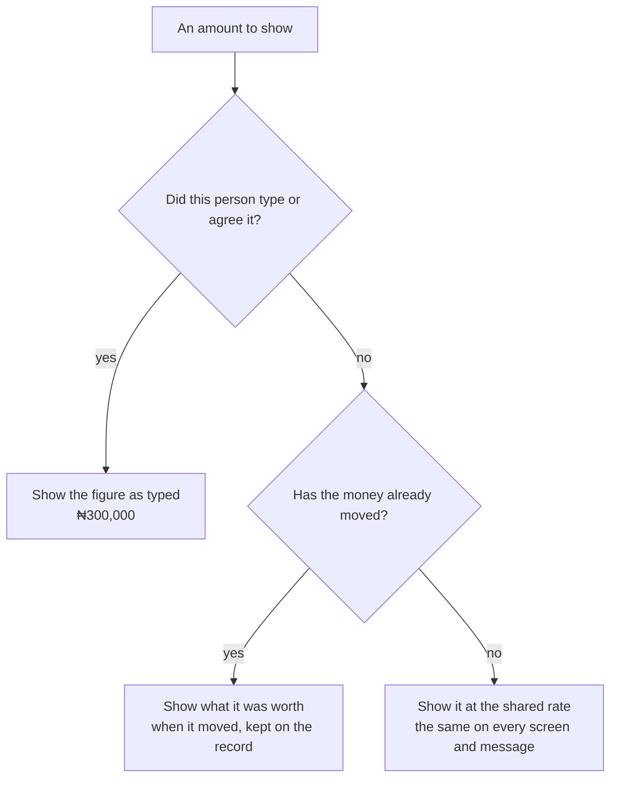
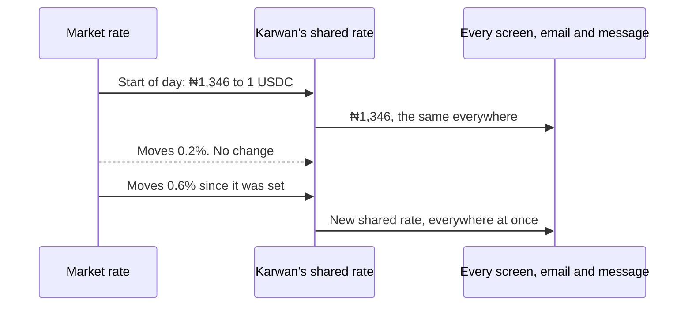

# 77 · One figure everywhere

Track T5 (money like a bank account), roadmap item T5.2 (money-path re-architecture). Proposed 11 Nov 2026 from the live product test. It finishes [view 55](55-money-in-your-own-currency.md), which made people type and read in their own currency, and closes the gaps that view listed under "Not done".

## What a person sees today

One account, read in naira, on one morning:

| Where | What it said |
|---|---|
| Home, Money, Profile | ₦2,029,299, then ₦2,029,284, then ₦2,029,314 within minutes |
| Order page | "Your balance ₦1,971,715" |
| Send | "Available ₦1,328,627" |
| Help and Telegram | "about ₦2,067,257" |
| A request typed as ₦300,000 | "Up to ₦299,996" five minutes later |
| A deal paid two days ago | a naira amount worked out at today's rate |
| Two emails about one request | ₦299,996 and ₦299,988 |

Nothing is wrong underneath. The USDC is exact. The figures differ for four reasons:

1. **The rate is read again every minute**, by every screen on its own, so the same USDC reads differently from one screen to the next.
2. **"Your balance" means three different sums**: everything you own, what you and your buying agent can spend, and what sits in your own wallet.
3. **Only some records keep the figure a person typed.** Sends, direct deals, listings and request budgets do. Monthly and hourly work, offers on requests and anything the assistant does in chat do not.
4. **Nothing keeps what a payment was worth when it happened**, so history is repriced every day.

## The idea in one line

A figure is said once and then it stays: what you typed stays as typed, what was paid stays at what it was worth then, and everything else on a screen is read at one rate that everyone shares.

## The three rules

**1. Typed stays typed.** Any amount a person types, says to the assistant, or agrees to is kept with its currency on the record it belongs to, beside the USDC. Whoever reads in that currency sees that figure for the life of the record. This already holds for sends, direct deals, listings and request budgets. It is extended to:

- the monthly or hourly rate on work and on a request for work,
- an offer made on a request, and the price an agent agrees for you,
- every amount the assistant acts on from the website, Help or Telegram,
- agent limits and price ranges from setup.

When an agent agrees a price that is exactly the buyer's budget, the buyer reads the budget's own figure, not a fresh conversion of the same USDC.

**2. Paid stays paid.** When money moves or a deal settles, each side's record keeps what the amount was worth in that side's currency at that moment. Activity, receipts, finished deals, emails and messages about it read that figure from then on. A person who later changes their currency reads the old amounts at the shared rate, marked "about".

**3. One shared rate for everything else.** Balances and prices nobody has typed or paid yet are read at one reference rate, held by the server and given to every screen, email and message. It does not change every minute. It changes at the start of each day, and during the day only when the market has moved more than half a percent since it was set. Every screen a person opens, and every message sent to them, uses the rate in force, so two screens can no longer disagree.

## One balance, named parts

"Your balance" is one sum everywhere: everything that is yours and free to use, in your account and with your agents. Home, Money, Profile, the order page, Send, Help and Telegram all show that figure under that name.

Where a step can use only part of it, the screen shows the part under its own name and says where the rest is:

- Send and Withdraw: "Ready to send ₦1,328,627" and, under it, "₦700,672 is with your agents. Bring it here."
- An order: "You can pay with ₦1,971,715" when that differs from the balance.

Money held in a deal or set aside as a deal guarantee is never part of the balance, as now. It is listed under the balance with its own name.

## How it works underneath

- **USDC is still the truth.** Contracts, escrow, ledgers and reconciliation do not change. Every rule above is about what is kept beside the USDC and how it is read.
- **Kept figures.** Records gain the same optional `{ currency, amount, rate, at }` that view 55 introduced, in the places listed under rule 1.
- **Worth when paid.** A money movement and a settled deal keep one such figure for each side, worked out at the shared rate in force at that moment.
- **The shared rate.** The server keeps the rate in force with the time it was set. The rates endpoint returns it, with that time, in place of the live reading. Quotes for typing use the same rate, so a figure typed and the balance it comes out of agree to the naira. The half percent step protects against holding a rate the market has left behind.
- **One reader.** The server has one function that turns an amount on a record into the line a person reads, following the three rules. Emails, Telegram, the assistant's cards and the API's "as said" fields all use it. The website's own reader follows the same rules and is tested against it with the same cases.
- **Old records.** Anything made before this view has no kept figure and reads at the shared rate, marked "about" where it is a payment already made.

## What does not change

- No naira moves. Bank and card in and out is roadmap T5.4 and its own view. When a provider is connected, the provider's own rate applies at that edge and is shown there.
- The few screens that must say USDC still do: paying in from another network, a withdrawal to an outside wallet, and the Proof line on a receipt.
- With USDC chosen as the reading currency, every figure is exact USDC and none of this applies.

## Decisions for the owner

1. **The shared rate changes daily, and inside the day only on a move above half a percent.** Recommended. The other choice is a rate fixed for the whole day whatever happens, which is simpler to explain but can sit two or three percent off on a bad day.
2. **A quote for a typed amount uses the shared rate, not the live one.** Recommended, so that typing ₦50,000 takes ₦50,000 off the balance on screen. The cost is that the USDC moved can be up to half a percent off the live market at that minute. Nobody trades at this rate, and both sides of a deal see the same figure.
3. **History is frozen at what it was worth then.** Recommended. A bank statement does not change after the fact.
4. **"Your balance" counts money with your agents.** Recommended, as Home does today, with the usable part named wherever it is smaller.
5. **Old payments read "about".** Recommended, instead of guessing a past rate for records that never kept one.

## Done when

One account is checked, inside one minute, on Home, Money, Profile, an order, Send, Help, an email and Telegram, and every amount for the same thing reads the same. A request typed as ₦300,000 reads ₦300,000 a week later. A deal paid on Monday reads the same on Friday.

## Build order, once approved

1. The shared rate on the server, the rates endpoint and the quote using it.
2. The one reader on the server, with the three rules and its test cases; emails, Telegram and the assistant's cards moved onto it.
3. Kept figures on work rates, offers, agreed prices and the assistant's moves.
4. Worth when paid on movements and settled deals; Activity, receipts and finished deals reading it.
5. One balance with named parts on Home, Money, the order page, Send, Withdraw, Help.
6. Guide, canon, FAQ and this view's "As built" section.
