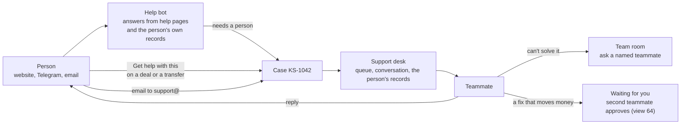
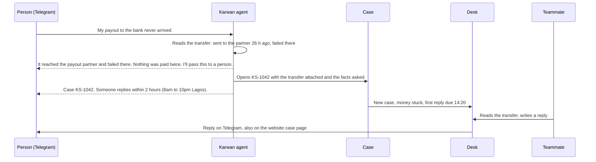
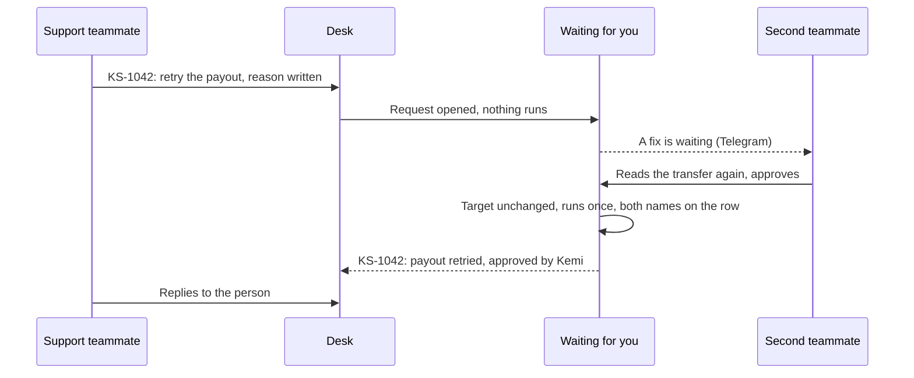

# 78 · A support desk for a product that holds money

Track: foundation, serving T2 (protected deals). Proposed 12 Nov 2026 after the owner's design review in Figma (page "Support desk and admin · 12 Nov"). It replaces the support half of the floating Help panel, works inside the closed desk of [view 64](64-named-operators-two-people-for-money.md), and leaves the assistant to [view 57](57-a-guide-at-every-step.md), which becomes the one floating guide with full memory.

## What is wrong today

- **Help pretends to be the assistant.** The floating Help panel answers like the assistant but keeps no memory, so a person who asked about their deals yesterday is a stranger today. People read that as Karwan forgetting them.
- **The real conversations happen in a Telegram group.** A person asks for a human, the request lands in the team's Telegram chat, and a teammate replies there. Nobody else on the team sees who answered, what was promised, or that a reply is overdue.
- **Tickets do not last.** They live in memory and a file on the server. A closed ticket is emailed to the team and then deleted an hour later, so there is no history to search when the same person writes again.
- **Most problems are about money.** Money held in a deal and transfers that did not arrive, mostly reported from Telegram. A teammate who can read the ticket cannot see the deal or the transfer it is about, and a teammate who could fix it has no way to ask a second person first.

## The idea in one line

Every question becomes one case with a short reference, which follows the person across the website, Telegram and email, and which the whole team works from one desk, where a fix that touches money always waits for a second teammate.

## Who is involved

## Where a person finds help

Help leaves the floating corner. It lives in Profile, under **Help and support**, as a full page:

1. **Search the help pages.** Answers come first, a person second.
2. **Ask the help bot.** It answers questions about using Karwan and reads the person's own deals, transfers and cases to say what is happening. It never moves money, retries a transfer or changes anything. When it cannot answer, or the person asks for someone, it asks the few facts a teammate will need (which deal or transfer, what they expected, what happened) and opens a case with them.
3. **Your cases.** Every case with its reference, its state and the last reply. Opening one shows the whole conversation and a box to write more.

A stuck deal and a transfer that did not arrive each carry a **Get help with this** button. It opens a case with that record attached, so neither the person nor the teammate has to find it again.

On Telegram, the person's agent opens the same case when they say they need a person, and anything they write while it is open goes to the case. An email to support@karwan.site opens or continues a case by its reference in the subject.

## The reply goes back the way the person came

A reply is sent on the channel the person last wrote from, and it is always on the website case page. When that channel cannot reach them (Telegram not linked any more, an email that bounces), the reply goes to the other channels the account has and the desk says which one it used. A person who writes back by email, Telegram or the website adds to the same case.

## Hours and first reply

The desk is staffed 8am to 10pm Lagos time, every day, with a first reply within 2 hours. Every case shows when its first reply is due. Out of hours, the bot says honestly when a person will see it ("Our team is back at 8am Lagos time. Your case is KS-1042.") and the clock starts at 8am. A case that passes its due time is raised in the team room and to the owner on Telegram.

## The desk

The desk is part of the closed desk of view 64, on laptop and phone. A support teammate opens only the pages the owner ticked for them, usually Support and the Team room.

- **The queue.** Open cases, oldest due first, with the reference, the person, the kind of problem ("money stuck", "transfer failed", "question"), the channel and the time left.
- **The conversation.** Everything the person and the bot said, every reply, and private team notes that the person never sees.
- **The person's records.** A read-only panel with what a teammate needs to answer: name and whether they are verified, the deals and transfers attached and their current state, earlier cases. It is built from a list of allowed fields, never from the full account, so no keys, provider ids, wallet ids or anything else that could be used against the backend reach the desk.
- **States.** New, waiting on us, waiting on the person, solved. A case solved and then written to again opens again.
- **Ask for a fix.** When the answer is a money move (retry a payout, release a milestone the buyer confirmed by message), the teammate asks for it from the case with a reason. It waits on **Waiting for you** for a different teammate with that page, exactly as view 64 describes. The case shows that a fix is waiting and who approved it.
- **The team room.** One shared room, and a thread for each case. A teammate who cannot solve a case asks a named teammate, the owner included; that person is told on Telegram and the case shows that it is waiting on them.

## Every case is kept

Cases, messages, notes and every state change are stored in the database of the network the person's account is on, never deleted when solved. A person's own conversation stays theirs: they can read it from Profile and ask for their account and cases to be deleted; account deletion already removes their tickets today. A teammate's reply, note, state change and fix request each leave a row in the desk's activity log.

## What fails where

| Where | What happens |
|---|---|
| The bot cannot answer | It says so and opens a case with the facts asked, never a guess. |
| The person writes about the same deal twice | The second message joins the open case for that deal instead of opening another. |
| Out of hours | The bot gives the time a person will see it; the due time starts at 8am Lagos. |
| A reply cannot be delivered | It goes to the account's other channels; the desk shows where it went. |
| An inbound email is not from a known person | It opens a case marked "not signed in"; the desk shows no account records until the teammate links one the person proves they own. |
| A teammate tries to fix money directly | There is no such button; only a request that a second teammate approves. |
| Someone asks for a code, a password or a seed | Neither the bot nor the desk ever asks; a teammate's reply containing one is held before it is sent. |
| The desk is out of reach | Cases still open and are stored; the team is told on Telegram that new cases are waiting. |

## What it does not change

- The assistant keeps all its tools and gains memory everywhere in view 57. The help bot is the assistant's narrow help mode on the shared core, with no money tools.
- View 64's locks stay: the closed address, member sign-in, pages ticked by the owner, two people for money.
- Testnet and mainnet keep their own cases; the desk shows the network it is signed in to.

## Status

| Part | Status |
|---|---|
| Ask for a person from the website, with the deal on screen attached | Live |
| Teammates reply from a Telegram chat; replies reach the person by email, Telegram and the website | Live |
| Email to support@ opens or continues a ticket | Live |
| A private key on each ticket (view 68) and a support role that cannot touch deals or accounts | Live |
| Help and support page in Profile, help bot that opens a case | Planned |
| Short case references, cases kept in the database | Planned |
| Get help with this on deals and transfers | Planned |
| Desk queue, conversation, records panel, notes, states, due times | Planned |
| Ask for a fix through Waiting for you | Planned |
| Team room and asking a named teammate | Planned |
| Telegram team chat becomes alerts only | Planned |

## Build order, once approved

1. Cases in the database with short references; today's tickets moved over.
2. The desk queue, conversation, notes and states on laptop and phone, reading the allowed-fields records panel.
3. Replies back the way the person came, with fallbacks, and email threading by reference.
4. Help and support in Profile, the help bot's case opening, Get help with this.
5. Hours, due times, the overdue alert, the team room and asking a named teammate.
6. Ask for a fix through Waiting for you.
7. Guide, canon, FAQ and this view's "As built".

## Where it lives

| Part | File |
|---|---|
| Cases today | `backend/src/support/store.ts`, `backend/src/routes/support.ts`, `backend/src/routes/supportTeam.ts` |
| Replies to every channel | `backend/src/support/notify.ts`, `backend/src/emails/supportTranscript.ts` |
| Telegram side | `backend/src/telegram/bot.ts` |
| Help panel today | `frontend/shared/components/AssistantWidget.tsx` |
| Desk today | `frontend/app/admin/support/page.tsx` |
| Designs | Figma, page "Support desk and admin · 12 Nov" |
