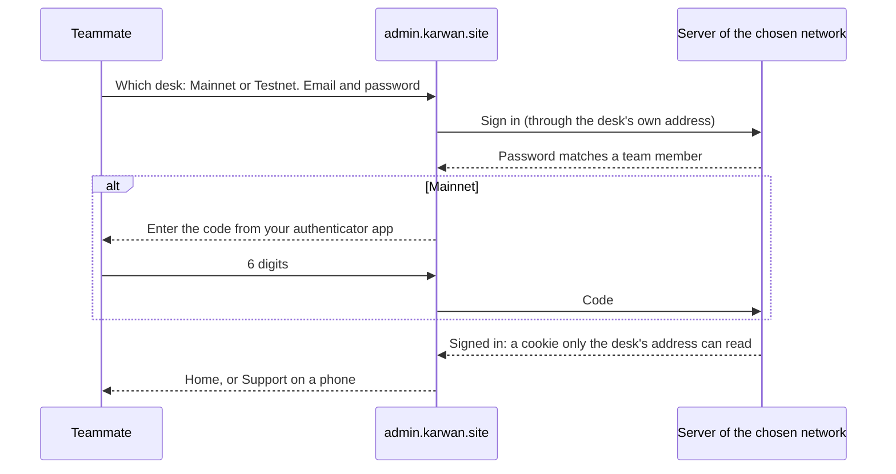
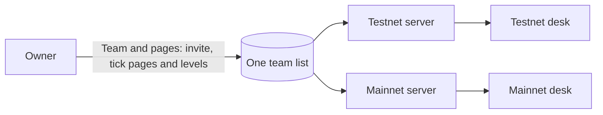

# 79 · A desk in plain words, for both networks

Track: foundation, serving T2 (protected deals). Roadmap item F.1, its second half; the first half is the support desk of [view 78](78-a-support-desk-for-money.md). Approved 12 Nov 2026. Proposed the same day from the owner's design review in Figma (page "Support desk and admin · 12 Nov"). The owner decided on 12 Nov: mainnet asks for an authenticator code at every sign-in; one team list serves both networks; the API directory is the owner's alone unless the owner ticks it for someone; a teammate sets up their code by scanning it at their first mainnet sign-in; one teammate may pause an account, and lifting the pause takes two. It keeps every lock of [view 64](64-named-operators-two-people-for-money.md).

## What is wrong today

- **A refresh signs you out.** The desk keeps its sign-in in the page's memory, so reloading a page or opening a link in a new tab asks for the password again.
- **There is no desk for mainnet.** `admin.karwan.site` only talks to the testnet server. The mainnet server has its own team list file and nobody on it, so nothing on mainnet can be looked at or approved from the desk.
- **The pages speak in code.** Control room, Diagnostics, Event ledger, Agent runtime, USYC, Signals: names a developer chose, under grouped uppercase labels. A new support teammate cannot tell where a stuck payout lives.
- **Amounts are in USDC only.** A teammate answering a Nigerian trader reads 52.10 USDC and has to work out what the person sees as ₦80,000.
- **A page is all or nothing.** A ticked page lets a member do everything on it. A support teammate shown "Ask for a fix" is then refused by the server, because the money route belongs to another page.
- **What needs a person is scattered.** Approvals, late cases and open disputes each sit on their own page; nothing says "these three are waiting for you".

## The idea in one line

One desk, in plain words, that you sign in to once for testnet or for mainnet with the same team account, that opens on what is waiting for you, shows every amount in the currency you choose, and gives each teammate exactly the pages, and the level on each page, the owner ticked.

## Sign in once, on the desk you choose

- **The sign-in survives a refresh.** It lives in a cookie that page scripts cannot read, scoped to `admin.karwan.site`. Moving between pages and reloading keep you signed in. Closing the browser, 30 minutes without use, or 12 hours at most signs you out. These are fixed, not settings.
- **Mainnet asks for a code every time.** After the password, a 6-digit code from an authenticator app on the teammate's phone. Five wrong codes lock that email for 15 minutes and tell the owner on Telegram.
- **Setting up the code.** The first time a teammate signs in to mainnet, after the password, the desk shows a code to scan into their authenticator app and asks for one code back to prove it worked. The owner can reset a teammate's code from Team and pages; the next mainnet sign-in sets it up again.
- **Which desk you are on is always visible.** The sign-in picks the network; the sidebar names it, and on mainnet every page carries "Mainnet. Every amount on this desk is real money." Switching network means signing in to the other desk.

## One team, two desks

A teammate the owner adds signs in to both desks with the same email and password, and the pages ticked for them apply on both. Only the owner changes the list. Each network still keeps its own records: cases, the activity log, sign-in attempts and the authenticator lock belong to the network they happened on. Money moves on mainnet are approved on the mainnet desk, by a second teammate signed in there.

## Pages by what people do

The sidebar groups pages by the job, in plain words. Every page from today has a place; nothing is removed.

| Group | Page | What it was |
|---|---|---|
| Today | Home | Control room |
| | Waiting for you | Approvals |
| | Support | Support (view 78) |
| | Team room | Team room (view 78) |
| People | Accounts, and one account | Profiles |
| | Businesses | Business review |
| | Waitlist and survey | Waitlist, Survey |
| | Updates | Home updates |
| | Newsletter | Publishing |
| | Feedback | Feedback |
| Deals and money | Deals | Deals |
| | Disputes | Disputes |
| | Money moves | Payments, and money in and out of accounts |
| | Treasury and yield | Treasury, USYC |
| Market | Matching | Matching review |
| | Agents | Agent runtime, Signals |
| System | Health | Diagnostics |
| | Errors | Error triage |
| | Activity log | Event ledger, Change log |
| | API directory | API directory (owner only) |
| Team | Team and pages | Team access, Desk access |
| | Keys | Your keys, Team keys |
| | Settings | Switches spread across pages today |

**One account** gathers what a teammate needs about a person: their money (balance, held in deals, with their agents, stuck), their record, recent money moves with where each one is, their deals, their cases and their activity, with Message, Open a case and Pause account.

**Settings** shows every switch that changes Karwan for everyone in one place, each change logged with the name of who made it, and lists the switches set only on the server so everyone can see what is running.

## Each page ticked, and how much

The owner ticks pages per teammate, as in view 64, and now also the level on pages that change things:

- **Read only.** The page opens; its changes are hidden and refused.
- **Can change.** Everything on the page that is not money.
- **Can ask for a fix.** On Money moves and Deals: the teammate can ask for a money move, which waits on Waiting for you for a second teammate. Nobody, at any level, moves money alone.

A page that is not ticked is hidden and its data refused, as today. The desk hides any button the teammate's level does not allow, so a support teammate never meets a button the server will refuse.

## Home: what is waiting for you

Home opens with **Needs you**: the approvals waiting for this teammate, disputes ready to rule on, and late cases, each with the one button that opens it. Under it, **Today on Karwan** (new accounts, deals started, money held in deals, open cases and the average first reply), **System** (website and app, agents, the network, the payout partner, the last backup, each Working, Slow or Down) and **Team on shift**. A teammate sees only the cards of pages ticked for them.

## Amounts in the reader's currency

The foot of the sidebar has **Show amounts in**: USDC, naira, Kenyan shilling, West African franc, US dollar, euro, pound, dirham, rupee and yuan. Every amount on the desk reads in that currency at the shared rate of [view 77](77-one-figure-everywhere.md), with the USDC under it and, on a person's own money, what it is in their currency ("₦12,400 for them"). The choice is the teammate's own and changes nothing for anyone else. A figure a person typed or agreed keeps the figure they typed, as view 77 says.

## On a phone

The desk works on a phone. A support teammate signs in on the phone and opens on Support; the queue, a case and the reply box fit one hand, with a tab bar for Support, Team room and Waiting for you.

## What fails where

| Where | What happens |
|---|---|
| The browser is closed, or 30 minutes pass without use | The next page asks for the password (and the code on mainnet). Nothing half-done is sent. |
| Five wrong mainnet codes | That email is locked on mainnet for 15 minutes; the owner is told on Telegram. Testnet sign-in is unaffected. |
| A teammate loses their phone | The owner resets their code from Team and pages; until they set it up again they can sign in to testnet only. |
| The owner removes a teammate | They are signed out of both desks at once; their open sign-ins stop working on the next request. |
| The mainnet server is down | The mainnet desk says so at sign-in; the testnet desk keeps working. |
| The shared rate has no figure for a currency | Amounts read in USDC with a note, never a guessed figure. |
| A teammate presses a button their level does not allow | They cannot: it is not shown. If a stale page sends the request anyway, the server refuses it and the activity log keeps the row. |
| Pause account | Stops money leaving that account, as the person's own pause does. One teammate with Accounts at "can change" may pause; lifting it is the person's own unpause with their code, or a request a second teammate approves. |

## What it does not change

- View 64's locks stay: the closed address behind Cloudflare Access, sign-in per member, pages ticked by the owner alone, every change logged, two people for any money or chain move.
- Each network keeps its own data and its own server. The desk only chooses which one it talks to.
- The support desk of view 78 keeps its behaviour; it takes the new look.
- Customers see nothing of this.

## Status

| Part | Status |
|---|---|
| Closed address, sign-in per member, pages ticked by the owner, two people for money (view 64) | Live |
| Support desk and team room (view 78) | Built, not deployed |
| Sign-in that survives a refresh, with the 30 minute and 12 hour limits | Built, not deployed |
| Mainnet desk, authenticator code at every sign-in | Built, not deployed |
| One team list for both desks | Built, not deployed |
| Levels per ticked page | Built, not deployed |
| Pages renamed and regrouped, Home, One account, Settings | Built, not deployed |
| Show amounts in | Built, not deployed |
| Pause an account, lifting it with a second teammate | Built, not deployed |
| Phone layout for support | Built, not deployed |

## As built

- **Sign-in.** The site's own desk address holds two cookies, the session and which network it belongs to; the browser never sees the session itself. A session lasts 30 minutes from the last use and never more than 12 hours, and ends when the browser closes. On mainnet a password opens a short ticket that only the code can turn into a session; a teammate with no code yet scans one at that step. Five wrong codes lock that email on mainnet for 15 minutes and tell the owner on Telegram; a code works once.
- **One team list.** Production keeps the team in the testnet database. The mainnet server reads and writes those two tables through its own login that can touch nothing else, so the owner changes the team once. Failed sign-ins, code locks and the last code used stay with the network they happened on.
- **Levels.** Each ticked page carries read only, can change or can ask for a fix. The server decides by the route: reading is read only, a route behind two people needs a fix, anything else needs can change. Pages ticked before levels existed read as can ask for a fix, which is what they allowed.
- **The pages.** Every old page has a place in the sidebar and an old address sends a teammate to the new one. Home asks the server once for what waits for this teammate. Money moves lists every top-up, send, withdrawal and move between networks with stuck ones first. Accounts finds a person by tag, address or email; the email is matched by the server and never sent back. One account shows their money, record, moves, deals and cases from an allowlist. Activity log reads each change as a sentence and exports a file. Settings reads the server's own switches as on or off, never their values.
- **Two people.** Lifting an account's pause and turning deal rules off are requests a second teammate approves on Waiting for you, which can also turn a request down.
- **On a phone.** Under 1,024 px the sidebar opens from a menu button. A teammate ticked for Support who signs in on a phone opens on Support, with a bar for Support, Team room and Waiting for you.

## Not done

- The summary tiles at the top of Treasury and yield wait for a server read of the treasury in one call.
- Disputes has no list of disputes already ruled.
- The accounts list has no balance column; balances show on one account.
- A case cannot be opened from the desk; a teammate opens the person's latest case from their account.
- One account does not yet sum up the person's agents.

## Deploy notes

- Set `DESK_CODE_KEY` (`openssl rand -hex 32`, on the server) to the same value in both servers' env files.
- On mainnet, set `TEAM_DATABASE_URL` to a login on the testnet database limited to `team_members` and `team_invites`.
- On the site, set `ADMIN_MAINNET_BACKEND_URL` to the mainnet API address; without it the mainnet desk says it is not set up.
- Old support tickets move once with `move:support-tickets` (view 78), run with `DRY_RUN=1` first.

## Build order, once approved

1. Sign-in in a cookie that survives a refresh, with the time limits.
2. One team list read by both servers; levels per page.
3. The desk talks to the server of the network chosen at sign-in; the mainnet code and its setup.
4. The new sidebar and page names, Home, and Show amounts in.
5. Each page in the new look, the money pages first (Waiting for you, Money moves, Deals, Disputes, Treasury and yield), then People, Market, System and Team; One account and Settings.
6. The phone layout for support.
7. Guide, canon and this view's "As built".

## Where it lives

| Part | File |
|---|---|
| Desk sign-in and sessions | `backend/src/routes/adminDesk.ts`, `backend/src/ops/deskSession.ts`, `backend/src/middleware/adminAuth.ts` |
| Team list | `backend/src/db/teamMembers.ts`, `backend/src/db/teamClient.ts` |
| Desk address and proxy | `frontend/app/api/admin-proxy/[...path]/route.ts`, `frontend/shared/admin/adminDesk.ts`, `frontend/middleware.ts` |
| Desk shell and pages | `frontend/app/admin/`, `frontend/features/admin/adminNavigation.ts` |
| Mainnet code | `backend/src/ops/deskCode.ts`, `backend/src/db/deskSignIn.ts` |
| Levels | `backend/src/ops/adminPages.ts` |
| Home, Money moves, Accounts, Settings | `backend/src/routes/adminHome.ts`, `adminMoves.ts`, `adminAccounts.ts`, `adminSettings.ts` |
| Phone bar | `frontend/features/admin/desk/DeskTabBar.tsx` |
| Shared rate | `backend/src/rates/sharedRate.ts` (view 77) |
| Designs | Figma, page "Support desk and admin · 12 Nov" |
