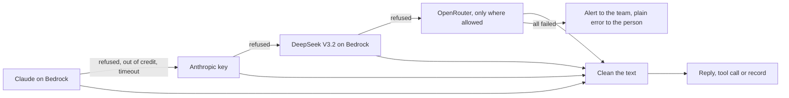

# 81 · The assistant always has a model

Track: foundation (reliability). Every capability Karwan offers runs through the assistant and its agents, so no model means no Karwan. Approved 13 Nov 2026 as drafted. Built the same day; the AWS permission is in `scripts/ops/iam/bedrock-models.json`.

## What is wrong today

Read from the testnet API and the AWS account on 13 November 2026:

| In the chain | State |
|---|---|
| Claude Haiku on Bedrock | Refused: "Access to Anthropic models is not allowed for this account." The model list says authorised; every real call is refused. |
| The Anthropic key | Refused: credit balance too low. |
| OpenRouter | Refused: insufficient credits. |

The testnet API fell back 60 times in a day and every chain ended in a refusal, so the assistant and the agents had no model. Mainnet has no model settings at all.

Each chain has a single cloud provider behind each link, and two of the three links are paid balances that run out without warning. Nothing tells the team when the last link fails.

What does work, tested the same day with real calls from Karwan's AWS account:

| Model on Bedrock | Plain answer | Tool call |
|---|---|---|
| DeepSeek V3.2 (`deepseek.v3.2`) | 0.4 s | right tool and arguments, 1.2 s |
| Amazon Nova Lite (`us.amazon.nova-lite-v1:0`) | 0.3 s | right tool and arguments, 0.7 s |

Both write their own markup into the text next to a tool call (`<｜DSML｜function_calls`, `<thinking>`). Shown as is, a person would read it.

## The idea in one line

Every place Karwan uses a model ends its chain on a model that is not Claude and runs in Karwan's own AWS account, cleans what that model writes, and tells the team when every link has failed.

## After the change

1. **One more link everywhere.** A new setting, `BEDROCK_FALLBACK_MODEL` (DeepSeek V3.2 by default), joins every chain in `backend/src/llm/client.ts` after both Claude links and before OpenRouter. It covers the assistant, the agents, negotiation, delivery checks, research, the supervisor and the dispute judge. The assistant's own provider list in `routes/assistant.ts` gets the same link.
2. **Private chats stay private.** The assistant and the supervisor never send a conversation through a third-party proxy, so they skip OpenRouter. The new link runs inside Karwan's AWS account, on a model AWS hosts; DeepSeek the company never receives the text, so these two chains use it too.
3. **The order stays as it is, with one link added.** Claude on Bedrock first, then the Anthropic key, then DeepSeek on Bedrock, then OpenRouter where allowed. The light model for cheap jobs stays Nova Lite, with the same chain behind it.
4. **Clean output in one place.** One function strips model-internal markup (DeepSeek's `DSML` blocks, `<thinking>` blocks and the like) from every text a model returns, before it reaches a person, a message or a stored record.
5. **An alert when all links fail.** The first time in an hour that a chain runs out, the team gets a Telegram and email alert naming each link and its error. The person sees "The assistant is not available right now. Try again in a few minutes." No internals.
6. **A check the owner can run.** `scripts/probe-models.ts` makes one short real call, plain and with a tool, to every model in the chain and prints which answered. It runs after any key or setting change, and on `/admin/diagnostics` the model card lists each link with its last result.

## Settings and permissions (owner)

- `BEDROCK_ENABLED=1` and `BEDROCK_FALLBACK_MODEL=deepseek.v3.2` in `.env` and `.env.mainnet`. Mainnet gets the same model settings as testnet.
- The server's AWS role (`karwan-mainnet-backup`, inline policy `bedrock-haiku`) may call only Claude Haiku and Nova Lite today. DeepSeek V3.2 is added to it.
- Claude on Bedrock and the Anthropic key stay in the chain; restoring either one puts Claude back in front without a code change.

## What does not change

Nothing a person can do. Prompts, tools and the rules the assistant follows are the same for every model. The guide and the canon say the assistant runs on more than one model provider.

## How we know it worked

- Tests: a chain moves to the next link after a refusal, a credit error or a timeout; the assistant and supervisor chains never include OpenRouter; the cleaner removes both kinds of markup and leaves ordinary text alone; the alert fires once an hour, not per call.
- `scripts/probe-models.ts` on testnet shows DeepSeek answering, plain and with a tool, with the Anthropic key and Claude on Bedrock still refused.
- On testnet, with only DeepSeek working, a request posted in the assistant gets a shortlist and a reply with no markup in it.
