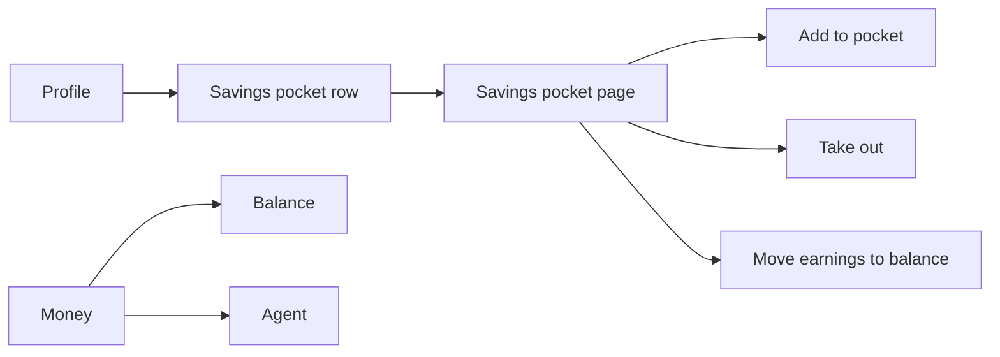
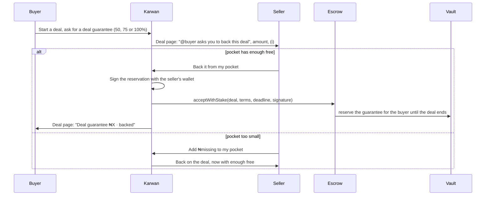

# 82 · The savings pocket

Track T2 (protected deals), with T5 (money). Proposed 15 Nov 2026. Drawn in
Figma, page "Savings pocket · 15 Nov" (309:570); the owner chose the name, the
earnings line and that the seller accepts the buyer's ask.

## What is wrong today

- **A big word on the Money page.** Money has three tabs: Balance, Agent and
  Deal guarantee. "Deal guarantee" reads as a product of its own, next to the
  balance, and people do not know what to do with it.
- **A buyer's ask is not kept.** A buyer can ask the seller to back a deal with
  a share of its value (50 to 100 percent, in steps of 5), and the deal shows
  it. On the Agreement escrow, where new deals go, Karwan builds the terms with
  no guarantee at all (`sellerStake` 0), so nothing is reserved for the buyer.
  The escrow can do it: terms with a guarantee are accepted with
  `acceptWithStake`, which reserves it with a signature from the seller.
  Nothing in Karwan calls it.
- **Nothing tells either side where the guarantee comes from.**

## The idea in one line

The money a person keeps aside is a **savings pocket** in Profile. A buyer can
ask for a **deal guarantee**; it comes only from the seller's savings pocket,
and the seller backs it in one tap when they accept.

## The words

| Thing | Word on screen |
|---|---|
| Money kept aside, which earns | Savings pocket |
| Putting money in, taking it out | Add to pocket, Take out |
| Earnings moved to the balance | Move to balance |
| The share of a deal the seller backs | Deal guarantee |
| The seller's step | Back it from my pocket |

"Deal guarantee" stays only for the per-deal term. The pocket is never called a
stake, a vault or insurance, in all five languages, the assistant and Telegram.

## Participants

| Who | Role |
|---|---|
| Buyer | Asks for a deal guarantee when starting the deal |
| Seller | Keeps a savings pocket; backs the guarantee when accepting |
| Karwan backend | Builds the terms, prepares the seller's signature, sends the accept |
| Agreement escrow | Accepts with the guarantee, frees it at the end, pays the buyer from it after a ruling |
| Guarantee vault | Holds the pocket; reserves part of it for one deal |
| Yield distributor | Pays the earnings (the US Treasury bill rate, paid by Karwan on testnet) |

## Where things are

- **Profile.** One row under Money in the same card: "Savings pocket", with the
  whole pocket as its value.
- **Savings pocket page.** The total, then "₦X free · ₦Y backing N deals"; Add
  to pocket and Take out; Earned so far with Move to balance; Backing your
  deals, each with the date it frees. The (i) note: money you keep aside, it
  earns at the rate of US Treasury bills (paid by Karwan on testnet), and a
  buyer can ask you to back a deal with it.
- **Money.** Balance and Agent only.
- Old links (`/guarantee`, `/account/guarantee`, Money's guarantee tab) open
  the savings pocket page.

## The ask and the accept

- **Start a deal.** The buyer's switch reads "Ask for a deal guarantee (i)",
  with 50%, 75% and 100% and the amount in their currency. The (i): a deal
  guarantee comes only from the seller's savings pocket; if the deal goes wrong
  and the ruling is yours, you can be paid from it.
- **The seller's deal page.** The ask is the first card: who asks, the amount,
  how much of the pocket is free. With enough free: Back it from my pocket. Short:
  Add ₦missing to my pocket, the exact shortfall. The (i): it can only come from
  your savings pocket, it stays yours and keeps earning, it frees when the deal
  ends well.
- **The buyer's deal page.** The terms show "Deal guarantee ₦X · backed" once
  the seller has backed it, and "asked" before.
- **The signature.** The same way "get paid now" reserves a guarantee for a
  financier today (`backend/src/money/familyFinancing.ts`): Karwan builds the
  vault's `Reserve` message for this deal and the seller's own Circle wallet
  signs it. The expiry in it must equal the one the escrow passes
  (the deal's horizon plus the long-stop plus 30 days), so it is read from the
  chain, not worked out in Karwan.

## Agentic first

| Channel | What it can do |
|---|---|
| Assistant and Telegram | Read the pocket ("how much is in my savings pocket"), add to it, take out, move earnings; when a buyer asks, the seller's agent says so and backs it after the seller confirms |
| Deal drafts | "Ask the seller for a 50% guarantee" sets the ask; the card shows "Deal guarantee 50%" |

The existing guarantee tools keep working; their words change to the pocket.

## What fails where

| Failure | What the person sees | What Karwan does |
|---|---|---|
| Pocket too small at accept | Add ₦missing to my pocket | Nothing is sent to the chain |
| Signature refused or the wallet is busy | "Could not back it. Try again." | Nothing moved; the deal stays waiting on the seller |
| The escrow refuses the accept | The deal stays waiting; support sees why | Logged with the deal; no retry loop |
| Take out while some of the pocket backs a deal | Only the free part can come out | The vault refuses the rest; the page says which deals hold it |

## Checks before code (rule 14)

Circle's signTypedData for developer-controlled wallets and the vault's
`Reserve` message are read from the current docs and the installed SDK, and the
whole accept is proved on an Arc fork (`scripts/ops/arc-fork.sh`) before
testnet, with the result written to `docs/arc-circle-checks.md`.

## What it does not do

- No new contract. The escrow and the vault already do this.
- No change to how much a buyer can ask for (50 to 100 percent) or to the
  reputation weight of a guarantee.
- No mainnet claim: earnings are paid by Karwan on testnet.

## Decided by the owner, 15 Nov 2026

1. The name is Savings pocket, everywhere.
2. The pocket page keeps the earnings line.
3. The seller accepts the buyer's ask; it is not only a term agreed with the deal.

## Status

| Part | State |
|---|---|
| This view | Approved by the owner, 15 Nov 2026, as written |
| The ask kept in the terms; the seller backs it when agreeing; funding refuses an unbacked or uncovered ask; the accept reserves it with the seller's signature (`backend/src/deals/dealGuarantee.ts`, `fundDirectSuite.ts`, `chain/agreementEscrow.ts`) | Built 15 Nov 2026; proved on an Arc fork (`scripts/ops/arc-fork.sh e2e dealguarantee`) |
| Savings pocket page `/pocket`, the Profile row, Money with Balance and Agent, old links redirected | Built 15 Nov 2026 |
| Start a deal: Ask for a deal guarantee (50, 75, 100%) with its (i); the deal page's Deal guarantee row; Back it from my pocket | Built 15 Nov 2026 |
| Assistant and Telegram: the agree card names and backs the guarantee; the pocket tools and cards use the new words; guide and canon | Built 15 Nov 2026 |
| Words in all five languages: the pocket pages, notifications, route titles, the trade record line, the confirm step | Built 15 Nov 2026 |
| Still to rename: older activity log lines and a few admin labels that still say deal guarantee for the holding | Not built |
