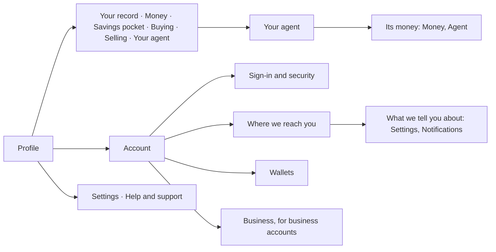

# 83 · Profile in order

Foundation (navigation), serving T5 (money) and T6 (channels). Proposed 15 Nov
2026. Drawn in Figma, page "Profile pages · 15 Nov" (328:570); the owner chose
that language and theme live only in Settings.

## What is wrong today

- **The same thing in two places.** Language and Theme are rows on Profile and
  again in Settings. The Language row on Profile opens Settings; the Theme row
  opens a page of its own (`/profile/theme`). The passkey is a row in Profile's
  Account card and again in Settings.
- **Two help rows.** "Help and support" (`/profile/help`) and "Help and how it
  works" (`/how-it-works`) sit in different cards.
- **Sign-in is split.** Passkey, Account recovery and Signed-in devices are
  three rows.
- **A page nobody can reach.** Agent funds (`/profile/agent-funds`) is linked
  from the assistant and a few prompts, never from Profile, while Money > Agent
  shows the same money.
- **Names that do not say what is inside.** "Contact" holds Email, Telegram and
  X. "More settings" opens the only settings page.
- **No way back.** Settings has no Back to Profile.

## The idea in one line

Profile says each thing once: one card for your record, money, trade and agent;
one card for your account; one card for settings and help. Every page under it
holds one subject and has Back to Profile.

## Where things are

## The pages

| Page | What it holds |
|---|---|
| Profile | Photo, name, @handle and account kind, Edit profile. The first card is unchanged: Your record, Money, Savings pocket, Buying, Selling, Your agent. Account: Sign-in and security, Where we reach you, Wallets, Business (business accounts only). One card with Settings (its value is the language and theme, "English · Dark") and Help and support. Terms, Privacy and Sign out at the foot. |
| Your agent (`/profile/setup`) | Agent on. What it does for you: what you sell, your price, how you get paid, when you buy, agent permissions. Its money: the agent's money, opening Money > Agent. Who it reaches: be found by, reach out to. More ways to get paid, Ask Aman. |
| Sign-in and security (`/profile/security`) | How you sign in: email, passkey, recovery password. Signed in now: each device with where and when, This device marked, Sign out on each. Sign out of the others. |
| Where we reach you (`/profile/contact`) | Email, Telegram and X, each with its state and its one action. What we tell you about opens Settings at Notifications. |
| Settings (`/settings`) | Display: language, theme, show amounts in, sound, start a trade with. Notifications and privacy: notifications, who can reach you, show my record publicly, outside agents can offer, publishing settled deals. Assistant: what Aman remembers. Delete account. Back to Profile. |
| Edit profile, Wallets, Help and support, Business | Unchanged, with Back to Profile. |

## Old links

| Old | Opens |
|---|---|
| `/profile/theme` | `/settings` |
| `/profile/devices` | `/profile/security` |
| `/profile/agent-funds` | `/profile/setup`, at Its money |

Assistant replies, emails and bookmarks that use the old links keep working.

## Agentic first

| Channel | What changes |
|---|---|
| Assistant and Telegram | Nothing it can do changes. Settings are still changed with a card (propose_change_settings), devices are still listed and signed out (get_my_devices, propose_sign_out_everywhere). Links it sends use the new pages, and the guide names them as they read on screen. |

## What fails where

| Failure | What the person sees | What Karwan does |
|---|---|---|
| The device list does not load | The sign-in card still shows; "Could not load your devices. Try again." under Signed in now | Nothing signs out until the list loads |
| The agent's money does not load | Its money shows a dash and still opens Money > Agent | The rest of Your agent works |

## What it does not do

- No new setting, no setting removed. Only where each one lives changes.
- No change to the first Profile card, the savings pocket (view 82) or Money.
- No change to what the assistant can do.

## Decided by the owner, 15 Nov 2026

1. Language and theme live only in Settings, not on Profile.
2. The arrangement drawn in Figma (328:570) is the one to build.

## Status

| Part | State |
|---|---|
| This view | Proposed 15 Nov 2026 |
| Profile, Your agent, Sign-in and security, Where we reach you, Settings, old links | Not built |
