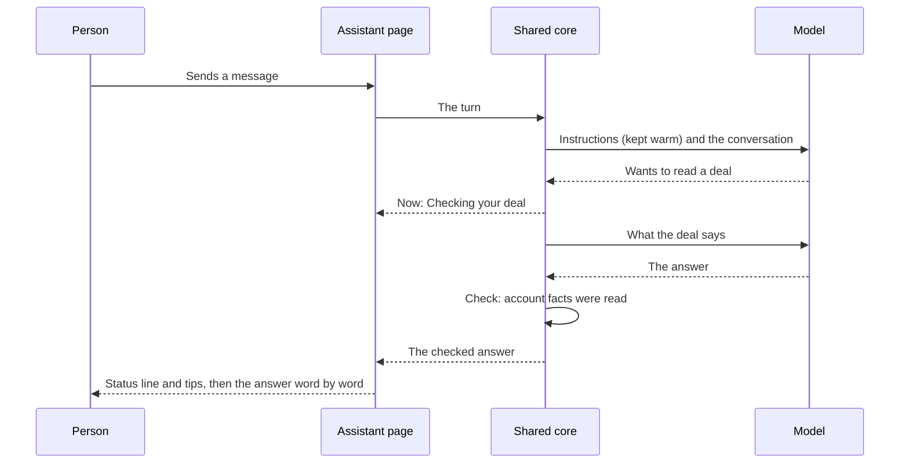

# 84 · The wait is worth watching

Track T6, roadmap T6.7. Builds on [view 57](57-a-guide-at-every-step.md) (the assistant page) and [view 80](80-aman.md) (Aman).

## What is hard today

After a person sends a message to Aman, three grey dots pulse until the whole answer is ready. A turn that reads the account can take several seconds, because Aman may look things up a few times before it answers. Nothing on the page says what is happening, and the answer then drops in all at once. For a trader new to assistants, the wait feels like the app has stalled.

## The idea

Make the wait shorter, and make what is left of it worth watching.

1. **Shorter.** The fixed part of every request (Aman's instructions and the guide to Karwan) is kept warm on the model's side between turns, so each turn starts faster. The answer still goes out only after Karwan has checked it (an answer that states account facts must have read the account first, and is asked again if it did not), and then appears word by word in under a second instead of dropping in all at once.
2. **Honest.** While Aman works, one line says what it is doing right now, such as "Checking your deal", "Reading your balance" or "Drafting the card". Each line comes from the step Aman really takes, never from a timer.
3. **Worth watching.** Under that line, a short tip is drawn in motion, one at a time: how a deal keeps money safe, or how to stay safe ("Karwan never asks for your code or password"). Tips fit the page the person came from: deal tips from a deal, safety tips from Money.

## The wait, on the page

- Aman's face in the thread takes its thinking mood.
- The status line changes as Aman moves from step to step, with a short fade.
- One tip at a time is drawn in under the status line. A tip stays long enough to read and gives way to the next only while the wait lasts. When the first words of the answer arrive, the tip and status give way to the answer.
- With reduced motion on, the tip and status change without movement.
- A quick answer (under about a second) shows no tip at all, so a fast turn never flashes.

## Tips

A fixed list, written and checked like the rest of the copy, in all five languages. Every tip states something true about Karwan today, in plain words, with no figures that can go stale. Each tip belongs to a kind: deal, money, safety or reputation. The page the person came from picks the kind first. The same list serves Telegram, where a slow turn sends one tip while Aman works.

## Channels

The status lines and tips are part of the turn on the shared core, so any channel can show them. The assistant page shows all of it. Telegram shows "typing" while Aman works, and on a turn longer than about four seconds sends one short tip, once per turn.

## What fails where

| Failure | What the person sees |
|---|---|
| The live stream breaks mid-turn | The page asks for the finished turn once and shows it whole |
| A step has no status line written for it | "Working on it" |
| Warm instructions are not reused (the model provider dropped them) | The turn is as fast as today, nothing else changes |
| The answer fails | The error the page shows today, with Try again |

## Decisions for the owner

1. **Make it shorter and make the wait worth watching, together** (approach A). Agreed 15 Nov 2026.
2. **Tips are a fixed, checked list in five languages, chosen by the page the person came from.** Recommended.
3. **Status lines come only from steps Aman really takes.** Recommended.
4. **Telegram shows typing and sends one tip on a slow turn.** Recommended.
5. **The answer is checked before it is shown,** then revealed word by word. Showing words while they are written would show answers that the check can still throw away. Recommended.
6. **A faster model is measured, not switched.** Claude Haiku 5.5 is on Bedrock and is built for low waits. We measure it beside today's model on the same turns and bring the numbers to the owner before any switch.
7. **Order:** Figma (the waiting state on phone and laptop, the tip in motion, the answer arriving, Telegram's line) for the owner's yes, then spec, plan and a test-first build.

## Status

| Part | State |
|---|---|
| This view | Approved 15 Nov 2026 |
| Figma: section "5 · The wait is worth watching (view 84)" (330:2078) on the page "Aman · the guide with a face · 15 Nov": four phone states (sent, a tip drawn in, the next step, the answer word by word), the laptop wait, Telegram on a slow turn, and the timing and motion strip | Drawn 15 Nov 2026, approved by the owner 15 Nov |
| The build: warm instructions, the turn's steps, the streamed page, status lines and tips in five languages, the answer word by word, Telegram typing and one tip | Built 15 Nov 2026, not deployed |
| Timing before and after (the same ten turns on Claude Haiku 4.5, without and with warm instructions, and on Claude Haiku 5.5) | Script ready, not yet run |

## As built

- **Warm instructions.** The instructions that are the same for everyone go to the model as their own part, kept warm for an hour; the lines about the person follow. Amazon Bedrock reads the tool list before the instructions, so the one warm point covers both. The backup model, which cannot keep anything warm, gets the request without it.
- **What the person sees.** Each step Aman takes is reported as it starts, and a second try that checks an answer against the account is reported too. The page asks for these as a stream; Telegram and older clients get the same single answer as before.
- **A broken connection.** The page gives each turn its own id, and the server keeps the finished answer for two minutes for that person only, so a page whose stream broke asks for it once.
- **Tips.** One list, written for the page in five languages; Telegram uses the English deal and safety tips, and a check fails the build if the two drift apart. The tip card follows the drawing: a label for its kind, the tip, and a thin line for how long it stays.
- **Models.** Claude Haiku 5.5 is available on Bedrock (checked 15 Nov 2026 in us-east-1, `us.anthropic.claude-haiku-5-5`). The timing script runs the same ten turns on a model of choice, with or without warm instructions, and prints the time to the first step, the whole turn, and the warm tokens read and written. No model is switched without the owner.
- **Warm by model.** Only Claude can keep instructions warm for an hour; Bedrock refuses the whole request when another model is asked to. Other Bedrock models get the ordinary five-minute warm point instead.
- **Measured on testnet, 15 Nov 2026.** Claude could not be timed: Bedrock refused Anthropic models for the account and the direct key had no credit. Amazon Nova Lite, ten turns: the first step showed after 5.0 to 6.2 seconds and the whole answer took 10 to 23 seconds, with or without the warm point; Nova reported no warm tokens, so on this model the warm point gives no speed.
