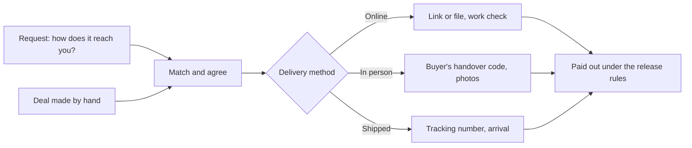

# 85 · Every deal says how it arrives

Track T2, protected deals. Reported by the team on 15 Nov 2026 as B-08: "every deal routes via link submission. Deals should be categorised based on delivery method." Builds on [view 32](32-kind-of-deal-and-hourly-work.md) (kinds of deal) and [view 46](46-offers-you-can-read.md) (requests and offers).

## What is hard today

A request already knows how the work reaches the buyer: online, in person at a place, or goods. The assistant asks it, and Find uses it to rank sellers near the buyer. But the deal made from that request keeps only whether it is a service or goods, so:

- **In-person work is delivered as a link.** A tailor who sews at your house, a cleaner or a plumber is a service, and every service deal asks the seller for a link before it can be marked delivered. There is no link to give.
- **Goods from a request are always shipped.** A matched goods deal asks for a tracking number, even when the buyer collects the item in person. Only deals made by hand can choose handed over in person.
- **The request form on the website never asks.** Only the assistant and Find ask how the work arrives, so a request posted on the website falls back to online or shipped.

## The idea

Every deal carries one delivery method, said in plain words, from the moment it is agreed. The method decides what the seller gives to mark it delivered and how the buyer checks it.

| Method | For | The seller marks it delivered with | The buyer checks it by |
| --- | --- | --- | --- |
| Online | design, writing, code, anything sent | a link or a file | opening it, with the agent's work check as today |
| In person | work done at a place: tailoring, cleaning, repairs, hair, lessons | the buyer's 6-digit handover code, typed when the work is done, and photos above the photo limit | showing the code only once they are happy |
| Shipped | goods sent by a carrier | the carrier and tracking number, and photos above the photo limit | the item arriving |

Goods handed over by hand use In person, with the same code that goods handovers use today. One code, one rule: the buyer shows it only when they hold the item or the work is done.

## Where the method is set

1. **On the request.** The request form asks one question, How does it reach you?, with three choices. The assistant and Telegram already ask it (`post_request`, `deliveryKind`), and Find already passes it.
2. **Carried to the deal.** When the buyer's agent or the buyer agrees an offer, the deal takes the request's method. A seller's offer can never change it.
3. **On a deal made by hand.** The deal form and the assistant's deal draft ask the same question for every deal, not only goods.
4. **Older deals** keep working: a service reads as Online, goods read as Shipped unless they were handed over in person.

## Where people see it

- The deal page names the method under the price (Online, In person, Shipped) and shows only the delivery step that fits it.
- Deal rows in Deals and Activity show the method beside the status, and Deals can be filtered by it.
- A seller sees the method on a request before offering, so a tailor knows the buyer wants the work done at their place.
- The assistant says the method when it reads a deal, and `get_deal_status` returns it on every channel.

## What does not change

The money side is the same for every method: the escrow, the release rules, the review window, disputes and the record. Only the proof of delivery differs. Nothing on Arc changes: the delivery fingerprint already covers a link, a shipment, a handover and photos.

## Where it lands

| Where | What changes |
| --- | --- |
| `backend/src/db/deals.ts`, `deals/createSchema.ts` | the deal holds `deliveryMethod` (online, in_person, shipped), read from `tradeType` and `goodsWay` for older deals |
| `backend/src/agents/buyer.ts` | a matched deal takes the request's method |
| `backend/src/deals/deliveryProofRules.ts`, `routes/deals.ts` | what delivery needs follows the method; the handover code works for in-person work, not only goods |
| `frontend/features/buyer/components/PostJobForm.tsx` | How does it reach you? on the request form |
| `frontend/features/deals/workspace/*` | the deal page step and the delivery sheet follow the method |
| deal rows, Deals filter | the method beside the status, and a filter |
| assistant | `post_request`, the deal draft and `get_deal_status` carry the method; guide and canon entries |

## Decided (owner, 15 Nov 2026)

1. In-person work is confirmed with the buyer's 6-digit handover code, the same code goods handovers use. A button alone would not show the buyer was there.
2. In-person work done in stages takes one code per stage, so each payout follows work the buyer saw.
3. Deals stay one list. Every row names its method, and a filter at the top picks Online, In person or Shipped.
