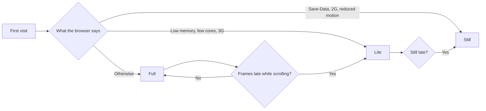

# 86 · Smooth on every phone

Foundation, serves T5 (the wallet page) and the landing. Builds on [view 49](49-the-landing-tells-the-whole-story.md) (the landing's motion and clips).

## What is hard today

The landing shows six kinds of trade, each a short looping clip behind its title. Measured on 15 Nov 2026 on a strong laptop with a 120 Hz screen, scrolling through that section:

| While scrolling the trade section | Frame time | Feels like |
|---|---|---|
| Clips paused | 8 ms | smooth, 120 frames a second |
| Clips playing, two on screen | 17 ms, a quarter of frames late | 60 a second, with hitches |
| All six clips playing at once | 33 ms | 30 a second, juddery |

The clips cost half the smoothness on a strong machine. On a phone with little memory, or on a slow connection, the whole landing can drag. In Nigeria, many people browse on exactly those phones.

Three things drive the cost:

1. A clip pauses only when it is fully off screen, so several play at once.
2. A laptop always loads the largest clip, though a tile is drawn at about 700 pixels wide.
3. The page glides under a mouse wheel by redrawing every frame, on top of the clips.

Separately, the owner reports that on an iPhone 15 Pro the landing and some in-app pages, the wallet page among them, do not fit well. At that width (393 pixels) nothing spills sideways, so the cause is specific to Safari on the phone and is checked from the owner's screenshots.

## The idea

Keep the full effect wherever the device can carry it, and step down quietly where it cannot.

1. **Lighter for everyone first.** These changes do not alter how the page looks.
   - Only the clip most in view plays; the others hold their still frame.
   - Each clip is loaded at the size its tile is drawn at, so a laptop gets the smaller file when the tile is small.
   - A clip loads only as its section comes near.
   - Sections far off screen are not drawn until they come near.
2. **Three levels for the device.** On the first visit the page reads what the browser tells it: memory, processor cores, connection speed, Save-Data and reduced motion. From that it picks a level.

   | Level | Who gets it | What they see |
   |---|---|---|
   | Full | Normal phones and laptops | Everything as today |
   | Lite | Little memory, few cores, or a slow connection | One clip at a time at the small size; the phone in the hero holds still instead of turning; no gliding wheel |
   | Still | Save-Data, 2G, or reduced motion | Still frames only; sections appear without scroll effects |

3. **It listens to the device.** For the first few seconds of scrolling, the page counts its own frames. If they keep running late, it steps down one level for the rest of the visit, and remembers that for the next visit. It never steps up mid-visit, so nothing flickers between levels.

## What stays the same

- The copy, the order of sections and the layout at each width.
- The full effect on normal devices.
- Reduced motion, which already means no motion, now also means still frames.

## What fails where

| Failure | What the person sees |
|---|---|
| The browser tells nothing about memory or connection (Safari) | Full, and the frame count steps it down if the phone struggles |
| A clip cannot autoplay (iPhone Low Power Mode) | Its still frame, with no play button |
| The saved level is from an old visit on a slower connection | The saved level, until the page is reloaded on a good connection and stays smooth |

## Decisions for the owner

1. **Lighter for everyone first, then three device levels.** Agreed 15 Nov 2026.
2. **Lite drops the turning phone and the gliding wheel, but keeps one clip.** Recommended.
3. **A level stepped down for frame time is remembered on that device.** Recommended, so a slow phone does not judder on every visit.
4. **The iPhone fit is fixed from the owner's screenshots**, page by page, in the same batch.

## Status

| Part | State |
|---|---|
| View | Draft, 15 Nov 2026 |
