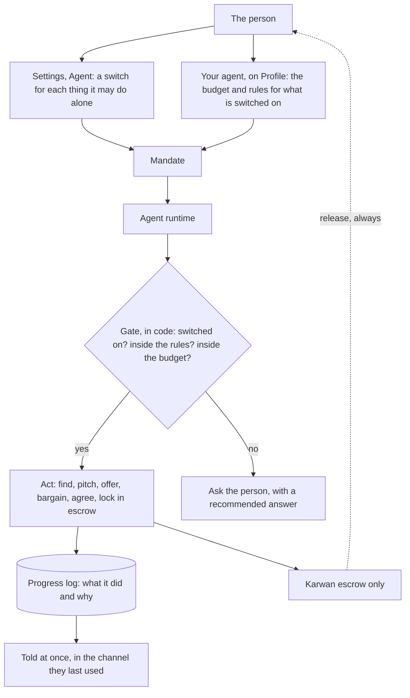
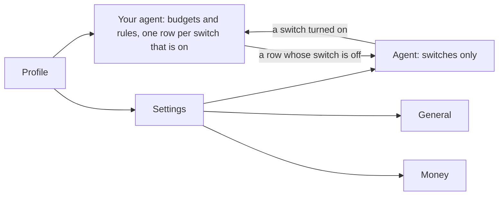
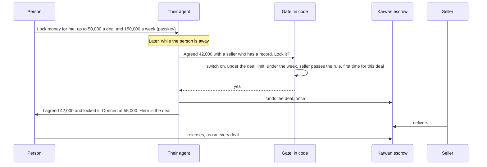
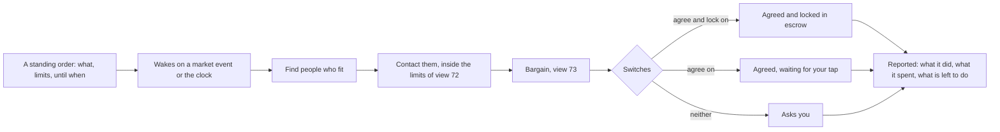
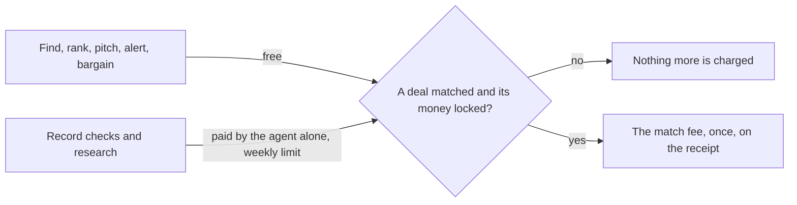

# 87 · Your agent on autopilot

Track T1 (find and agree), roadmap item T1.11, with T5 (the fee and the money it may lock), T3 (the record that is checked and published) and T6 (the same switches from Telegram). It builds on [view 45](45-your-agent.md) (your agent on one page), [view 48](48-one-agent-per-person.md) (one agent per person), [view 52](52-an-agent-that-works-for-you.md) (the mandate), [view 72](72-your-agent-finds-the-people.md) (finding people), [view 73](73-agents-that-bargain.md) (bargaining), [view 75](75-your-agent-asks-before-a-deal.md) (the agent switch), [view 83](83-profile-in-order.md) (Profile in order) and [view 15](15-outside-agents.md) (outside agents). Raised by the owner on 15 Nov 2026: "give it instructions and budget, set your rules that allow it to act when you are not there. The agent framework should be Karwan's gold mine." Approved by the owner the same day, with the decisions recorded below.

## What is true today

Read from the code and the web on 15 Nov 2026.

- **The agent stops at the last tap.** It offers, bargains and can agree a price inside the person's limits. Locking the money always waits for the person, so a deal agreed at night starts in the morning.
- **Goals are kept, not worked.** "Sell 20 bags this month" is saved and read back in the morning brief. Nothing goes out to do it.
- **One choice covers everything.** "What it does alone" is one of three answers (make offers, ask me first, agree for me). A person cannot let the agent bargain but not find people, or find people but not pay for research.
- **Settings is one long page.** Language, money display, privacy and notifications sit together, and nothing there is about the agent.
- **Only Karwan's own agents trade.** An agent outside Karwan can buy for its person. It cannot sell, offer or bargain.
- **The agent earns Karwan almost nothing.** A find is free and a record check is 0.005 USDC. The income is the deal fee.

What others have shipped: agents that pay a fixed price from a catalogue on card rails, and agents that pay other agents for API calls. In a real test of agents trading for people, the stronger model got the better price and the people on the losing side did not notice ([Anthropic, Project Deal](https://www.anthropic.com/features/project-deal)). In a simulated market most agents took the first offer and some paid scammers ([Microsoft, Magentic Marketplace](https://arxiv.org/html/2510.25779v1)). We found nobody doing bargained deals, held in escrow and backed by a record, for traders who have no catalogue.

## The idea in one line

You switch on what your agent may do alone, give each thing a budget and rules, and it works your trade while you are away: it finds people, bargains, agrees and locks the money in escrow, inside limits that code enforces and only you can raise.

## Where the switches and the budgets live

Decided by the owner, 15 Nov 2026: the switches are in Settings, the budgets and rules are in the agent workspace on Profile.

Settings is arranged in three groups, so nobody hunts for a setting.

| Group | What it holds |
|---|---|
| General | Language, theme, sound, notifications, who can reach you, show my record publicly, publishing settled deals, what Aman remembers, delete account |
| Money | Show amounts in, start a trade with |
| Agent | One switch for each thing the agent may do alone. Nothing else. |

Which setting sits in which group is settled in Figma before anything is built.

| Switch in Settings, Agent | What you set for it in Your agent |
|---|---|
| Agent on | Nothing. Off stops everything below (view 75). |
| Make offers for me | What you sell, your usual and lowest price, how you get paid |
| Bargain for me | Your lowest price, the most you pay, how many days you can wait |
| Agree a price for me | The price it may agree without asking |
| Lock money for me | The most for one deal, the most in a week, who it may deal with |
| Find people for me | What you need or sell, where, how many people a day it may contact |
| Pay for checks and research | The weekly limit |
| Morning brief | The hour and quiet hours |

1. **A switch that is off has no row.** Your agent shows budgets only for what is on, with one line that opens Settings for the rest.
2. **The three answers become switches.** "Make offers", "Ask me first" and "Agree for me" map onto the switches above, so nobody's agent changes what it does on the day this ships.
3. **Every switch is an assistant tool.** "Turn on autopilot up to ₦50,000 a deal" works on the website and in Telegram, through the same confirm card.

## Lock money for me

The one switch that changes a rule. Until now no money moved without the person. With this switch on, the agent may move money to one place only: a Karwan escrow, for a deal it agreed inside the person's rules.

1. **Escrow only.** The agent can never send money to a person, a wallet or a link. The only payment it can make alone is funding a deal on the escrow family, and the gate refuses any other destination.
2. **Two limits, in the person's currency.** The most for one deal and the most in a week. Past either, the agent asks.
3. **Turning it on, or raising a limit, takes the passkey or PIN,** on the person's own device. The agent cannot read or answer that step. Lowering a limit or turning it off needs nothing.
4. **Who it may deal with.** By default only people with a record: verified, or with settled deals on Karwan. A new seller, or a price far from the market, goes to the person as a question.
5. **Release never changes.** The person confirms the delivery, or the review window ends, as on every Karwan deal. Autopilot never releases.
6. **Told at once.** Every lock sends one message with the price, how the price moved and the deal.
7. **Off by default,** for everyone, on both networks.

## A runtime that can be trusted with money

| Rule | What it means |
|---|---|
| Code decides, never the model | Whether a step is switched on, inside the rules and inside the budget is checked in code before the step runs. The model writes words. |
| Each step happens once | A step is written down with its own key before it runs. After a restart it is checked against the escrow and the market, then finished or left. A deal is never funded twice. |
| One worker per request | A request is held by one server at a time, so two servers never bargain or pay for the same request. |
| Other people's words are data | Requests, listings, messages and web pages sit inside tags and cannot give the agent orders (view 48). |
| The agent stops itself | After repeated failures, or more locks in a day than the person allowed, everything it does alone stops and the person is told once. |
| A second wall on mainnet | Each agent wallet also carries Circle's spending limits, set by the person with a code the agent never sees (view 52). On testnet Karwan's gate is the only wall, and the agent says so. |
| Everything is on the record | Each thing done alone is in the progress log with the rule that allowed it. "What did my agent do" reads it back. |

## Standing orders

A goal the agent works, not one it remembers. "Find me customers for my catering in Abuja, up to 5 a day." "Buy 20 bags of rice under ₦60,000 each by Friday."

An order ends when it is done, when its date passes, or when the person stops it. The contact limits of view 72 hold whatever the order says.

## A receipt for every bargain

Every deal an agent agreed carries one receipt: where the price opened, where it closed, the range settled deals ran at, and what the agent saved or earned against the first offer. Code sets every number in the bargain (view 73), so a person's price does not depend on which model speaks for them.

## What the agent pays for

Decided by the owner, 15 Nov 2026: no subscription and no charge for trying. The agent pays on its own for data that is useful, and Karwan's fee comes only when a deal is matched.

| | Useful data | The match fee |
|---|---|---|
| What is bought | A read that helps the agent decide: a person's record, a passport, market research | A deal the agent found and matched |
| Who pays | The agent that reads | The person whose agent went looking |
| When | Each read, paid by the agent alone inside its weekly limit | Once, when the matched deal's money is locked in escrow |
| Price | 0.005 USDC for a record check (view 48) | 1% of the agreed price |
| Never charged for | The same read twice on one request | A search, a pitch, a deal alert, an answer of "interested", a bargain that ends without a deal |
| Shown as | "3 record checks" on the weekly line | One line on the deal's receipt |

1. **Trying is free.** However many people the agent contacts and however long it bargains, nothing is charged until a deal is matched.
2. **Data is the agent's own cost.** It pays for a read without asking, as it does today, and stops at the weekly limit.
3. **A match that falls through costs nothing.** If the chosen seller declines or never answers and the money is not locked, there is no fee.
4. **The deal fee is unchanged.** The match fee is for the finding and the bargaining; the deal fee is for the escrow.

## Other agents, and people not yet on Karwan

1. **An outside agent can sell.** The door of view 15 gains the selling side: an agent that proved the one person behind it can list what that person sells, receive requests that fit, offer and bargain, under the same rules and the same limits as a Karwan agent. It still cannot release money.
2. **Karwan's record is read from outside.** Finding people and checking a record are sold to other agents where agents shop for services, and each person's settled-deal record can be published where other agents look, with their consent. Both wait for mainnet and a check of the current Arc and Circle documents.
3. **Reaching someone who is not on Karwan.** When the agent knows only a username, it writes the invitation and the person sends it themselves, from their own account. Karwan never sends a cold message to a stranger.

## What fails where

| Failure | What the person sees | What Karwan does |
|---|---|---|
| A lock would pass a limit | "This is above what I may lock alone. Lock ₦62,000?" | Nothing is funded until they answer |
| The agent's money is short | "I agreed ₦42,000 but hold ₦30,000. Add ₦12,000?" | The agreed price is held for the seller's waiting time, then the request reopens |
| The seller has no record | A question with the seller's public facts | No lock |
| Karwan restarts in the middle of a lock | Nothing, or one message when it is done | The step is checked against the escrow and finished once |
| The passkey step is not completed | "Lock money for me is still off" | The switch stays off |
| The agent stopped itself | One message saying why, with Turn back on | Everything it does alone waits |
| The weekly limit for data is used | "I'm working on free data this week. Raise the limit?" | The agent goes on without paid reads |
| The match fee cannot be paid | The amount to add, with the deal total | Nothing is locked until the deal and its fee can both be paid |

## What this view does not do

- It changes no contract. A lock made alone is the same funding call a tap makes today.
- It does not let an agent release, withdraw, send or pay anyone outside an escrow.
- It does not change how agents bargain (view 73) or who may be contacted (view 72).
- It does not add a channel. Telegram and the website stay the two places people talk to their agent.

## Order of work

Everything through step 8 can be shown on testnet.

| Step | What | Depends on |
|---|---|---|
| 0 | Switch on what is already built on testnet: the mandate and brief (view 52), finding people (view 72), bargaining (view 73), the outside-agent door (view 15); measure a week | The owner's deploy |
| 1 | The runtime: one worker per request, the gate, the agent stopping itself | none |
| 2 | Settings in three groups, the agent switches, budgets in Your agent | Figma approved first |
| 3 | Lock money for me | steps 1 and 2 |
| 4 | Standing orders | steps 1 and 2 |
| 5 | The bargain receipt | view 73 on |
| 6 | The match fee | Arc and Circle checks |
| 7 | Outside agents sell | view 15 on |
| 8 | Invitations the person sends | step 4 |
| 9 | Circle spending limits, selling Karwan's finds and checks to other agents, publishing records | Mainnet; Arc and Circle checks |

## Decided by the owner, 15 Nov 2026

1. **The agent may lock money alone.** It is a setting: switched on in Settings, Agent, with its budget and rules in Your agent.
2. **Settings is arranged in groups:** general, money and agent.
3. **The agent pays for useful data alone,** such as a record check, inside its weekly limit.
4. **Karwan's fee is for a matched deal only,** never for a try. This replaces the fee per introduction first proposed.
5. **Whoever's agent went looking pays the match fee,** buyer or seller, as one rule.
6. **By default the agent locks money only with people who have a record:** verified, or with a settled deal on Karwan.
7. **A person types their own limits** when they turn Lock money on. Nothing is filled in.
8. **Three locks in a day,** then the agent stops itself and asks.
9. **Whatever can be shown on testnet is built there first.**
10. **The match fee is 1% of the agreed price,** on deals agents matched, never on a deal link or an offer made by hand. The buyer's is returned on a full refund; a seller's is taken only when they are paid.
11. **A lock is told at once,** in quiet hours too.
12. **An outside agent sells only for a person with a Karwan account,** linked once.

## Status

| Part | State |
|---|---|
| This view | Approved by the owner, 15 Nov 2026 |
| Step 1, the runtime | Built 15 Nov 2026, not deployed: what an agent does alone is read as switches from one place, with older accounts reading as before; the gate for locking money, which nothing calls yet; one server holds a request while it works it; a match can be funded after a restart, and accepted once; an agent can stop itself |
| Step 2, settings and switches | Drawn in Figma 16 Nov 2026, page "View 87 · Agent on autopilot · 16 Nov" (347:570), approved by the owner 16 Nov 2026. Plan written, waiting for the owner. Nothing built |
| Steps 0 and 3 to 9 | Not started |
