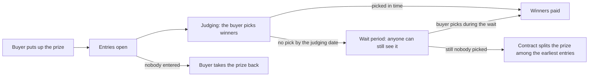

# 88 · Contests that protect the people who enter

Track T2 (protected deals), roadmap item T1.2 (choose the kind of deal), building on [view 40](40-contests-and-agent-jobs.md) (contests on the job escrow) and [view 11](11-contracts.md) (the contract family). Raised by the owner on 16 Nov 2026: "the essence of the smart contract is to help facilitate protection for participants … if no winner is picked, the money returns serves no real protection for participants." Approved by the owner on 16 Nov 2026 with the decisions below.

## What is true today

Read from the code on 16 Nov 2026.

- **The prize is held from the start.** Entrants can see the money is real before they work.
- **The buyer can walk away with it.** If the buyer picks nobody by the award date, the contract sends the whole prize back to the buyer. The only cost is a line on their record saying the contest was not awarded. A buyer can collect a dozen entries, use them, and get their money back.
- **One shape for every contest.** Entries are open 1 to 30 days, then the buyer has a fixed 7 days to pick. There is no hackathon shape (a building period, then judging), and no way to see when judging ends.
- **The contract cannot be changed.** The job escrow is immutable. A new rule means a new version of the bounty contract, which the owner deploys.

## The idea in one line

Once someone has entered, the prize always goes to entrants: if the buyer does not pick winners in time, the contract pays the earliest valid entries itself.

## The rules proposed

| Moment | What happens |
|---|---|
| Opening | The buyer sets the entry period, the judging period and the places. The prize and the fee are held. The page shows all three dates. |
| Nobody enters | The buyer can take the prize back, as today. |
| Judging ends with winners picked | Winners are paid in place order, as today. |
| Judging ends with nobody picked | A wait period starts (proposed 3 days), so a late buyer can still pick and every entrant sees what comes next. |
| Wait period ends with nobody picked | Anyone can trigger the payout. The places go to the earliest entries, in the order they were first sent, using the shares set at opening. The buyer gets nothing back, and their record shows the contest was not judged. |
| Fewer entries than places | The empty places' shares go to the entries there are, in the same order. |

Why the earliest: it is the one fact the contract can check alone. The time of first entry is on chain, and replacing an entry keeps its first time, so nobody gains by resending.

## Kinds of contest

| Kind | Entry period | Judging period |
|---|---|---|
| Design or writing contest | 1 to 30 days | 3 to 14 days |
| Bug bounty | 1 to 60 days | 3 to 30 days |
| Hackathon | 1 to 60 days of building | 3 to 30 days of review |

These are presets on one rule. The contract only knows the dates and the shares.

## What it does not solve, said plainly

- **Spam entries.** A first entry with nothing in it could still be paid if the buyer never judges. Proposed guard: an entry counts toward the automatic split only if the buyer did not mark it as not valid during judging, with a reason every entrant can see. A buyer who marks every entry as not valid gets the prize back, and their record shows it.
- **Disputes about the winners.** The buyer's pick stays final, as today. Appeals to a person at Karwan are a later step.

## What changes

- A new version of the bounty contract with the judging date, the wait period, first-entry times and the automatic split, tested exploit-first before any deploy. The owner deploys it.
- The contest form and the assistant ask for the judging period. The card says in one line what happens if nobody is picked.
- Contests already open keep the old rule until they end.
- Before any code: an Arc and Circle check entry in `docs/arc-circle-checks.md` for the deploy and the USDC movements.

## Decisions

Answered by the owner on 16 Nov 2026.

1. With nobody picked, the places go to the earliest valid entries, in order of first entry, at the shares set at opening.
2. The wait after judging ends is 3 days.
3. The buyer can mark an entry as not valid, with a reason every entrant sees. If every entry is marked not valid, the prize goes back to the buyer and their record shows it.
4. Design or writing, bug bounty and hackathon each get their own date presets.

## Build order

1. Contract: a new version of the bounty library with the judging date, the 3-day wait, first-entry times, the not-valid mark and the automatic payout. Exploits written first: a buyer who awards nobody, an entrant who resends to move up, a buyer who marks everything not valid, payout triggered early, payout triggered twice.
2. Arc and Circle check entry, then the owner deploys to Arc Testnet.
3. Backend: the contest runner reads the new dates, calls the payout after the wait, and keeps old contests on the old rule.
4. Website and assistant: presets, the judging period, the line on the card, the not-valid mark with its reason.
5. Guide, canon, terms.
