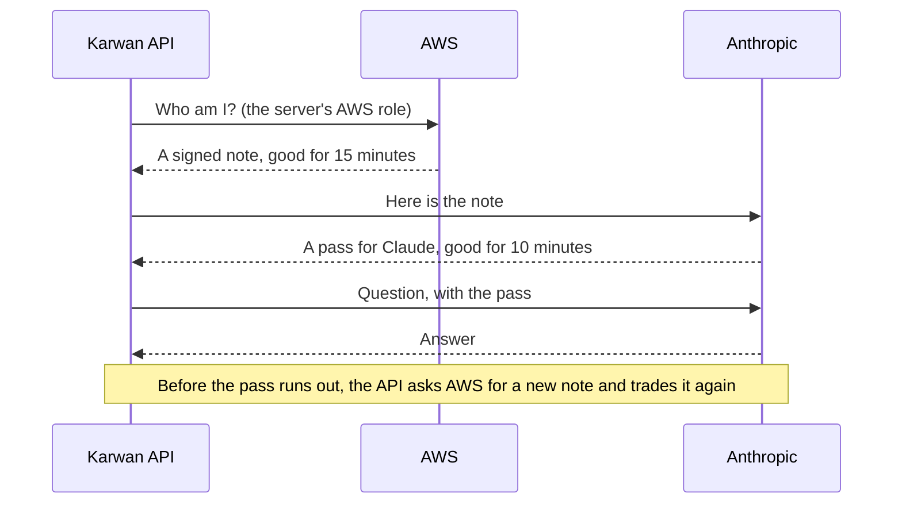
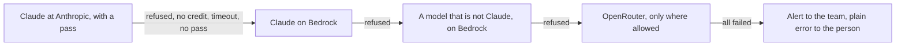

# 89 · Claude without a stored key

Track: foundation (security and reliability), roadmap F.3. Proposed 17 Nov 2026. Not approved, nothing built.

## What is wrong today

Karwan reaches Claude two ways. Claude on Bedrock uses the server's own AWS identity, so no secret is stored for it. Claude at Anthropic uses a fixed key that sits in the server's settings file and never expires. Anyone who reads that file can spend on the account until someone notices and deletes the key.

The order of the chain also puts Bedrock first (view 81). Bedrock has refused Claude before with no warning, and it trails Anthropic on new models and features.

## The idea in one line

The server proves to Anthropic that it is Karwan's server, gets a pass that lasts minutes, and asks Claude at Anthropic first. Bedrock is the backup, and OpenRouter stays last where it is allowed.

## How the server proves who it is

1. **AWS signs a note.** The API asks AWS for a short note that says which AWS role is asking. AWS signs it. Nothing is stored: the API asks again each time it needs one.
2. **Anthropic trades the note for a pass.** Anthropic checks the signature against AWS's public keys and checks that the role is the one Karwan registered. It returns a pass tied to a Karwan service account at Anthropic.
3. **The pass is renewed before it ends.** The API keeps one pass in memory and replaces it two minutes before it runs out. A note is used once.
4. **Every call to Claude at Anthropic carries the pass.** The assistant, the agents, negotiation, delivery checks, research, the supervisor and the dispute judge all take it from the same place.

## The order of the chain

- Anthropic moves from second to first. The rest of view 81 holds: the model that is not Claude, the cleaning of model text, the ten minute rest for a link refused for good, and the alert when every link fails.
- Failing to get a pass counts as that link failing. The call moves to Bedrock and the person waits no longer than for any other refusal.
- A chat that carries a person's own data still never goes to OpenRouter.

## What stays the same

- On a developer's machine there is no AWS role, so a key in the local settings still works. The server never needs one once this is live.
- Testnet and mainnet run on the same server and the same AWS role. Each names its own Anthropic workspace, so spend and limits show apart.

## Moving over without a gap

1. Set up the trust: AWS is told to issue notes, the server's role is allowed to ask for them, and Anthropic is told which AWS account and role to accept.
2. Prove it from the server with one real question, before any code ships.
3. Ship the code with the key still in place. The pass is used when it works and the key is not read.
4. After a week with no key use, remove the key from both servers and delete it at Anthropic.

## Sources checked

Read on 17 Nov 2026:

- Anthropic: Authentication, Workload Identity Federation, the reference for it, and the AWS guide (`platform.claude.com/docs/en/manage-claude/`).
- AWS: the `GetWebIdentityToken` call in the STS reference. A note lasts 60 seconds to one hour, the account must switch the feature on, and the call is not offered on the global endpoint.

## Not in this view

- Signing GitHub's deploy steps in the same way. No deploy step calls Claude.
- Changing which Claude model each job uses.
