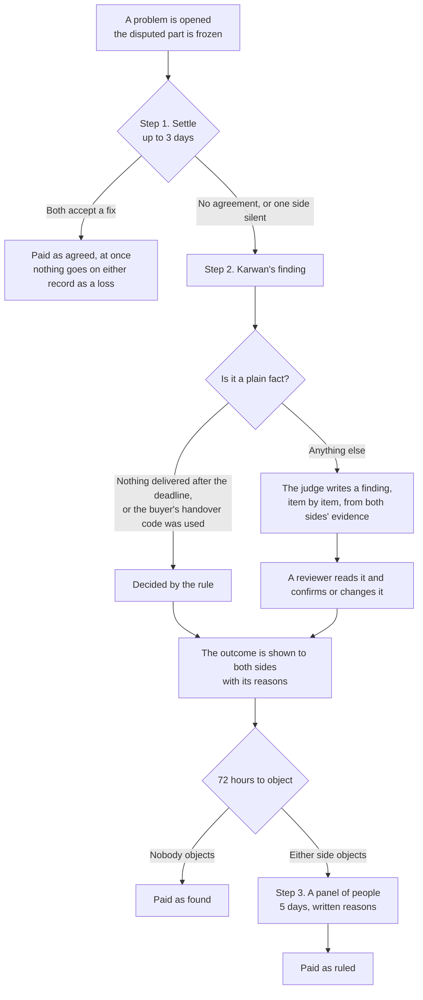

# 90 · Disputes settled reliably

Track T2 (protected deals), roadmap items T2.3 (mainnet escrow) and T2.4 (your case, written for you), building on [view 27](27-deals-on-the-escrow-family.md) (deals on the escrow family), [view 33](33-delivery-proof-for-every-kind-of-deal.md) (delivery proof) and [view 21](21-flagged-delivery-review.md) (held deliveries). Raised by the owner on 18 Nov 2026: "If we can settle dispute reliably, then I guess we opened Pandora's box." Approved by the owner on 18 Nov 2026 with the decisions below.

## What is true today

Read from the contracts, the backend and the testnet server on 18 Nov 2026.

- A buyer or seller can open a problem after a delivery. It costs nothing and freezes the delivered part until it is decided.
- The page asks each side three questions and gives them 3 days. On deals made on the escrow family, Karwan's automatic decision comes 1 hour after the problem opens and reads only the chain record. The answers are seen only if the case later reaches a person.
- The automatic decision is all or nothing. Nothing delivered after the deadline: the buyer gets everything. The delivery check failed: the buyer gets everything. Delivered on time, the check passed and the buyer disputes: the seller gets everything.
- The delivery check for online work is a comparison by a language model. For goods sent by carrier it only confirms that a tracking number exists.
- Either side has 72 hours to ask for a person. Karwan's review Safe then has 5 days. If it does not rule, the money is split by the share written in the deal's terms, which today is half each.
- The two sides can already end a problem themselves: one proposes a share, the other accepts, and the escrow pays it at once. Nothing in the product offers this during a problem.
- Agents take no part in a problem. Karwan is the only judge, including on a deal that Karwan's own financier paid early.

## The idea in one line

A problem goes through three steps, each slower and more careful than the last: the two sides settle it with their agents' help; if they cannot, Karwan writes a finding from both sides' evidence and a person confirms it; if either side objects, a panel of people rules with written reasons. Nobody loses money on a fact they were not heard on, and nobody gains from Karwan being slow.

## The three steps

### Step 1. Settle

Most problems are a late delivery, a missing part or a misunderstanding, and both people would rather finish the deal than fight over it.

- The person who opens the problem picks what is wrong from a short list tied to the deal's terms: not delivered, not what was agreed, late, wrong or damaged item, something else.
- Each side's assistant gathers that side's case from the deal itself (the agreed terms, each delivery and its check, tracking, the chat lines that matter) and drafts their answers. The person edits and confirms. Nothing is sent unseen, and a draft may cite only what exists on the deal.
- Each side's agent proposes a way out that fits the terms: more time to redo the work, a part refund, a full refund, or release. The other side sees it as one card with the amounts and accepts, counters or declines.
- A fix both accept is paid by the escrow at once and ends the problem.
- An agent proposes and explains. It accepts an outcome for its person only inside a limit that person has set, such as "accept a part refund of up to a tenth". With no limit set, the person confirms.

### Step 2. Karwan's finding

Starts when both sides have answered, or when the 3 days end.

- **Plain facts are decided by the rule.** Nothing was delivered and the deadline and grace have passed: the buyer is refunded. The buyer's own six-digit handover code was used: the seller is paid. A side that never answered loses to the side that did, after two reminders.
- **Everything else gets a finding.** The judge, a language model working under fixed rules, reads the terms, every delivery with its check result, both sides' answers and the chat, and writes what was delivered item by item with a proposed share. What people wrote is treated as evidence, never as instructions.
- **A person confirms every finding** before it is proposed. The reviewer sees what each fact points to and can change the share with a reason.
- **The delivery check is evidence, never a ruling.** A passed check no longer decides against a buyer, and a failed check no longer decides against a seller, without the finding.
- **Goods.** A dispute about what was in the box always gets a finding. The buyer is asked for photos of the parcel as it arrived and opened; the seller's packing photo and the carrier's status are shown beside them.
- Both sides see the outcome with its reasons in plain words, and have 72 hours to object.

### Step 3. A panel of people

- Either side objects with one tap and one sentence. Each may add one more piece of evidence in the first 48 hours.
- The panel is the review Safe fixed when the deal opened: two signers must agree, and for a large deal the senior Safe. It rules any share within 5 days and writes its reasons.
- **A deal Karwan has money in is not judged by Karwan alone.** A reviewer from the reviewers' body, described below, is one of the panel's signers, and where Karwan's own financier paid the seller early, theirs must be one of the two signatures. The panel is fixed when a deal opens, before anyone knows who will fund it, so this is a rule Karwan follows and publishes; the contract cannot enforce it today.
- The ruling is final on Karwan. The terms say so before any money moves, and say what each side may still do outside Karwan.
- **No key on a Karwan server signs a ruling.** The review and senior Safes are owned by people's own wallets only, and each needs two of them. The keys Karwan's servers hold can propose, refer and carry out a ruling the escrow already allows, never rule one (owner, 20 Nov 2026).

## Who does what

| Who | Does | Never does |
|---|---|---|
| Buyer and seller | Say what is wrong, confirm their case, accept or decline a fix, object to a finding | Lose money on a fact they were not asked about |
| Their agents | Gather the case, propose a fix, remind, accept inside a limit their person set | Accept an outcome beyond that limit |
| Assistant, website and Telegram | Shows the problem as one card with the next step and its date; takes answers, photos and decisions in chat | Decide anything |
| The rule | Decides the plain facts | Decide anything that needs judgment |
| The judge | Writes the finding and a proposed share | Move money. A person confirms first |
| Reviewer | Confirms or changes every finding, with a reason | Rule alone on an objection |
| Panel | Rules objections, two signers, written reasons | Rule a deal Karwan funded without the outside signer |
| A financier on the deal | Is told at each step and may add evidence | Decide or object for the seller |
| Escrow | Holds only the disputed part, pays only the two parties, by the outcome | Pay anyone else |

## Time

| Step | Longest | What ends it sooner |
|---|---|---|
| Settle | 3 days | Both accept a fix; both have answered |
| Finding | 2 days after that | A plain fact |
| Objection window | 72 hours | Nothing; it always runs in full |
| Panel | 5 days | The ruling |

The longest a problem can run stays 13 days, the limit the contract already sets. The aim is that most end in step 1 within 3 days.

## When Karwan is slow

Today a panel that misses its 5 days leaves the two sides with half each, so the side in the wrong gains from the delay.

- Reviewers are named on a rota, with alerts at day 1, day 3 and day 4 of a waiting case, and a second person behind each.
- Every waiting case is on the operators' desk with its age.
- The share that applies when nobody rules is chosen per deal from its kind, written into the terms when the deal opens, instead of one flat half.
- Decision for the owner: when the fallback applies because Karwan was late, Karwan reviews the case afterwards and pays the wronged side the difference from its own funds.

## What a problem costs

Opening a problem is free today, so it can be used to hold a seller's money.

- A problem settled by agreement counts against nobody.
- A ruling against someone goes on their record, with the reason, and weighs more than a cancelled deal. So does opening problems that are repeatedly found to have no ground.
- Decision for the owner, for the next contract version: the opener puts up a small amount that the winner gets back and the loser pays.

## What people can check

Karwan publishes, for each month: problems opened, the share settled by agreement, the share decided by rule, by finding and by panel, the median days to an outcome, and the share of findings changed on objection. These are the figures the product's reliability stands on.

## What it does not solve, said plainly

- Nobody can prove what was inside a parcel. Photos, the carrier's record and both people's history make a finding better; they do not make it certain.
- A buyer and seller who work together do not dispute. That risk is handled in trade finance and reputation, not here.
- The judge can be wrong. That is why a person confirms every finding and either side can object.
- A ruling on Karwan is not a court judgment. The terms say what remains open to each side outside Karwan.

## What changes

| Piece | Change | Needs a new contract |
|---|---|---|
| Timing of the automatic decision | Waits for both answers or the 3 days | No |
| The rule table | Keeps the plain facts; a passed or failed check no longer decides alone | No |
| The judge | Runs on escrow family deals as an adviser; a reviewer confirms | No |
| Settling | Offers by each side's agent on the escrow's existing agreed split | No |
| Your case | Drafted from the deal's own records (T2.4) | No |
| Outside signer | Added to the review Safes; signs every case on a deal Karwan funded, by published rule | No, a Safe setting |
| The outside signature enforced by the contract | A deal that is paid early by Karwan moves to a panel that needs it | Yes |
| The share when nobody rules | Chosen per kind of deal when it opens | No |
| A finding of any share without the panel | The arbiter may propose the share the reviewer confirmed, still open to objection | Yes |
| A cost to open a problem | Held from the opener, returned to the winner | Yes |
| The buyer-silence rule | Written into the contract (owner, 24 Oct 2026) | Yes |

Each row that touches Arc or the Safes gets its entry in the checks log before any code.

## Decisions

The owner decided all five on 18 Nov 2026.

1. **An agent may accept a small settlement alone,** inside a limit its person set. Off by default.
2. **Outside reviewers: yes, as a body of expert reviewers by field.** People who know the trade under dispute (design, software, textiles, logistics and so on) are admitted as reviewers for that field, and a case is given to reviewers from its field. It runs like a DAO: its members and its rules are public. See below.
3. **A cost to open a problem, returned to the winner:** yes, in the next contract version.
4. **When Karwan is late and the fallback applies, Karwan makes the wronged side whole,** up to a monthly cap.
5. **A person confirms every finding in the first version,** moving later to only the unclear ones.

## The reviewers' body

The owner's direction, to be designed in its own view before anything is built.

- **Who.** Reviewers are admitted per field on proof of experience and a clean record on Karwan. A reviewer never sits on a case where they have traded with either side or have money in the deal.
- **What they do.** A case that reaches step 3 is given to reviewers from its field. Their ruling is signed on the panel like any other.
- **Why they are careful.** A reviewer is paid per case and puts up a guarantee. Rulings that are overturned or found careless cost them their place and part of the guarantee.
- **How it starts.** The first version is small and named: a handful of invited reviewers per field, sitting beside Karwan's own signers, on the cases Karwan has money in first.
- **Open questions for that view.** How reviewers are admitted and removed; how a case is given out so neither side can pick its judge; what a reviewer may see of each side's private details; how they are paid; whether the body later holds the panel's keys itself. Until the contract can route a case to it, the body's signature is a rule Karwan follows and publishes.

## What this design draws on

- The United Nations' notes on online dispute resolution describe the same three stages: the parties negotiate, a neutral helps them settle, and a final stage decides ([UNCITRAL working paper](https://uncitral.un.org/sites/uncitral.un.org/files/media-documents/uncitral/en/acn9_wg.iii_xxxii_crp.3_e.pdf)).
- Trade platforms start with direct negotiation inside the platform, so the record is kept, and only then review the contract, the chat and both sides' evidence ([Alibaba.com seller guide](https://seller.alibaba.com/blogs/2026/southeast-asia/b2b-trade/trade-assurance-complete-guide-alibaba-secure-payment)).
- Work platforms give a recommendation that does not bind before any binding step ([Upwork](https://www.upwork.com/resources/upwork-dispute-process)).
- On-chain escrows make the loser carry the cost of a ruling and return the winner's deposit ([Kleros escrow specification](https://docs.kleros.io/products/escrow/kleros-escrow-specifications)).

## Status

| Step | Status |
|---|---|
| This view | Approved by the owner, 18 Nov 2026, with the five decisions above |
| First part, on escrow family deals: both sides heard, a person confirms the finding, 72 hours to ask for people, the problem card | Built, not switched on. Proven on an Arc fork with a full payment and a 60% share |
| Two signatures on every ruling, no server key among them | Found 20 Nov 2026 on Arc Testnet: the review Safe needed one signature and the operator key owned it and the senior Safe. Change prepared and dry-run; the owner signs it |
| The reviewers' body | To be designed in its own view |
