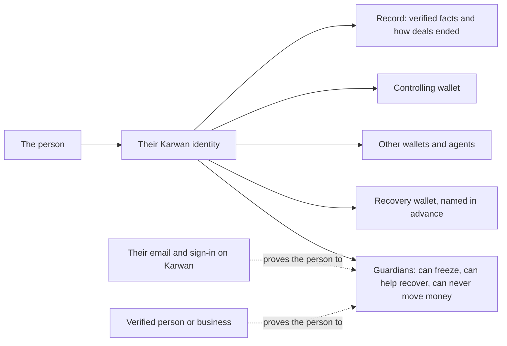

# 91 · Financing on a record that holds

Tracks T4 (trade finance) and T3 (reputation), building on [view 18](18-trade-finance.md) (trade finance), [view 08](08-reputation.md) (reputation), [view 13](13-portable-reputation.md) (portable reputation) and [view 90](90-disputes-settled-reliably.md) (disputes). Raised by the owner on 18 Nov 2026: what protects financiers from bad actors, who qualifies and for how much, and a person's identity, reputation and trade history surviving a compromised wallet. Approved by the owner on 18 Nov 2026 with the decisions below.

The three parts belong together. An advance is only as safe as the record it was given on, and a record is only worth something if it belongs to a real person who cannot lose it or have it stolen.

## What is true today

Read from the contracts and the backend on 18 Nov 2026.

**Financing**

- A seller can be paid early on a business order once the buyer has paid it into escrow in full and the seller has accepted. The financier pays the seller directly; the escrow repays the financier first when the deal pays the seller.
- At least a tenth of the advance is held from the seller's deal guarantee for the financier. Karwan's test financier advances up to 80% of what the deal still owes.
- Any seller with a record qualifies, whatever their history. There is no limit on what one seller can owe in total.
- If the seller never delivers, the buyer is refunded in full and the financier gets only the held tenth. A buyer and a seller working together can take the rest.
- An invoice the buyer has not yet paid, such as Net 30, cannot be financed.

**Reputation**

- The record counts different wallets, not different people. At testnet values a clean mid-level record costs a returnable guarantee, a few small deals among one's own wallets and two weeks.
- No mainnet values are set.

**Identity**

- Every person has one identity on chain. Wallets and agents join it by signature. The record of facts and deal endings belongs to the identity, not to a wallet, so it already follows a person to a new wallet.
- A person can name a recovery wallet that takes control after 7 days unless they cancel.
- That protects against a lost key, not a stolen one. Whoever holds the controlling key can cancel a recovery, clear the recovery wallet and hand control to a wallet of their own, all at once.
- A person who never named a recovery wallet has no way back.
- Deal payouts are sent to the wallet named in the deal. Recovering the identity does not move them.

## The idea in one line

Money is advanced only against something that will pay it back, to a person Karwan can identify, up to a limit that person has earned with different real people; and that person's identity and record can be frozen at once and brought back to a new wallet, by them and nobody else.

## Part 1. Financing

### Three kinds of advance, by what pays it back

| Kind | When | What pays the financier back | Main risk |
|---|---|---|---|
| After delivery | The seller has delivered and the buyer is reviewing | The escrow, unless the buyer disputes | A dispute or refund |
| Before delivery | The order is funded and accepted, nothing delivered yet | The escrow, only if the seller delivers | The seller never delivers, alone or with the buyer |
| On terms | The buyer has approved the delivery and pays on a later date | The buyer's promise to pay | The buyer does not pay |

After delivery and before delivery exist today as one action. On terms is new and needs its own contract.

### Rule 1. An advance before delivery is always covered in full

The gap between the advance and what is held is where a financier loses. Before delivery, that gap must be covered by someone Karwan can identify:

- by the seller's deal guarantee, held for the financier; or
- by the seller's earned limit (rule 2), for the part that is not held; or
- by the buyer, who agrees when the order is financed that if the seller fails to deliver, the financier is repaid from the refund before the buyer is. A buyer who does not agree is not asked again, and the order can still be financed after delivery.

A buyer and seller working together gain nothing: the money they would take is their own guarantee, their own earned standing or the buyer's own refund.

### Rule 2. A limit that is earned

Each seller has a financing limit: the most they may owe across all open advances.

- It grows with deals completed for different verified buyers and with advances repaid on time.
- It shrinks at once on a default and on a lost dispute, and slowly with time.
- A new seller's limit for advances before delivery is zero. They start with advances after delivery, which carry the least risk, and earn their way up.
- It is not the general reputation score. It reads only completed value with distinct verified people and repaid advances, which cost real money and time to fake.

### Rule 3. The held guarantee follows the risk

| Seller | After delivery | Before delivery |
|---|---|---|
| No repaid advance yet | Up to half the deal, a quarter of the advance held | Not offered, unless covered in full under rule 1 |
| Some advances repaid, several different verified buyers | Up to 80%, a tenth held | A part of the deal, half of the advance held |
| A long clean history | Up to 80%, a tenth held | Up to 70%, a fifth held |

The figures are starting points to be set from testnet data before mainnet, then fixed.

### Rule 4. The two sides must be different people

No advance where the buyer and seller share a verified person or business, a device, or the source their wallets were first funded from, or where they have only ever traded with each other. The first advance on a pair that has never traded is looked at by a person.

### Rule 5. Stronger proof before a financier is treated as safe

On a financed goods order, delivery counts when the carrier reports it delivered or the buyer's handover code is used, not when a tracking number is entered ([view 33](33-delivery-proof-for-every-kind-of-deal.md)).

### Rule 6. Financiers are known, and see what they are buying

- On mainnet a financier is a verified person or business before their first offer. On testnet the present bar stays, and the desk says it is practice.
- Each offer screen shows what backs the advance, what is held, and what the financier loses if the deal fails. Nothing is called risk-free.
- A financier's total exposure to one seller is capped.

### Rule 7. Karwan's own financier

Capped in total and per seller, never the only offer on an advance before delivery, and never the only judge of a deal it funded (view 90).

### Advances on terms, later

For a buyer who pays 30 to 90 days after delivery: the buyer approves the delivery on Karwan and the date they will pay; a financier pays the seller now; on the date, the buyer pays into the escrow and the financier is repaid. What backs it is the buyer: a verified business, a limit the buyer has earned by paying on time, and a guarantee the buyer puts up. Proposed for after the first mainnet version, once the other two kinds have a clean history.

## Part 2. A record that counts people

- **One person, one record.** Financing reads only records with a verified person or business behind them. Two wallets of the same person are one trading partner.
- **A deal counts above a floor.** A minimum value, and a partner who is verified or has their own history with others.
- **Mainnet values are set and fixed before launch:** months, not days, and amounts that cost real money to fake.
- **What weighs most:** a defaulted advance, then a lost dispute, then a cancelled deal. A problem settled by agreement weighs nothing (view 90).
- **Verification on testnet is practice:** account age, deals completed, different partners, advances repaid, dispute history. On mainnet it is a verified person or a registered business.

## Part 3. An identity that survives a lost or stolen wallet

### What a person holds

The record already belongs to the identity. What changes is who can save the identity when a key is lost or stolen.

### Freeze first

Anyone who thinks their wallet is compromised can freeze their identity at once, from Karwan with their email sign-in or through a guardian. While frozen:

- control of the identity cannot change, and no wallet or agent can be added;
- no advance can be taken and no deal guarantee can be withdrawn;
- deals already running carry on, and their record is kept.

A freeze moves no money and ends by the person's own confirmed action or after a recovery. Freezing is quick and cheap to undo, so it can be used on suspicion.

### Changes to control wait, and are announced

Handing control to another wallet, and naming or clearing the recovery wallet, take effect after 7 days, not at once. The person is told by email, Telegram and the bell the moment a change is asked for, and can freeze. A thief with the key can no longer cancel a recovery and take the identity in one move.

### Recovery, three ways

| Way | For whom | How |
|---|---|---|
| Recovery wallet | Anyone who named one | As today: it takes control after 7 days |
| Guardians | Anyone | The person proves who they are to their guardians. Karwan is one guardian, acting only on the person's email sign-in plus a second proof. For a verified person or business, the second proof is being verified again as the same one. A person may add a guardian of their own. Enough guardians agreeing starts a recovery to a new wallet, which completes after 7 days |
| During a freeze | A theft in progress | A recovery started by guardians cannot be cancelled by the controlling key while the identity is frozen |

- Guardians can freeze and can help recover control of the identity. They can never move money, change a deal or read private details.
- Every freeze, change and recovery is public on chain as it happens, without the person's email or name.
- Karwan alone can never take an identity: it is one guardian, and a recovery needs the person's own proofs and the 7 days.

### What follows the identity to the new wallet

- The record: every verified fact and every deal ending.
- The financing limit and the history behind it.
- Trade history. Karwan keeps the detail; the chain keeps how each deal ended and in what size band, never the amount, so a statement Karwan gives a person or a lender can be checked against the chain. Verified facts are stored as keyed fingerprints, so nobody can test a guess against them.
- Payouts from deals still running: a person may set a new payout wallet for their identity, which takes effect after the same wait and announcement.

Money already inside a stolen wallet cannot be recovered by any design. That is why a guarantee withdrawal waits, and why a freeze stops new advances at once.

### The email

A person's email is never written on chain. A keyed fingerprint of it is recorded as a fact on their identity, so Karwan can show that the person signing in is the one the identity belongs to, and nobody reading the chain can learn or test an address.

## What it does not solve, said plainly

- A person who loses their wallet, their email and their own guardian together has only the verified-again route, and none if they were never verified.
- Karwan as a guardian is a power. It is limited to the identity, needs the person's own proofs, waits 7 days and is public, but it is a power people must be told about.
- A limit that is earned keeps honest new sellers waiting. That is the price of financiers being safe.
- A real person can still default. The limit and the guarantee make the loss small and the record makes it costly.
- Verifying a person or a business depends on outside providers and on what each country offers.

## What changes

| Piece | Change | Needs a new contract |
|---|---|---|
| Karwan's financier before delivery | Only to sellers with a limit, or covered in full | No |
| Financing limit per seller | Kept by Karwan, checked before every offer and every acceptance | No |
| Held guarantee by risk | The hold asked for follows the table | No, the contract takes any hold of a tenth or more |
| Different people check | Before every offer | No |
| Financier's screen | What backs it, what is held, what can be lost | No |
| Mainnet reputation values, the smallest deal that counts | Set and fixed | No |
| Buyer covers an advance before delivery | The refund repays the financier first, with the buyer's consent | Yes |
| The limit enforced on chain | So no financier can exceed it by going around Karwan | Yes |
| Advances on terms | New | Yes |
| Changes to control wait 7 days; freeze; guardians | New rules on the identity registry | Yes |
| Payouts follow the identity | A payout wallet per identity | Yes |

Each row that touches Arc or Circle gets its entry in the checks log before any code.

## Decisions

The owner decided all five on 18 Nov 2026.

1. **A buyer may cover an advance before delivery, by consent.** If the seller fails to deliver, the financier is repaid from the refund before the buyer is. No buyer is bound without agreeing.
2. **A seller with no history** is offered an advance before delivery only when it is covered in full.
3. **Advances on terms** come after the first mainnet version.
4. **Karwan is a guardian of identities,** limited as written: the identity only, on the person's own proofs, after the wait, in public.
5. **Verification on mainnet:** a registered-business check per country, starting with Nigeria, and a verified-person check for individuals. The providers are chosen in their own check.

## Build order

1. Without a new contract: the financing limit per seller, the hold that follows the risk, the different-people check, Karwan's financier limited to covered advances, and the financier's screen.
2. Mainnet reputation values and the smallest deal that counts, set from testnet data.
3. The next contract version, with view 90's contract items: the buyer's consent, the limit on chain, the identity freeze, the wait on control changes, guardians, and payouts that follow the identity.
4. Advances on terms, in their own view.

## What this design draws on

- Recovery by guardians who can help a person back in but hold no spending power, with a waiting period the owner can use to stop a false recovery ([social recovery pattern](https://iptf.ethereum.org/patterns/pattern-social-recovery/)).
- A guardian who can lock an account at once, starting a security period ([Argent](https://argent.xyz/blog/a-new-era-for-crypto-security)).
- Recovery that proves control of an email without putting the address on chain ([ZK Email account recovery](https://docs.zk.email/account-recovery/)).
- In invoice finance, money moves only when independent evidence agrees, and nobody controls every step alone ([accounts payable controls](https://precoro.com/blog/accounts-payable-internal-controls-guide/)).

## Status

| Step | Status |
|---|---|
| This view | Approved by the owner, 18 Nov 2026, with the five decisions above |
