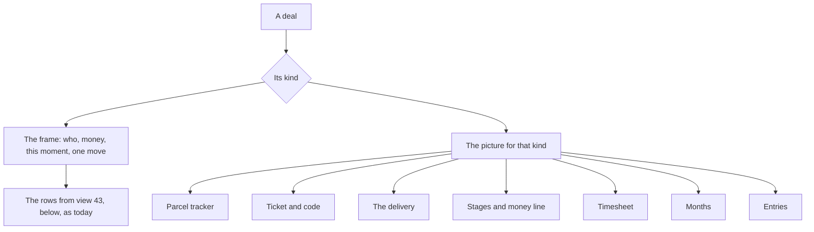
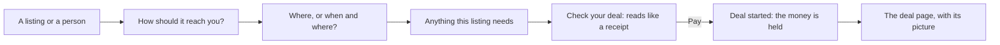

# 92 · Every deal looks like what it is

Track T2 (protected deals), with T1.2 (choose the kind of deal) for how a deal starts. It keeps the calm deal page from [view 43](43-calm-deal-page.md) and the kinds of deal from [view 44](44-one-product-flow.md) and [view 85](85-every-deal-says-how-it-arrives.md). Proposed by the owner on 18 Nov 2026 from a drawn sample: "each deal gets its own look and fits how people can track it, not a generic deal page which may not fit delivery for the different types of work". Built in place, one kind at a time.

## What is hard today

- Every deal shows the same row of steps. A suit sent from Lagos to Paris, a phone handed over at a shop, a video delivered as a file and a month of part-time work all read as "Agreed, Paid in, Delivered, Paid out". People have to translate that into what is actually happening.
- Starting a deal is one long form. A person new to apps meets every field at once, and the kind of deal is a choice they have to understand before they can make it.
- The page answers "what state is the deal in", not the questions people actually ask: where is my parcel, when do we meet, is the work any good, how many hours am I paying for, when is the next month paid.

## What people need, before anything is drawn

Two people are on every deal. Both ask the same four things, whatever they are trading:

1. **Where is my money?** Held, paid out, or coming back to me.
2. **What happens next, and when?** One date or one event, never a list.
3. **Is there anything I must do?** One move, or a plain line saying nothing is needed.
4. **What if it goes wrong?** Who to talk to, and what Karwan does.

Then each kind of deal has its own questions:

| Kind | The buyer asks | The seller asks |
|---|---|---|
| Goods sent | Where is it? When does it arrive? What do I do when it comes? | Where do I send it, by when? How do I show it shipped? When am I paid? |
| Meeting in person | When and where do we meet? What do I check before I hand over the code? | Is the money there before I travel? When am I paid? |
| One job | When is it due? Is the work what I asked for? Can I ask for a change? | What exactly must I deliver, by when? How long until I am paid if they say nothing? |
| In stages | Which stage is it on? What have I paid, what is held, what is left? | Which stage is due next? Is the money for it already held? |
| By the hour | How many hours this week? Is there a cap? What happens if I don't approve? | Have my hours been approved? When is the money out? |
| Monthly | When is the next month paid? Can I pause or end it? | Is next month already held? |
| Contest | How many entries? By when must I choose? | Is the prize held? Was my entry seen? Did I win? |

## The idea

One frame on every deal, and a different picture inside it.

The frame is the title block from view 43: who the deal is with, the deal reference, where the money is, the amount, one line for this moment, and the one move. It answers the four shared questions. Under it, each kind of deal shows the picture people already know from the rest of their lives, chosen to answer that kind's own questions.

| Kind | The picture | It answers |
|---|---|---|
| Goods sent | A parcel tracker: Paid, Shipped, On the way, Arrived, with the carrier, tracking number and expected day | Where it is and when it comes |
| Meeting in person | A ticket: day, time and place, and the handover code shown large | When, where, and what to hand over |
| One job | The delivery itself: the file, link or video, with what Karwan checked it against | Whether the work is right |
| In stages | A checklist of stages, each with its amount and date, over one line showing paid, held and later | Where the job is and where the money is |
| By the hour | The week as a timesheet, hours per day, the cap, and Approve | What the hours cost |
| Monthly | The months in a row, paid, and this month with its pay day | When the next pay is |
| Contest | The entries as a gallery, and the day to choose by | Which one wins |

The seller sees the same picture from their side: the tracker asks them to add the tracking number, the ticket tells them to ask for the code, the delivery shows what they sent and when payment comes if the buyer says nothing.

## Starting a deal: one question a screen

Starting a deal becomes a short run of screens, each asking one thing in big type, with the answer already chosen when Karwan knows it.

- **The kind is chosen by plain questions, not named.** "How should it reach you?" with Send it to me or We meet picks goods sent or meeting in person. "How do you want to pay?" with Once when it's done, In parts, By the hour or Each month picks the work kinds. Nobody has to learn the word escrow or the names of the kinds.
- **What is known is already filled in.** The listing's price, the seller, the way it ships, the buyer's last address. A regular taps Continue; a first-timer reads one question at a time.
- **Check your deal reads like a receipt.** The item, each amount, the Karwan fee, a line, the total, the day it should arrive and what happens if it never does.
- **The end is certain.** One screen with the lock, the amount and "Held by Karwan", then the deal page.

## One mark for where the money is

A small seal with a lock reads Held whenever Karwan holds money on the deal, in every picture and in the list of deals. Your turn replaces it when the person must act. The same words are used by the assistant on the website and in Telegram.

## Same answers in every channel

Every picture is drawn from facts the assistant already reads (get_deal_status and the deal tools), so a person who asks in Telegram "where is my suit" gets the same carrier, tracking number and day the tracker shows. No picture shows something the assistant cannot say, and no move exists on the page that the assistant cannot make.

## Decisions

1. **The frame never changes.** Who, money, this moment, one move. A person learns it once.
2. **The picture is the kind's own.** Never a generic step row where the kind has a better picture.
3. **One question a screen when starting**, with known answers filled in.
4. **One lock mark for held money**, everywhere.
5. **Built in place, one kind at a time.** Goods sent and one job first, then meeting in person and stages, then starting a deal one question a screen, then by the hour, monthly and contests, then the finished screen for all. Each step ships on its own.
6. **Works for anyone, anywhere.** Plain words, amounts in the currency chosen in Settings, real photos from many places, nothing that assumes a country.
7. **Later, not now.** Saved addresses and questions a listing asks of the buyer (such as measurements for a suit) are new data; they come after the pictures.

## Status

Approved by the owner on 18 Nov 2026. Phase 1 built on 19 Nov, not deployed: goods sent show the parcel tracker, one job shows the delivery, and the Held or Your turn seal sits beside the money line. Meeting in person, stages, starting a deal one question a screen, hourly, monthly, contests and the finished screen follow in that order. Sample: the drawn deal flow from 18 Nov.
