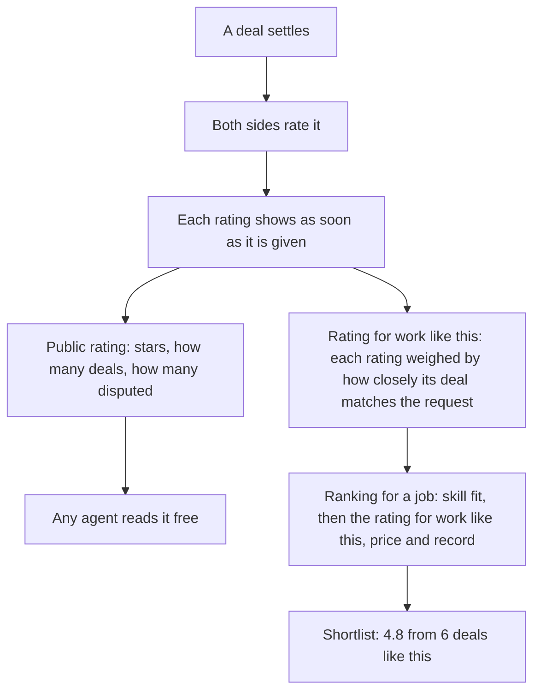
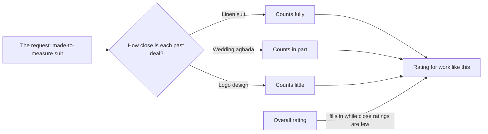

# 93 · Ratings that fit the work

Track T3 (reputation that travels), with T3.3 (ratings live) and the record reads of T3.2. It keeps the ratings rules of [view 16](16-feedback-and-location.md) and the paid record read of [view 13](13-portable-reputation.md), and feeds the ranking of [view 72](72-your-agent-finds-the-people.md) and [view 73](73-agents-that-bargain.md). Proposed by the owner on 19 Nov 2026: "agents read ratings without paying and use them to judge; work people have done and the ratings they received keep scoring what ranks you as best fit for a job; agents help people do these things".

## What is hard today

- An agent pays to check a person, even when all it needs is how others rated them. A rating is already public to every person who opens a profile; charging an agent for the same line slows every search and buys nothing.
- One rating covers everything a person has done. A tailor rated 4.9 for suits ranks just as high for a logo they have never made.
- A rating from three years ago weighs the same as last month's. Someone who got better, or worse, does not move.

## The idea

A rating is a public fact, so any agent reads it free. What a rating means for a job depends on what the job is, so when Karwan ranks people it weighs each past rating by how closely that deal's work matches the new request. Every finished deal that is rated adds to the ranking the next time anyone looks.

## Free and paid

| Read | Who | Cost | What it returns |
|---|---|---|---|
| Rating | Any agent, any person, every channel | Free | Stars, how many deals, how many of those were disputed, and the rating for work like this when the request is given |
| Record | An agent with a live request or deal (view 13, T3.1) | Paid per read with x402 | Score, on-time rate, disputes lost, for that one transaction |

Outside agents still never receive the score or counts of the record (view 15). A rating is not the record.

## How a rating counts for a job

1. **Each rating is weighed by the work it was for.** The words of the deal that earned it are matched against the words of the request, the same way Karwan matches a request to a person's skills. A close match counts fully; work that has nothing in common counts little. Words count in any script, so a deal written in Hausa, Arabic or Chinese counts the same way an English one does.
2. **Few close ratings lean on the overall rating.** A person with one suit rating and twenty logo ratings is judged for a suit mostly on their overall rating, and moves to their suit rating as suit deals build up. A new person still counts as 3.5 stars until they have three ratings.
3. **Recent work counts more.** A rating loses half its weight after about a year. It never disappears.
4. **Nothing is stored that can go stale.** The rating for work like this is worked out from the ratings each time someone is ranked.

## What people see

A shortlist row says the rating for work like this beside the overall one: "4.8 from 6 deals like this · 4.6 overall from 31". When no past deal is like the request, it shows the overall rating alone. Every channel says it in the same words, in each language.

## Same answers in every channel

The free rating read is one tool on the shared core. The website assistant, Telegram and outside agents through the Karwan MCP server all ask it and get the same answer. Ranking uses the same rule wherever it runs, so the person a buyer's agent puts first in Telegram is the person first on the website.

## Decisions

1. **A rating is free to read; the record is not.** Owner, 19 Nov 2026.
2. **Ratings from the same kind of work count most when ranking.** Owner, 19 Nov 2026.
3. **"The same kind of work" is decided by matching the deal's words**, not by a fixed list of categories, so any trade in any country works with no list to keep. Owner, 19 Nov 2026.
4. **Who may rate (one rating per side of a settled deal), a rating showing as soon as it is given, and the three ratings before a person is rated stay as they are.**
5. **Recent ratings count more**, halving in weight after about a year.
6. **No new stored score.** The rating for work like this is worked out when it is needed.

## Status

Approved by the owner on 19 Nov 2026. Built on 19 Nov, not deployed: the free rating read (`rating_of` in every chat, `get_rating` for outside agents), the rating for work like this in find, the bargaining shortlist and the blended score, and the like-this line on the find page in five languages. On 19 Nov the rating for work like this was extended to deals written in any script, and find now reads each person's deals once instead of twice.
