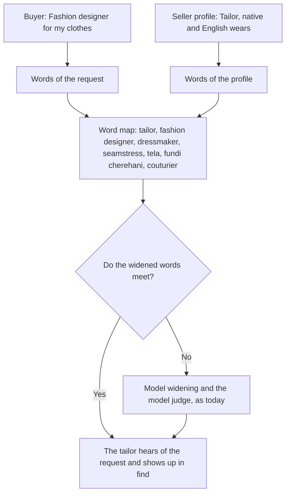
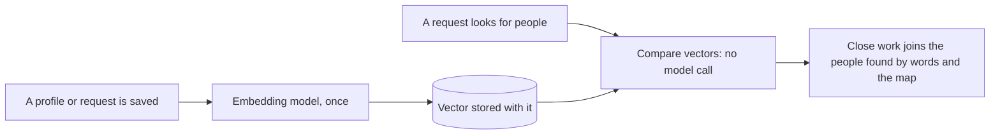

# 95 · Found by what you mean

Track T1 (find and agree), item T1.12. It widens the word matching that [view 41](41-agents-that-always-answer.md) uses to tell sellers about a request, that [view 72](72-your-agent-finds-the-people.md) uses to find people, and that [view 93](93-ratings-that-fit-the-work.md) uses to weigh ratings for work like this. Raised by the owner on 20 Nov 2026: "fashion designer can also be likened as tailor".

## What is hard today

- A buyer asks for a fashion designer. Nearly every person who makes clothes in Nigeria calls themselves a tailor. The two share no word, so the two only meet if a model sees that they mean the same thing.
- When a request is posted, a model widens its words and the words of every profile, and a second model judges up to 20 sellers who share no word with it. If those models fail or run slowly, matching falls back to the exact words, and the tailor never hears of the request.
- Finding people from the assistant, standing orders, outside agents through MCP, and "people who need this" use the exact words only, with no model at all. "Find me a fashion designer" can miss every tailor on Karwan today.

## The idea

Karwan keeps its own word map: groups of words and phrases that people use for the same work or the same thing. Every time Karwan matches words, it first widens both sides with the groups they touch. This needs no model and costs nothing, so it works on every path, even when every model is down. The models still run on top and catch what the map does not know yet.

A second phase adds meaning vectors, so work the map has never seen still lands near the right people.

## How the map works

1. **A group is a set of names for the same work or thing.** "Tailor", "fashion designer", "dressmaker", "seamstress", "clothier", in English, in each of our five languages (English, French, Arabic, Hindi, Swahili) and in the words people use in Nigeria, such as Hausa "tela" and Pidgin "tailor man".
2. **A phrase counts only when all its words are there.** "Fashion designer" opens the clothing group; "designer" on its own does not, because a graphic designer is not a tailor.
3. **Widening adds words, it never removes them.** Every word of the request and the profile still counts as it does today. The map can only bring more people in, never push someone out.
4. **Close names only.** A group holds names for the same work. Work that is related but different (a tailor and a fabric seller) goes in separate groups, so a buyer is not sent people who cannot do the job.
5. **One map, used everywhere words are matched:** telling sellers about a request, finding people, standing orders, outside agents through MCP, "people who need this", skill checks in matching, and the rating for work like this.
6. **The map grows from what the models find.** When the model judge says a seller fits a request they share no word with, that pair is kept as a suggestion. The team reviews suggestions and adds the good ones to the map. Nothing is added without a person agreeing.

## Phase 2: meaning vectors

Each profile and request is turned once into a meaning vector when it is saved, by an embedding model in Karwan's own AWS account. Matching then compares vectors with plain arithmetic, in any language, with no model call at match time. It finds close work the map has never seen. It needs pgvector added to the Karwan database, so it is planned separately once the map is live.

## What people see

Nothing new to learn. A buyer who asks for a fashion designer sees tailors who fit, and the tailor's agent hears of the request. In the shortlist, the reason line keeps saying why the person fits, in the person's own words ("Tailor, native and English wears").

## Same answers in every channel

The map lives on the shared core. The website, Telegram, the assistant and outside agents through MCP all match through it, so a tailor found for a fashion designer on the website is found the same way in Telegram.

## Decisions

1. **Both: a word map first, then meaning vectors.** Owner, 20 Nov 2026.
2. **The map only widens.** It never removes a match that exact words would make.
3. **Phrases count whole**, so a shared single word like "designer" does not join unrelated trades.
4. **People decide what goes into the map.** Model findings are suggestions until the team agrees. This keeps view 93's rule: there is still no list of categories. The map links words that mean the same, it does not sort people into fixed boxes.
5. **The models stay.** Model widening and the model judge keep running; the map is the floor under them.

## Status

Proposed 20 Nov 2026. Phase 1, the word map, is next after the owner agrees this view; phase 2, meaning vectors, follows once the map is live.
