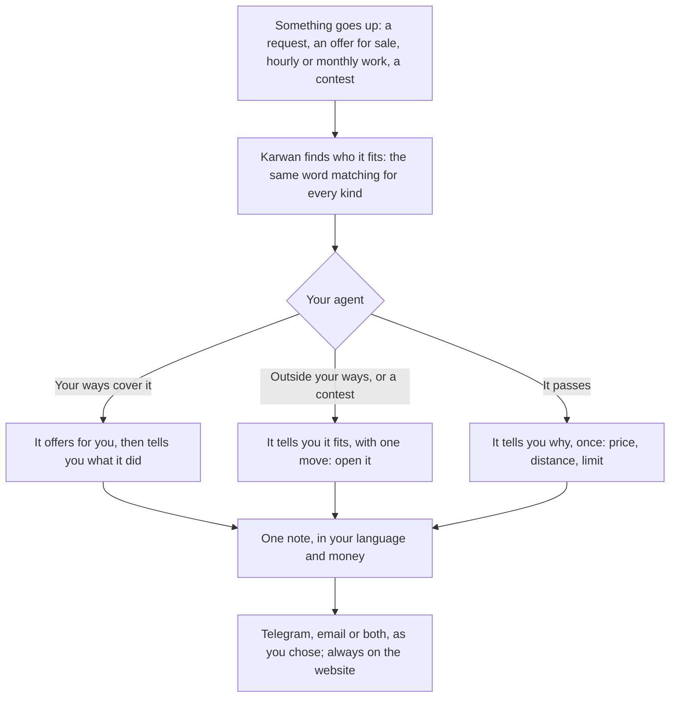

# 96 · Every open trade reaches the people it fits

Track T1 (find and agree), with T6 (channels). It serves roadmap item 9 ([view 72](72-your-agent-finds-the-people.md), your agent finds the people) and keeps the market of [view 17](17-one-market.md) and [view 44](44-one-product-flow.md), the contests of [view 40](40-contests-and-agent-jobs.md), the hourly and monthly work of the Time family, the agent notes of [view 52](52-an-agent-that-works-for-you.md) and the matching words of [view 95](95-found-by-what-you-mean.md). Proposed by the owner on 20 Nov 2026: "a small filter button in market to filter by date and time listed; nothing tracks contest and hourly opened listings; nothing alerts users of open contests; check all contract types and deal types; agents should always alert their user once anything fits them".

## What is hard today

- The market can be searched and narrowed by category, but not by when something was listed. Someone who checks every evening cannot ask for "what went up today".
- Your trades counts your deals, your requests and your offers. A contest you posted or entered, and hourly or monthly work you posted or offered on, are not in it, so there is no one place to come back to.
- A new contest tells nobody. The sellers whose work it fits are never told, and the contest's own news (an entry in, winners paid, the prize returned) reaches no one in Telegram or by email.
- Each kind of trade alerts in its own way, or not at all. Hourly and monthly work tells the people it fits, but always in English. A request your agent passes on is never mentioned to you, so a fit you might have wanted goes by in silence. Every new offer for sale is sent to every account as news, which buries the alerts that matter.

## The idea

Every open trade, whatever its kind, goes through one path when it goes up: Karwan finds the people it fits, and each of them hears from their own agent, in their language and money, on the channels they chose. Your agent acts where your ways let it and tells you either way. Nothing that fits you is dropped because of its kind.

## The four parts

### 1. When it was listed

A small "Listed" button beside the categories opens a short choice: any time, last hour, today, this week, this month. Under it, the order: newest first, oldest first, or closing soonest for requests and contests. The choice lives in the address like the side and category, so a link keeps it. It works on both sides of the market: offers on Buy, and requests, contests and work on Sell. Your agent takes the same filter in every chat ("show me requests for tailoring posted today").

### 2. Your trades holds every kind

| Tile | What it counts | Flag |
|---|---|---|
| Deals | Deals under way | Your move |
| Requests | Your open requests | Offers in |
| Offers | Your live offers for sale | |
| Contests | Contests you posted that are open, and contests you entered that are not decided | Entries in, or a result |
| Work | Hourly and monthly work you posted or offered on, and work under way | Offers in, or hours to approve |

Each tile opens its own list, as requests and offers do now. Your agent reads the same list in chat, so "what do I have open?" answers with all five.

### 3. Contests reach the people they fit

When a contest opens, Karwan matches its title, brief and tags against what people sell, the same way it matches hourly work, and the sellers it fits are told: the prize, how many winners, and when entries close. An agent never enters a contest for anyone, because an entry is work the person makes. People told once get one reminder a day before entries close, only if they have not entered. Every contest event reaches the people it concerns on their channels:

| Event | Who hears |
|---|---|
| Opened | The sellers it fits |
| An entry came in | The person who posted it |
| An entry marked not valid | The person who entered it |
| Winners paid | Each winner and the person who posted it |
| Cancelled, or the prize returned | The person who posted it and everyone who entered |

### 4. One alert rule for every kind

| Kind | When it goes up, the people it fits hear |
|---|---|
| Request at a fixed price | Your agent offered, or it fits and needs you, or your agent passed and why |
| Offer for sale | It fits a request you posted in the last 30 days |
| Hourly or monthly work | Your agent offered your rate, or it fits and you can offer yours |
| Contest | It fits what you sell, with the prize and closing date |
| Direct deal, pay link, agent job | Already reach both sides; unchanged |

Rules that hold for every kind:

1. **Every alert is in the person's language and money**, as other notes are. Work alerts stop being English only.
2. **A pass is said once.** When your agent passes on something that fits you, it says why in one line (over your price, too far, your weekly limit). Many passes in a day roll into your brief instead of one message each.
3. **News is not an alert.** An offer for sale reaches you as an alert only when it fits something you asked for. Offers that fit nothing you asked for wait in the market and in the brief, so the alerts that do arrive are worth opening.
4. **No more than one alert per thing per person**, and a daily cap. Past the cap, the rest go into the brief, never dropped.
5. **Your settings still decide the channel, never whether it fits.** Telegram, email or both is your choice. A mute pauses messages, and while it is on, what fit you waits in the brief and on the website for when you look.

## Same answers in every channel

Finding who an open trade fits, writing the note, and the market filter are one piece of the shared core. The website, Telegram, email and outside agents through the Karwan MCP server read the same alerts and the same lists, so what your agent tells you in Telegram is what the website shows.

## Decisions

1. **One path for every kind of open trade**: find who it fits, then the agent tells them. Owner, 20 Nov 2026.
2. **Contests are told, never entered, by an agent.** Owner, 20 Nov 2026.
3. **One reminder before a contest closes**, only to people told who have not entered. Owner, 20 Nov 2026.
4. **News of an offer that fits nothing you asked for stops being an alert** and moves to the brief and the market. Owner, 20 Nov 2026.
5. **A pass on something that fits you is said, once**, and rolled into the brief past a few a day. Owner, 20 Nov 2026.
6. **The market filter is by time listed, with three orders**, and lives in the address. Owner, 20 Nov 2026.

## Status

Approved by the owner on 20 Nov 2026. Phase 1 (parts 1 and 2: the Listed filter on both sides and in chat, contests and work in Your trades and in chat) built on 20 Nov 2026, not deployed. Phase 2 (parts 3 and 4: one fit path, passes told, offers for sale only on a fit, contests reaching the sellers they fit with one reminder, contest news on Telegram and by email) built on 20 Nov 2026 behind FIT_ALERTS, off, not deployed.
